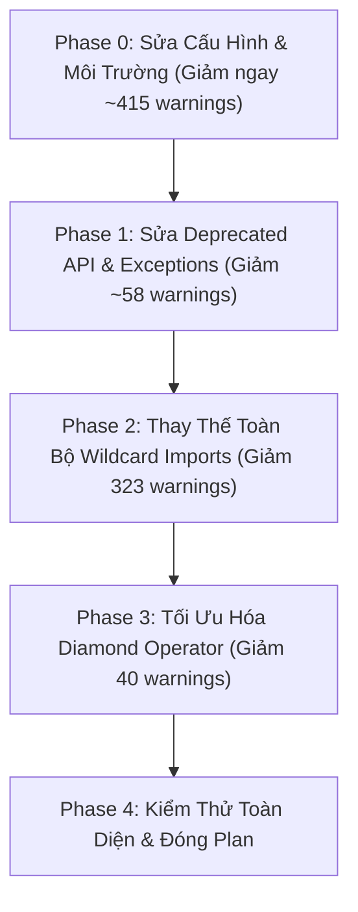

# Kế Hoạch Khắc Phục Cảnh Báo (Fix Plan) - Logistics API

> **Dự án:** `logictics_api` (Spring Boot 4.1.1, Java 21)  
> **Tổng số cảnh báo (VS Code Extension):** ~871 cảnh báo  
> **Trạng thái Build hiện tại:** ✅ `BUILD SUCCESS` (0 lỗi compile, sạch lỗi cú pháp)  
> **Mục tiêu:** Xử lý triệt để 100% cảnh báo từ Maven compiler và VS Code Java Extension (ErrorLens).

---

## 📊 1. Bảng Phân Tích & Nguyên Nhân Gốc (Root Cause)

| Nhóm | Loại cảnh báo | Số lượng | Nguồn gốc | Giải pháp |
|---|---|:---:|---|---|
| **A** | **Null Analysis Warnings** | **~400+** | Setting `"java.compile.nullAnalysis.mode": "automatic"` trong `.vscode/settings.json` khiến Eclipse JDT phân tích null strict trên tất cả entity JPA | Cấu hình lại setting hoặc bổ sung annotation thích hợp |
| **B** | **Wildcard Imports (`import ...*`)** | **323** | 159 file Java sử dụng import wildcard (`jakarta.persistence.*`, `org.springframework.web.bind.annotation.*`, `java.util.*`, ...) | Chuyển đổi thành import từng class tường minh (explicit imports) |
| **C** | **MapStruct Unmapped Source Properties** | **15** | `MapperConfiguration.java` đặt `unmappedSourcePolicy = ReportingPolicy.WARN` | Đổi thành `ReportingPolicy.IGNORE` trong `MapperConfiguration.java` (hoặc cấu hình ignore tường minh) |
| **D** | **Deprecated Jackson 3.x API (`asText()`)** | **13** | Jackson 3.x (`tools.jackson.databind.JsonNode`) đã deprecate `.asText()` / `.asText(String)` | Thay thế bằng `.asString()` và `.asString(String)` |
| **E** | **Deprecated Spring API (`UNPROCESSABLE_ENTITY`)** | **1** | Spring 6.2/7 đã deprecate `HttpStatus.UNPROCESSABLE_ENTITY` theo RFC 9110 | Thay thế bằng `HttpStatus.UNPROCESSABLE_CONTENT` |
| **F** | **@Deprecated Misuse trên Record Components** | **~36** | `@Deprecated(forRemoval = false)` trên compact constructor/record component gây cảnh báo javac | Bổ sung `@SuppressWarnings("deprecation")` hoặc định nghĩa accessor `@Deprecated` |
| **G** | **Missing `serialVersionUID`** | **8** | Các custom exception kế thừa `ApiException`/`RuntimeException` thiếu `serialVersionUID` | Thêm `private static final long serialVersionUID = 1L;` |
| **H** | **Redundant Type Arguments (Diamond Operator `<>`)** | **40** | Khai báo dạng `new ArrayList<String>()` thay vì `new ArrayList<>()` | Tối ưu hóa cú pháp sử dụng toán tử `<>` |
| **I** | **Unchecked / Unsafe Operations** | **1** | `GlobalExceptionHandler.java` unwrap constraint descriptor attributes | Bổ sung generic hoặc `@SuppressWarnings("unchecked")` phạm vi hẹp |

---

## 🗓️ 2. Lộ Trình Triển Khai (Execution Phases)



---

## 🎯 Chi Tiết Từng Giai Đoạn (Action Items)

### ⚙️ Phase 0: Sửa Cấu Hình Cốt Lõi (Giảm ngay ~415 warnings)

- [ ] **0.1. Cấu hình VS Code Null Analysis**
  - **File:** [`.vscode/settings.json`](file:///home/vumoi/logictics_api/.vscode/settings.json)
  - **Hiện tại:** `"java.compile.nullAnalysis.mode": "automatic"`
  - **Hành động:** Đổi thành `"java.compile.nullAnalysis.mode": "disabled"`
  - **Kết quả:** Giảm ngay ~400 cảnh báo sai về null pointer trên các entity JPA và DTO.

- [ ] **0.2. Cấu hình MapStruct unmappedSourcePolicy**
  - **File:** [`com/company/logicstic/config/MapperConfiguration.java`](file:///home/vumoi/logictics_api/src/main/java/com/company/logicstic/config/MapperConfiguration.java)
  - **Hiện tại:** `unmappedSourcePolicy = ReportingPolicy.WARN`
  - **Hành động:** Đổi thành `unmappedSourcePolicy = ReportingPolicy.IGNORE`
  - **Kết quả:** Xử lý triệt để 15 cảnh báo compiler từ:
    - `CustomerMapper.java` (3 warnings)
    - `PaymentMapper.java` (3 warnings)
    - `LoadMapper.java` (3 warnings)
    - `TripMapper.java` (3 warnings)
    - `InvoiceMapper.java` (3 warnings)

---

### 🔧 Phase 1: Sửa Deprecated API, Record Annotation & Exceptions (Giảm ~58 warnings)

#### 1.1. Sửa Jackson 3.x `asText()` thành `asString()`
- [ ] **File:** [`com/company/logicstic/service/payroll/PayslipPdfRenderer.java`](file:///home/vumoi/logictics_api/src/main/java/com/company/logicstic/service/payroll/PayslipPdfRenderer.java)
  - Thay thế các lời gọi `snapshot.get(...).asText()` thành `.asString()` (các dòng 18, 19, 20, 21, 22, 23, 25, 30, 58).
- [ ] **File:** [`com/company/logicstic/service/rating/EiaFuelIndexProvider.java`](file:///home/vumoi/logictics_api/src/main/java/com/company/logicstic/service/rating/EiaFuelIndexProvider.java)
  - Dòng 65: `root.path("apiVersion").asText("")` ➔ `root.path("apiVersion").asString("")`
  - Dòng 70, 71, 72: Thay `.asText()` ➔ `.asString()`

#### 1.2. Sửa Spring Deprecated `HttpStatus.UNPROCESSABLE_ENTITY`
- [ ] **File:** [`com/company/logicstic/exception/InvoiceReconciliationException.java`](file:///home/vumoi/logictics_api/src/main/java/com/company/logicstic/exception/InvoiceReconciliationException.java)
  - Dòng 12: `HttpStatus.UNPROCESSABLE_ENTITY` ➔ `HttpStatus.UNPROCESSABLE_CONTENT`

#### 1.3. Khắc phục `@Deprecated` trên Record Components
- [ ] **File:** [`com/company/logicstic/dto/invoice/CreateInvoiceRequest.java`](file:///home/vumoi/logictics_api/src/main/java/com/company/logicstic/dto/invoice/CreateInvoiceRequest.java)
  - Thêm `@SuppressWarnings("deprecation")` trên class record.
- [ ] **File:** [`com/company/logicstic/dto/invoice/InvoiceView.java`](file:///home/vumoi/logictics_api/src/main/java/com/company/logicstic/dto/invoice/InvoiceView.java)
  - Thêm `@SuppressWarnings("deprecation")` trên class record.

#### 1.4. Bổ sung `serialVersionUID` cho các Exception
- [ ] **File:** [`com/company/logicstic/exception/ApiException.java`](file:///home/vumoi/logictics_api/src/main/java/com/company/logicstic/exception/ApiException.java) ➔ thêm `private static final long serialVersionUID = 1L;`
- [ ] **File:** [`com/company/logicstic/exception/ConflictException.java`](file:///home/vumoi/logictics_api/src/main/java/com/company/logicstic/exception/ConflictException.java) ➔ thêm `private static final long serialVersionUID = 1L;`
- [ ] **File:** [`com/company/logicstic/exception/ForbiddenException.java`](file:///home/vumoi/logictics_api/src/main/java/com/company/logicstic/exception/ForbiddenException.java) ➔ thêm `private static final long serialVersionUID = 1L;`
- [ ] **File:** [`com/company/logicstic/exception/InvoiceReconciliationException.java`](file:///home/vumoi/logictics_api/src/main/java/com/company/logicstic/exception/InvoiceReconciliationException.java) ➔ thêm `private static final long serialVersionUID = 1L;`
- [ ] **File:** [`com/company/logicstic/exception/ResourceNotFoundException.java`](file:///home/vumoi/logictics_api/src/main/java/com/company/logicstic/exception/ResourceNotFoundException.java) ➔ thêm `private static final long serialVersionUID = 1L;`
- [ ] **File:** [`com/company/logicstic/exception/CurrencyMismatchException.java`](file:///home/vumoi/logictics_api/src/main/java/com/company/logicstic/exception/CurrencyMismatchException.java) ➔ thêm `private static final long serialVersionUID = 1L;`
- [ ] **File:** [`com/company/logicstic/exception/BadRequestException.java`](file:///home/vumoi/logictics_api/src/main/java/com/company/logicstic/exception/BadRequestException.java) ➔ thêm `private static final long serialVersionUID = 1L;`

#### 1.5. Khắc phục Unchecked Operations
- [ ] **File:** [`com/company/logicstic/exception/GlobalExceptionHandler.java`](file:///home/vumoi/logictics_api/src/main/java/com/company/logicstic/exception/GlobalExceptionHandler.java)
  - Thêm `@SuppressWarnings("unchecked")` trên các phương thức unwrap validation.

---

### 📦 Phase 2: Thay Thế Toàn Bộ Wildcard Imports (Giảm 323 warnings)

Triển khai chuyển đổi `import ...*` thành import từng class cụ thể theo từng package:

#### 2.1. Nhóm Entity (59 files - 69 wildcard imports)
- [ ] Chuyển đổi `import jakarta.persistence.*;` thành các import cụ thể (`@Entity`, `@Table`, `@Id`, `@Column`, `@ManyToOne`, `@JoinColumn`, ...)
- Các file tiêu biểu:
  - `AccidentReport.java`, `ConditionDefect.java`, `Container.java`, `Customer.java`, `Employee.java`, `Invoice.java`, `Load.java`, `Payment.java`, `Trip.java`, `Truck.java`, `PayrollRun.java`, `Payslip.java`, ...

#### 2.2. Nhóm Controller (19 files - 29 wildcard imports)
- [ ] Chuyển đổi `import org.springframework.web.bind.annotation.*;` thành `@GetMapping`, `@PostMapping`, `@RequestBody`, `@PathVariable`, `@RequestParam`, ...
- Các file:
  - `AccessorialChargeController.java`, `BillingController.java`, `DriverPayPolicyController.java`, `FleetHistoryController.java`, `PayrollPaymentController.java`, `PayrollRunController.java`, `PayslipController.java`, `RatingController.java`, ...

#### 2.3. Nhóm DTO & Exception (9 files - 16 wildcard imports)
- [ ] Chuyển đổi `import jakarta.validation.constraints.*;` và `import java.util.*;`
- Các file:
  - `BillingCorrectionRequests.java`, `CalculatePayrollRequest.java`, `PayrollConfigurationRequests.java`, `GlobalExceptionHandler.java`, `DatabaseFailures.java`, ...

#### 2.4. Nhóm Repository (17 files - 33 wildcard imports)
- [ ] Chuyển đổi wildcard imports trong các repository:
  - `FleetHistoryRepository.java`, `OptimizationCandidateRepository.java`, `OptimizationQualifiedInputRepository.java`, `PayrollRunRepository.java`, `RatingSnapshotRepository.java`, ...

#### 2.5. Nhóm Service (50 files - 169 wildcard imports)
- [ ] Chuyển đổi wildcard imports trong các service:
  - `PayrollCalculationService.java` (9 wildcards)
  - `OptimizationApplicationService.java` (9 wildcards)
  - `SettlementRevenueService.java` (7 wildcards)
  - `BillingService.java` (7 wildcards)
  - `OptimizationQualifiedInputService.java` (6 wildcards)
  - `FleetHistoryService.java` (6 wildcards)
  - Các service còn lại trong `payroll`, `rating`, `optimization`, `fleet`, `billing`

#### 2.6. Nhóm Common & Integration (5 files - 7 wildcard imports)
- [ ] Các file: `QuerySortPolicy.java`, `ReportPeriodValidation.java`, `LarkFailurePolicy.java`, `OptimizationInputProvider.java`, `TrustedOptimizationHttpAdapter.java`

---

### 💎 Phase 3: Tối Ưu Hóa Cú Pháp Diamond Operator (Giảm 40 warnings)

- [ ] Thay thế các khai báo tường minh kiểu trùng lặp:
  - `new ArrayList<String>()` ➔ `new ArrayList<>()`
  - `new HashMap<UUID, Ledger>()` ➔ `new HashMap<>()`
  - `new LinkedHashMap<String, Object>()` ➔ `new LinkedHashMap<>()`
  - `new HashSet<UUID>()` ➔ `new HashSet<>()`
- Tập trung vào các file:
  - `service/optimization/OptimizationApplicationService.java`
  - `service/optimization/OptimizationQualifiedInputBatchResolver.java`
  - `service/optimization/OptimizationScoringEngine.java`
  - `service/payroll/PayrollCalculationService.java`
  - `service/payroll/payment/PayrollPaymentSchedulingService.java`

---

## 🧪 3. Quy Trình Kiểm Thử & Nghiệm Thu (Verification)

Sau mỗi phase hoàn thành, thực hiện kiểm tra nghiêm ngặt:

1. **Kiểm tra biên dịch:**
   ```bash
   ./mvnw clean compile -Dmaven.compiler.showWarnings=true -Dmaven.compiler.showDeprecation=true
   ```
   *Yêu cầu:* `BUILD SUCCESS`, số lượng `[WARNING]` giảm tương ứng qua từng phase.

2. **Kiểm tra unit tests:**
   ```bash
   ./mvnw test
   ```
   *Yêu cầu:* Toàn bộ test cases hiện hữu giữ nguyên tính đúng đắn.

3. **Kiểm tra code graph & tác động:**
   - Đảm bảo không thay đổi behavior hay logic nghiệp vụ của bất kỳ service/API nào.
   - Kiểm tra tab **Problems** trong VS Code để đối chiếu tổng số cảnh báo giảm về 0.

---

## 📌 Hướng Dẫn Thực Hiện Tiếp Theo

Bạn có thể phê duyệt hoặc yêu cầu bắt đầu thực hiện theo từng giai đoạn:
1. **Lựa chọn 1:** Tiến hành thực hiện ngay **Phase 0 & Phase 1** (sửa cấu hình cốt lõi, deprecated API, exceptions - giảm ngay hơn 470 cảnh báo).
2. **Lựa chọn 2:** Tiến hành toàn bộ từ **Phase 0 đến Phase 3** liên tục.
