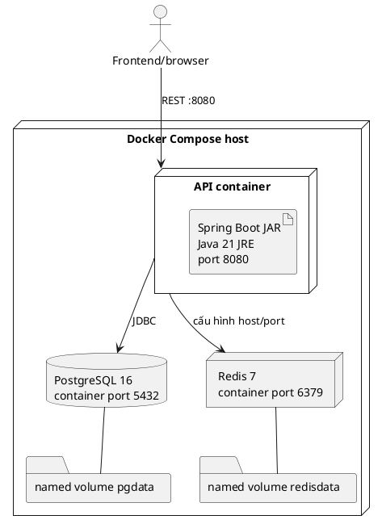

# LogisticsX / CETA — Tài liệu context cho báo cáo thực tập

Tập hợp các tài liệu context được trích xuất từ source code và tài liệu trong repository. Mọi dữ kiện kỹ thuật giữ nguồn trích dẫn tại chỗ; các ví dụ, giới hạn xác minh và câu hỏi bổ sung được ghi trong từng phần.

## Mục lục

1. [Tổng quan](#phan-00)
2. [Yêu cầu và tác nhân](#phan-01)
3. [Use Case](#phan-02)
4. [Luồng nghiệp vụ](#phan-03)
5. [Lớp và cơ sở dữ liệu](#phan-04)
6. [API](#phan-05)
7. [Kiến trúc và triển khai](#phan-06)
8. [Giao diện](#phan-07)
9. [Kiểm thử và kết quả](#phan-08)
10. [Đối chiếu sai lệch](#phan-09)
11. [Thuật ngữ và câu hỏi](#phan-10)

---

<a id="phan-00"></a>

# 00. Tổng quan LogisticsX

## Phạm vi và độ tin cậy của bản khảo sát

Tài liệu này mô tả mã nguồn hiện có trong hai thư mục repo mà phiên khảo sát đọc được: backend tại repo hiện tại và frontend tại repo sibling /home/vumoi/logictics-app. Đây là ảnh chụp working tree ngày 20-10-2026, không phải xác nhận về bản đang chạy hoặc bản đã phát hành. Backend đang ở nhánh main, HEAD 2bc3944, ahead 4 commit và có thay đổi staged/unstaged cùng file mới chưa track; frontend đang ở nhánh feat/complete-ux-review-tasks-20261020 và cũng có thay đổi chưa commit. Các file context này chỉ nên trích dẫn như mô tả snapshot. (nguồn: kết quả chỉ-đọc git status --short --branch và git rev-parse --short HEAD ngày 20-10-2026)

GitNexus được liệt kê trong AGENTS.md, nhưng truy vấn graph trong phiên này không sử dụng được do database version 42 không tương thích với storage runtime version 40. Kết quả impact trả risk UNKNOWN; vì vậy không xem danh sách caller rỗng là bằng chứng về việc một thành phần không được dùng. Các phần dưới đây được đối chiếu bằng source và tài liệu có trong repo. (nguồn: AGENTS.md:4-15; kết quả mcp GitNexus impact/query ngày 20-10-2026)

## Mô tả hệ thống

LogisticsX là hệ thống Transportation Management System (TMS) gồm REST API backend và ứng dụng web frontend. Backend hiện trong source là ứng dụng Java/Spring Boot với JPA, PostgreSQL và Flyway; frontend là SPA React/TypeScript dùng Refine, Ant Design và React Router. Tên bảng, route, API và trạng thái tính năng dưới đây được lấy từ source hiện tại, không lấy roadmap làm bằng chứng đã hoàn thành. (nguồn: README.md:1-18; pom.xml:6-28; /home/vumoi/logictics-app/package.json:1-40)

Mô hình miền dùng các khái niệm chuẩn sau: Tenant là phạm vi công ty; Load là đơn/chuyến hàng cần vận chuyển; Trip là chuyến xe vật lý gồm các Stop; Truck là phương tiện; Driver trong giao diện thường ánh xạ đến Employee có role tài xế. Một Load và một Trip là hai thực thể riêng, không dùng thay thế lẫn nhau. (nguồn: docs/plan.md:13-16; src/main/java/com/company/logicstic/entity/Load.java:35-88; src/main/java/com/company/logicstic/entity/Trip.java:29-82; src/main/java/com/company/logicstic/service/TripExecutionService.java:130-177)

### Mục tiêu và phạm vi thấy trong source

Các module có endpoint hoặc resource frontend hiện hữu gồm: đăng nhập Lark và truy vấn user hiện tại; Tenant/role; Customer, Employee/Driver, Truck, Terminal; Load, Trip, Trip Stop; chứng từ; notification; AI dispatch và AI Load Gap; optimization; pricing/rating; invoice, payment, shipment cost, profitability/reporting; settlement, payroll, payslip; Fleet history và Lark Base/event integration. Danh sách này là phạm vi code có mặt, không khẳng định từng module đã sẵn sàng cho production. (nguồn: src/main/java/com/company/logicstic/controller/LoadController.java:28-82; TripExecutionController.java:26-103; ReportController.java:37-250; AiDispatchController.java:27-240; OptimizationRunController.java:20-39; /home/vumoi/logictics-app/src/pages/resourceRegistry.ts:20-96)

Mục tiêu chi tiết trong docs/plan.md mô tả roadmap TMS gồm Order Lifecycle, Dispatch, Fleet/Telematics, Driver Portal, Documents, Settlement, Payroll, Maintenance, Financials và Operations/Lark. Các mục tiêu trong tài liệu này không tự động chứng minh module tương ứng đã được triển khai. (nguồn: docs/plan.md:1-33, 37-45)

## Multi-tenancy

Code có cơ chế database-per-tenant có điều kiện: khi bật app.tenancy.enabled, TenantJwtClaimFilter đọc claim tenant của JWT, gắn vào TenantContext và yêu cầu DataSource của tenant; TenantRoutingDataSource chọn kết nối theo tenant. TenantContext được dọn ở finally sau request. Cấu hình application.yml đặt app.tenancy.enabled mặc định false, vì vậy không thể kết luận multi-tenancy đang bật trong môi trường chạy nếu thiếu cấu hình triển khai. Registry có migration riêng. (nguồn: src/main/resources/application.yml:64-82; src/main/java/com/company/logicstic/config/TenantJwtClaimFilter.java:21-66, 69-75; TenantContext.java:7-32; TenantRoutingDataSource.java:12-34; src/main/resources/db/migration/registry/V1__create_tenant_registry.sql:1)

Bản nháp gọi hệ thống là multi-tenant SaaS. Phần hỗ trợ tenant trong code có bằng chứng; SaaS đang phục vụ khách hàng thật, quy mô tenant, billing SaaS hay vận hành production thì KHÔNG TÌM THẤY TRONG CODE. (nguồn: src/main/java/com/company/logicstic/config/TenantDataSourceConfiguration.java:18-57; KHÔNG TÌM THẤY TRONG CODE)

## Công nghệ được xác minh

| Thành phần | Phiên bản khai báo / bằng chứng | Vai trò trong source | Căn cứ chọn |
|---|---|---|---|
| Java | 21 | Ngôn ngữ backend | [SUY LUẬN] Phù hợp runtime Spring hiện tại; repo không ghi quyết định chọn Java. |
| Spring Boot | 4.1.1 ở parent Maven | Khởi tạo và cấu hình backend | [SUY LUẬN] Repo xác nhận đang dùng, không ghi lý do lựa chọn. |
| Spring Web MVC, Validation, Spring Security OAuth2 Resource Server | Phiên bản theo Spring Boot BOM | REST, validation request, security filter | [SUY LUẬN] Vai trò suy ra từ dependency và config. |
| Spring Data JPA / Hibernate | Theo BOM | ORM và persistence | [SUY LUẬN] Vai trò suy ra từ dependency. |
| PostgreSQL | Driver JDBC khai báo; docker-compose dùng postgres:16-alpine | Cơ sở dữ liệu chính trong cấu hình đang thấy | [SUY LUẬN] Lý do chọn không được ghi. |
| Flyway | Theo BOM, Flyway PostgreSQL | Versioned SQL migrations | [SUY LUẬN] Vai trò suy ra từ migration và dependency. |
| JJWT | 0.12.6 | Ký và xác minh JWT nội bộ Lark login | Repo có ghi phiên bản, không nêu rationale. |
| MapStruct | 1.6.3; Lombok theo BOM | Mapping Entity/DTO và giảm boilerplate | [SUY LUẬN] |
| SpringDoc OpenAPI | 3.1.1 | Sinh tài liệu OpenAPI/Swagger UI | Repo có ghi phiên bản, không nêu rationale. |
| Apache PDFBox | 3.0.8 | Có dependency phục vụ PDF | [SUY LUẬN] Chức năng PDF cụ thể cần đối chiếu PayslipPdfRenderer. |
| React | ^18.3.1 | UI web | [SUY LUẬN] Lý do chọn không được ghi trong docs/plan.md. |
| TypeScript | ~6.0.2 | Kiểu tĩnh frontend | [SUY LUẬN] |
| Ant Design | ^5.29.3; @refinedev/antd ^5.47.0 | Component UI và adapter Refine | [SUY LUẬN] |
| Refine Core | ^4.58.0; React Router provider ^4.6.2 | Resource/admin framework và router integration | [SUY LUẬN] |
| React Router DOM | ^6.30.3 | SPA navigation | [SUY LUẬN] |
| TanStack Query | ^4.41.0 | Cache/query layer dùng cùng Refine | [SUY LUẬN] |
| Zustand | ^5.0.15 | Client state | [SUY LUẬN] |
| Leaflet / MapLibre GL / deck.gl | ^1.9.4 / ^3.6.2 / ^8.9.36 | Thư viện bản đồ/visualization có trong dependency | Việc cài dependency không chứng minh dữ liệu vị trí live. |
| Vitest / Playwright | ^2.1.8 / 1.64.0 | Unit/component và browser E2E test tooling | [SUY LUẬN] |

(nguồn: pom.xml:6-29, 33-124, 146-164; /home/vumoi/logictics-app/package.json:1-73; docs/plan.md:382-418)

## Quy trình phát triển thấy trong repo

docs/plan.md mô tả trình tự sprint khuyến nghị 1–7; đây là kế hoạch, không phải biên bản chứng minh team đã chạy đúng Agile/Scrum. KHÔNG TÌM THẤY TRONG CODE bằng chứng về sprint đã diễn ra, backlog tool, ceremony, phân công nhóm hoặc UAT thực tế. Repo frontend có workflow CI cấu hình bằng GitHub Actions; điều đó chỉ chứng minh có file workflow, không chứng minh đã chạy thành công. (nguồn: docs/plan.md:382-418; /home/vumoi/logictics-app/.github/workflows/main.yml:1-35)

## Trạng thái kiểm chứng một số tính năng trọng tâm

Các trạng thái này mô tả mức hỗ trợ trong source snapshot, không phải nghiệm thu UAT.

| Tính năng | Trạng thái | Căn cứ và giới hạn |
|---|---|---|
| AI dispatch | MỚI LÀM MỘT PHẦN | Có API run/session/approve/reject và service phối hợp candidate scoring, có thể gọi LLM để rerank và có fallback; phụ thuộc cấu hình/provider, code mới nằm trong working tree chưa commit. (nguồn: src/main/java/com/company/logicstic/ai/dispatch/AiDispatchController.java:27-222; AiDispatchService.java:55-132, 221-289; src/main/resources/application.yml:36-47) |
| Optimization | MỚI LÀM MỘT PHẦN | Có run, score, feasibility, audit và accept có kiểm tra freshness/idempotency; input provider cho routing/ELD/availability là cổng tích hợp, tính sẵn có ngoài môi trường không được xác minh. (nguồn: OptimizationRunController.java:20-39; OptimizationApplicationService.java:30-92; OptimizationAcceptanceService.java:34-84; OptimizationInputProvider.java:7-8) |
| Bản đồ | MỚI LÀM MỘT PHẦN | Frontend có trang map và route map visualization; KHÔNG TÌM THẤY TRONG CODE backend một luồng telemetry/WebSocket live tương ứng ở route inventory đã khảo sát. (nguồn: /home/vumoi/logictics-app/src/pages/map/MapPage.tsx:6-14; /home/vumoi/logictics-app/src/components/dashboard/NetworkRouteMap.tsx:21-42; KHÔNG TÌM THẤY TRONG CODE) |
| Theo dõi vị trí trực tiếp | CHƯA CÓ | KHÔNG TÌM THẤY TRONG CODE luồng nhận GPS/ELD liên tục hoặc API WebSocket vị trí. Có lịch sử/mileage attribution cho phương tiện nhưng đó không tự chứng minh location tracking live. (nguồn: src/main/java/com/company/logicstic/controller/FleetHistoryController.java:17-23; KHÔNG TÌM THẤY TRONG CODE) |
| Notifications | MỚI LÀM MỘT PHẦN | Có API đọc danh sách/chi tiết và mark-all-read; không thấy lệnh gửi notification trong controller này và chưa xác minh trigger tự động. (nguồn: NotificationController.java:21-50; NotificationService.java:17-38; KHÔNG TÌM THẤY TRONG CODE) |
| Báo cáo phân tích | MỚI LÀM MỘT PHẦN | Có nhiều REST report endpoints; trang Executive Dashboard bị khóa bởi EXECUTIVE_CONTRACT_CONFIRMED=false. Executive-summary contract và một số profitability dimensions chưa được xác nhận; không lấy điều này để phủ nhận các report route độc lập. (nguồn: ReportController.java:37-222; /home/vumoi/logictics-app/src/features/executive/config/executive.contract.ts:1-5; /home/vumoi/logictics-app/docs/backend-gaps.md:20,25,47,234-246) |
| Documents | MỚI LÀM MỘT PHẦN | Có list/detail/delete; frontend chủ động bỏ create/edit generic vì chưa có multipart upload adapter. (nguồn: DocumentController.java:24-55; /home/vumoi/logictics-app/src/pages/resourceRegistry.ts:120-127) |
| Lark | MỚI LÀM MỘT PHẦN | Có OAuth/login, đồng bộ Load/Driver sang Base và event inbox/dispatcher; source Lark sync/event mới có file chưa commit. KHÔNG TÌM THẤY TRONG CODE endpoint bot broadcast/interactive card tương ứng kế hoạch. (nguồn: LarkAuthController.java:17-60; LarkBaseController.java:17-52; src/main/java/com/company/logicstic/integration/lark/base/LarkSyncController.java:12-43; LarkEventController.java:15-49; docs/plan.md:349-361; git status backend ngày 20-10-2026) |

## Dữ liệu và giới hạn diễn giải

Code/API không chứng minh dữ liệu runtime nào đang là LIVE. JSON examples, test resources, synthetic fixtures hoặc dữ liệu do seeder tạo cần được gắn rõ DEMO/FIXTURE; không dùng chúng làm thống kê hoạt động doanh nghiệp. API snapshot trong docs/frontend/api-operation-index.md được tạo từ JAR snapshot ngày 06-10-2026, có deployment_verified=false, nên không dùng thay route registry của source đang dirty ngày 20-10-2026. (nguồn: docs/frontend/api-operation-index.md:1-7; docs/frontend/openapi-provenance.json:1-19)

Các thông tin về doanh nghiệp thực tập, hệ thống trước khi số hóa, số liệu ngành logistics, kết quả vận hành thực tế và phần việc cá nhân của sinh viên đều [CẦN NGƯỜI DÙNG BỔ SUNG].

---

<a id="phan-01"></a>

# 01. Yêu cầu chức năng, phi chức năng và tác nhân

## 1. Quy tắc đọc trạng thái

- **ĐÃ HOÀN THIỆN**: có luồng xử lý backend/frontend nhìn thấy được ở phạm vi nêu trong yêu cầu; không đồng nghĩa đã nghiệm thu production.
- **MỚI LÀM MỘT PHẦN**: chỉ có một phần API/UI, phụ thuộc contract/provider, bị khóa, hoặc có gaps được tài liệu hóa.
- **CHƯA CÓ**: không tìm thấy implementation tương ứng trong source đã khảo sát.
- Các thao tác chỉ được hiển thị trong roadmap không được xem là chức năng hiện hữu.

## 2. Tác nhân và vai trò

Backend phát hành JWT nội bộ sau callback Lark, lấy role từ role của Employee; filter xác minh Bearer token và chuyển roles thành Spring authorities. Tenant claim cũng được đưa vào security context. Frontend có ma trận quyền riêng để điều khiển route/action; tài liệu code nói rõ backend vẫn là nơi quyết định authorization cuối cùng. (nguồn: src/main/java/com/company/logicstic/integration/lark/auth/LarkAuthService.java:179-220; LarkAuthenticationFilter.java:40-88; /home/vumoi/logictics-app/src/providers/permissions/roleMatrix.ts:1-6)

### Vai trò có thể chứng minh

| Tác nhân / role | Bằng chứng | Phạm vi thực tế thấy được |
|---|---|---|
| Người dùng đã xác thực | Spring Security yêu cầu xác thực mặc định cho route chưa có matcher cụ thể | Cần JWT hợp lệ; quyền chi tiết còn phụ thuộc route matcher. |
| ADMIN | matcher backend cho roles, internal API, và nhiều module | Vai trò quản trị được dùng trực tiếp bởi SecurityConfig. |
| ACCOUNTANT | matcher cho invoices, payments, rating, reports, settlement/payroll; có một số quyền đọc/duyệt nghiệp vụ | Có quyền các route tài chính được liệt kê, không suy ra quyền ngoài các matcher. |
| DISPATCHER | matcher cho Fleet operations, optimization, accessorial, employee/driver, customer/truck/load/trip/document/terminal/inspection và Lark Base | Vai trò vận hành/điều phối trong backend. |
| PAYROLL | matcher báo cáo, payroll/settlement và Fleet read | Có nhóm quyền payroll/report theo cấu hình backend. |
| PAYROLL_MANAGER | xuất hiện cùng PAYROLL ở matcher báo cáo/payroll | Có nhóm quyền backend tương tự PAYROLL tại các path được khai báo. |
| DRIVER | có thể là Employee role được token phát hành; route payslip self-service hiện hữu | Không thấy một Driver Portal API đầy đủ trong route source đã khảo sát. |
| SUPERADMIN, OWNER, MANAGER | được khai báo trong ma trận JWT frontend cho một số resource/action | KHÔNG TÌM THẤY TRONG CODE matcher backend tương ứng theo role này trong SecurityConfig hiện tại. Không xem đây là vai trò backend đã xác nhận. |
| Customer User | có entity CustomerUser trong backend | KHÔNG TÌM THẤY TRONG CODE luồng đăng nhập/API portal khách hàng tương ứng. |
| Tenant Role | có TenantRole và TenantRoleClaim cùng API /api/roles | Là dữ liệu role/claim quản lý trong tenant; không mặc định đồng nhất với role JWT ở trên. |

(nguồn: src/main/java/com/company/logicstic/config/SecurityConfig.java:44-129; LarkAuthService.java:193-205; src/main/java/com/company/logicstic/entity/TenantRole.java:18-41; src/main/java/com/company/logicstic/entity/TenantRoleClaim.java:16-42; src/main/java/com/company/logicstic/controller/RoleController.java:30-75; /home/vumoi/logictics-app/src/providers/permissions/roleMatrix.ts:19-57; /home/vumoi/logictics-app/src/types/roles.types.ts:10-22)

### Ma trận quyền theo nhóm route backend

| Module / path | Roles được nêu tường minh trong backend | Ghi chú |
|---|---|---|
| /api/roles/**, /api/internal/** | ADMIN | Route quản trị. |
| /api/fleet/** | ADMIN, ACCOUNTANT, DISPATCHER, PAYROLL, PAYROLL_MANAGER; POST status-events/mileage-attributions giới hạn ADMIN, DISPATCHER | Quyền POST cụ thể được matcher đặt trước. |
| /api/optimization/** | ADMIN, DISPATCHER; một số qualified-inputs GET và forecast POST có matcher khác | Đọc kỹ method matcher cho từng route. |
| /api/invoices/**, /api/payments/**, /api/rating/** | ADMIN, ACCOUNTANT | Các route rating trên Load cũng có rule riêng. |
| /api/expenses/*/approve, /api/accessorial-charges/*/approve | ADMIN, ACCOUNTANT | Quyền duyệt. |
| /api/reports/** và các path report cụ thể | ADMIN, ACCOUNTANT, PAYROLL, PAYROLL_MANAGER | Các báo cáo vận hành và tài chính đều trong matcher này. |
| /api/driver-pay-policies/**, /api/driver-settlements/**, /api/pay-periods/**, /api/payroll/** | ADMIN, ACCOUNTANT, PAYROLL, PAYROLL_MANAGER | Payroll controller còn có kiểm tra actor/state ở service. |
| /api/employees/**, /api/drivers/** | ADMIN, DISPATCHER | Employee/driver management. |
| /api/customers/**, /api/trucks/** | ADMIN, ACCOUNTANT, DISPATCHER | Master data. |
| /api/loads/** | ADMIN, ACCOUNTANT, DISPATCHER | Bao gồm update/delete; validation nghiệp vụ ở controller/service. |
| /api/trips/**, /api/trip-stops/** | ADMIN, DISPATCHER | Các hành động stop cũng dùng cùng rule path. |
| /api/documents/**, /api/terminals/** | ADMIN, ACCOUNTANT, DISPATCHER | Không có quyền upload documents tương ứng trong API hiện có. |
| /api/inspections/** | ADMIN, DISPATCHER | Inspection CRUD. |
| /api/lark/base/** | ADMIN, DISPATCHER | Lark webhook /api/lark/events được cấu hình riêng là public tại security filter, sau đó tự xác minh chữ ký. |
| Những path không khớp matcher | authenticated | Fallback yêu cầu đăng nhập nhưng không đặt role cụ thể tại SecurityConfig. |

(nguồn: src/main/java/com/company/logicstic/config/SecurityConfig.java:44-129)

Frontend cũng dùng ROLE_MATRIX để ẩn/chặn action theo JWT roles, và fail-closed với resource/action không được mô tả. Đây là bảo vệ UX; không thay thế kiểm tra backend. Một vài giá trị legacy như OWNER/MANAGER/SUPERADMIN có trong frontend matrix nhưng không nằm trong danh sách role matcher ở backend. (nguồn: /home/vumoi/logictics-app/src/providers/permissions/roleMatrix.ts:24-57, 67-95; /home/vumoi/logictics-app/src/providers/permissions/jwtRoles.ts:44-66)

## 3. Yêu cầu chức năng trích xuất từ code

| ID | Yêu cầu trong phạm vi code | Trạng thái | Bằng chứng / giới hạn |
|---|---|---|---|
| FR-01 | Đăng nhập người dùng qua Lark OAuth, đổi authorization code lấy thông tin Lark và cấp JWT nội bộ | MỚI LÀM MỘT PHẦN | Có authorize/login/callback, kiểm tra state và phát token; chỉ xác minh integration với Lark qua code/test, không xác minh tenant/provider chạy thật. (nguồn: LarkAuthController.java:17-60; LarkAuthService.java:96-153, 160-220) |
| FR-02 | Gắn tenant context và định tuyến truy cập tenant database | MỚI LÀM MỘT PHẦN | Database-per-tenant có điều kiện; tenancy mặc định false. (nguồn: application.yml:64-82; TenantJwtClaimFilter.java:21-66; TenantRoutingDataSource.java:12-34) |
| FR-03 | Tra cứu, tạo, sửa, xóa Load | ĐÃ HOÀN THIỆN ở phạm vi CRUD API | Có GET collection/detail, POST, PUT, DELETE; chưa khẳng định UI/UAT production. (nguồn: LoadController.java:28-82; LoadService.java:21-149) |
| FR-04 | Tạo lịch sử/timeline cho Load và đọc timeline | MỚI LÀM MỘT PHẦN | Có LoadTimelineController/service và bảng load_events; không thấy mọi sự kiện trong plan đều đã tích hợp. (nguồn: LoadTimelineController.java:19-39; LoadTimelineService.java:25-60; V6__create_load_events.sql:2-22; docs/plan.md:41-75) |
| FR-05 | Quản lý Trip, gán/bỏ Driver, đọc Stops và cập nhật trạng thái thực thi Stop | ĐÃ HOÀN THIỆN ở phạm vi endpoint hiện diện | Có Trip CRUD và các hành động assign/unassign/arrive/start/complete/depart. Không suy ra GPS automation. (nguồn: TripController.java:28-77; TripExecutionController.java:26-103; TripExecutionService.java:130-177) |
| FR-06 | Điều phối thủ công Load, Driver và Truck | MỚI LÀM MỘT PHẦN | CRUD và AI dispatch có, nhưng dispatch board/candidate matcher theo toàn bộ tiêu chí trong docs/plan không hiện diện dưới endpoint tương ứng. (nguồn: docs/plan.md:78-107; AiDispatchController.java:27-240; KHÔNG TÌM THẤY TRONG CODE dispatch board API như roadmap) |
| FR-07 | Gợi ý AI dispatch, lưu session/decision, cho người dùng approve/reject | MỚI LÀM MỘT PHẦN | Có run, decision và approval commands; LLM/provider và trạng thái dry-run phụ thuộc cấu hình. Source đang có thay đổi chưa commit. (nguồn: AiDispatchController.java:37-160; AiDispatchService.java:55-132, 221-289; application.yml:36-47) |
| FR-08 | Chạy optimization, xếp hạng candidate, xác nhận assignment | MỚI LÀM MỘT PHẦN | Có hard feasibility, scoring, persisted audit và accept với revalidation; provider route/HOS/availability phải được cấu hình. (nguồn: OptimizationApplicationService.java:30-92, 112-145; OptimizationAcceptanceService.java:34-84; OptimizationInputProvider.java:7-8) |
| FR-09 | Quản lý Customer, Employee, Driver, Truck, Terminal và Inspection | ĐÃ HOÀN THIỆN ở phạm vi API CRUD/tra cứu được khai báo | Controller hiện có collection/detail/create/update/delete ở các resource tương ứng; role và validation vẫn áp dụng. (nguồn: CustomerController.java:30-80; EmployeeController.java:30-80; TruckController.java:30-80; TerminalController.java:30-80; InspectionController.java:30-80) |
| FR-10 | Liệt kê, xem và xóa Document; upload chứng từ | MỚI LÀM MỘT PHẦN | Backend chỉ có search/detail/delete; frontend resource registry tắt create/edit do thiếu multipart adapter. (nguồn: DocumentController.java:24-55; resourceRegistry.ts:120-127) |
| FR-11 | Xem notification, xem chi tiết và mark-all-read | ĐÃ HOÀN THIỆN ở phạm vi API đọc/đánh dấu đã đọc | Không chứng minh tự động gửi hoặc push notification. (nguồn: NotificationController.java:21-50; NotificationService.java:17-38) |
| FR-12 | Xem report hoạt động, tài chính, Fleet và profitability | MỚI LÀM MỘT PHẦN | ReportController có nhiều endpoint; Executive Dashboard contract vẫn false; exact executive-summary/report compatibility và một số profitability dimensions còn là gap riêng. (nguồn: ReportController.java:37-222; executive.contract.ts:1-5; /home/vumoi/logictics-app/docs/backend-gaps.md:20,25,47,234-246) |
| FR-13 | Rating Load, phiên bản hóa rate policy và chấp nhận snapshot | ĐÃ HOÀN THIỆN ở phạm vi API/command hiện tại | Có preview/accept/snapshot, contract/rule versions; không đồng nghĩa đối chiếu mọi nghiệp vụ thương mại của doanh nghiệp. (nguồn: RatingController.java:20-44; RatePolicyController.java:18-55; V21__create_versioned_customer_rate_policies.sql:3) |
| FR-14 | Tạo/đọc/sửa/hủy Payment và ghi nhận command history | MỚI LÀM MỘT PHẦN | Có create/read/update/cancel command nhưng kênh payment phải tuân contract; không có manual payment completion hoặc bằng chứng gateway production. (nguồn: PaymentController.java:28-95; docs/payment-command-contracts.md:1-15; /home/vumoi/logictics-app/docs/backend-gaps.md:25,208-212) |
| FR-15 | Tính toán, review, approve, lock và điều chỉnh Driver Settlement | MỚI LÀM MỘT PHẦN | Các command calculate/review/approve/lock hiện diện; roadmap rộng hơn như reject, generic recalculate hoặc settlement payment alias không được khẳng định có. (nguồn: DriverSettlementController.java:20-148; /home/vumoi/logictics-app/docs/backend-gaps.md:16,244) |
| FR-16 | Tính toán/review/approve/lock Payroll Run, sinh Payslip và xử lý payment command | MỚI LÀM MỘT PHẦN | Run calculate/detail/workflow và payslip artifact có; collection/configuration reads và self-service payment-status contract còn thiếu; issuance không đồng nghĩa PAID. (nguồn: PayrollRunController.java:9-28; PayslipController.java:7-24; /home/vumoi/logictics-app/docs/backend-gaps.md:17-18,210-216,245) |
| FR-17 | Ghi Fleet policy, status event và mileage attribution | ĐÃ HOÀN THIỆN ở phạm vi command API | Có endpoint/persistence; không phải ingestion vị trí GPS live. (nguồn: FleetHistoryController.java:16-24; V34__capture_immutable_fleet_history_and_mileage_attribution.sql:2) |
| FR-18 | Đồng bộ Load/Driver với Lark Base, xem tình trạng và xử lý event callback | MỚI LÀM MỘT PHẦN | Có sync state/event inbox trong working tree; không tìm thấy Lark Bot broadcast API theo roadmap và chưa xác minh tài khoản Lark thật. (nguồn: LarkBaseController.java:17-52; src/main/java/com/company/logicstic/integration/lark/base/LarkSyncController.java:12-43; LarkEventController.java:15-49; docs/plan.md:349-361) |
| FR-19 | Customer portal/public Load tracking và GPS tracking token | CHƯA CÓ | Có plan nêu tracking token/public endpoint; KHÔNG TÌM THẤY TRONG CODE controller route public tracking tương ứng. (nguồn: docs/plan.md:68-75; KHÔNG TÌM THẤY TRONG CODE) |

## 4. Yêu cầu phi chức năng có bằng chứng

| ID | Yêu cầu / cơ chế | Bằng chứng trong repo |
|---|---|---|
| NFR-01 Authentication | Bearer JWT nội bộ; Lark OAuth callback; endpoint public được liệt kê rõ, phần còn lại yêu cầu authenticated | SecurityConfig.java:33-56, 128-132; LarkAuthenticationFilter.java:40-94 |
| NFR-02 Authorization | Path matchers theo role; frontend access policy fail-closed cho action không biết | SecurityConfig.java:60-129; /home/vumoi/logictics-app/src/providers/permissions/roleMatrix.ts:67-95 |
| NFR-03 Tenant isolation | Tenant claim lấy từ identity, mismatch trả 403; routed datasource bắt buộc có tenant context; conditional feature mặc định tắt | TenantJwtClaimFilter.java:39-66; TenantRoutingDataSource.java:21-34; application.yml:64-82 |
| NFR-04 Input validation | Spring Validation dependency và controller dùng @Valid; DTO có constraint annotations | pom.xml:46-49; ví dụ src/main/java/com/company/logicstic/controller/LoadController.java:60-75 |
| NFR-05 Error envelope | Security failures tạo JSON response; exception handlers chuyển lỗi domain/validation thành API error response | SecurityConfig.java:39-43; src/main/java/com/company/logicstic/config/SecurityResponses.java:1-40; src/main/java/com/company/logicstic/exception/GlobalExceptionHandler.java:23-45 |
| NFR-06 Pagination | PagedResponse dùng cho các collection search; frontend query serializer/provider kiểm soát query whitelist | src/main/java/com/company/logicstic/dto/PagedResponse.java:7-21; src/main/java/com/company/logicstic/service/LoadService.java:55-67; /home/vumoi/logictics-app/src/providers/dataProvider.ts:1-6 |
| NFR-07 Localization | Frontend khởi tạo locale vi, fallback en; dùng i18next và react-i18next | /home/vumoi/logictics-app/src/main.tsx:21-24; /home/vumoi/logictics-app/src/providers/i18nProvider.ts:13-24 |
| NFR-08 Deployment container | Docker multi-stage Java 21 build/runtime, non-root user, healthcheck; compose có API/PostgreSQL/Redis | Dockerfile:3-76; docker-compose.yml:1-74 |
| NFR-09 Integration-testability | Maven khai báo Spring Boot Test, Spring Security Test, H2, REST Assured và Testcontainers PostgreSQL | pom.xml:119-164 |
| NFR-10 Client/server query cache | TanStack Query được khai báo và Refine được cấu hình React Query client | /home/vumoi/logictics-app/package.json:20-40; /home/vumoi/logictics-app/src/App.tsx:179-190 |

Không đưa các thuộc tính “high availability”, “encryption at rest”, “SLA”, “backup policy”, “WCAG conformance”, hay “production uptime” vào báo cáo như yêu cầu đã đạt vì KHÔNG TÌM THẤY TRONG CODE bằng chứng nghiệm thu cho các nội dung đó.

---

<a id="phan-02"></a>

# 02. Use Case theo source hiện tại

## 1. Phạm vi

Danh mục UC dưới đây được rút ra từ API controller, UI route và tài liệu contract trong hai repo. UC là mục tiêu người dùng, không phải phép đếm API. Các path được ghi nguyên theo mapping source; API có cùng tên nhưng không có màn hình tương ứng được đánh dấu rõ. Authentication backend hiện có Lark OAuth; route UI có chọn Tenant nhưng không tìm thấy API list tenant trong controller inventory. (nguồn: src/main/java/com/company/logicstic/integration/lark/auth/LarkAuthController.java:17-60; /home/vumoi/logictics-app/src/router/AppRouter.tsx:161-187; src/main/java/com/company/logicstic/controller)

## 2. Danh mục Use Case

| Mã UC | Tên Use Case | Tác nhân chính | Module | Trạng thái code |
|---|---|---|---|---|
| UC-01 | Đăng nhập LogisticsX qua Lark | Nhân viên có tài khoản Lark được liên kết | Authentication | MỚI LÀM MỘT PHẦN |
| UC-02 | Nạp thông tin người dùng/tenant hiện hành | Người dùng đã đăng nhập | Tenant/Security | MỚI LÀM MỘT PHẦN |
| UC-03 | Tra cứu và quản lý khách hàng | ADMIN, ACCOUNTANT, DISPATCHER | Customer | ĐÃ HOÀN THIỆN ở phạm vi CRUD API |
| UC-04 | Tạo và cập nhật Load | ADMIN, ACCOUNTANT, DISPATCHER | Load | ĐÃ HOÀN THIỆN ở phạm vi CRUD API |
| UC-05 | Xem timeline và lịch sử Load | Người dùng vận hành có quyền đọc Load | Load Execution | MỚI LÀM MỘT PHẦN |
| UC-06 | Tạo Trip, gán Driver, thực hiện Stop | ADMIN, DISPATCHER | Trip Execution | ĐÃ HOÀN THIỆN ở phạm vi endpoint |
| UC-07 | Sinh và xử lý đề xuất AI Dispatch | Dispatcher/nhân viên được cấp quyền | AI Dispatch | MỚI LÀM MỘT PHẦN |
| UC-08 | Chạy Optimization và chấp nhận candidate | ADMIN, DISPATCHER | Optimization | MỚI LÀM MỘT PHẦN |
| UC-09 | Tra cứu Documents | ADMIN, ACCOUNTANT, DISPATCHER | Documents | MỚI LÀM MỘT PHẦN |
| UC-10 | Đọc và đánh dấu Notification | Người dùng đã đăng nhập | Notifications | ĐÃ HOÀN THIỆN ở phạm vi API hiện có |
| UC-11 | Xem báo cáo hoạt động và tài chính | ADMIN, ACCOUNTANT, PAYROLL, PAYROLL_MANAGER | Reporting | MỚI LÀM MỘT PHẦN |
| UC-12 | Định giá Load và lưu rating snapshot | ADMIN, ACCOUNTANT | Rating | ĐÃ HOÀN THIỆN ở phạm vi API hiện có |
| UC-13 | Phát hành/điều chỉnh invoice và payment | ADMIN, ACCOUNTANT | Billing/Payments | MỚI LÀM MỘT PHẦN |
| UC-14 | Tính, review, approve và lock settlement/payroll | ADMIN, ACCOUNTANT, PAYROLL, PAYROLL_MANAGER; Driver đọc payslip của mình theo API | Settlement/Payroll | MỚI LÀM MỘT PHẦN |
| UC-15 | Ghi Fleet event / mileage attribution | ADMIN, DISPATCHER; quyền đọc Fleet rộng hơn | Fleet | ĐÃ HOÀN THIỆN ở phạm vi command API |
| UC-16 | Đồng bộ Load/Driver với Lark Base | ADMIN, DISPATCHER | Lark Base | MỚI LÀM MỘT PHẦN |
| UC-17 | Tiếp nhận Lark event webhook | Lark platform | Lark Events | MỚI LÀM MỘT PHẦN |
| UC-18 | Quản lý vai trò trong tenant | ADMIN | Roles | ĐÃ HOÀN THIỆN ở phạm vi CRUD API |
| UC-19 | Xem trang Map / route visualization | Dispatcher | Map | MỚI LÀM MỘT PHẦN |
| UC-20 | Tải lên POD/BOL cho Load | Driver/Dispatcher | Documents | CHƯA CÓ trong API hiện tại |
| UC-21 | Tra cứu công khai trạng thái Load bằng token | Customer | Public Tracking | CHƯA CÓ trong API hiện tại |
| UC-22 | Xem Driver Portal | Driver | Driver Portal | CHƯA CÓ trong route/API hiện tại |
| UC-23 | Nhận GPS/ELD và cập nhật vị trí tự động | Driver/Telematics provider | Telematics | CHƯA CÓ trong API hiện tại |
| UC-24 | Quản lý Employee/Driver, Truck và Terminal | ADMIN, DISPATCHER | Master Data | ĐÃ HOÀN THIỆN ở phạm vi CRUD/tra cứu API |

Bằng chứng về quyền endpoint nằm trong SecurityConfig; role ở frontend chỉ điều khiển route/action UX và không thay thế authorization backend. Các UC gắn với Roadmap nhưng không tìm thấy endpoint phải được giữ ở trạng thái chưa có. (nguồn: src/main/java/com/company/logicstic/config/SecurityConfig.java:44-129; /home/vumoi/logictics-app/src/providers/permissions/roleMatrix.ts:1-6, 24-57; docs/plan.md:68-75, 110-133, 349-361)

## 3. Đặc tả UC trọng yếu

### UC-01 — Đăng nhập qua Lark

- **Tác nhân:** Nhân viên có tài khoản Lark đã liên kết với Employee.
- **Tiền điều kiện:** Lark integration bật và cấu hình hợp lệ; người dùng khởi tạo authorize hoặc login.
- **Hậu điều kiện thành công:** Backend xác thực state, đổi code, tìm Employee, phát JWT Bearer chứa subject/email/tenant/role.
- **Luồng chính:** UI mở /login → bắt đầu Lark authorize → Lark callback → POST /api/auth/lark/callback → LarkAuthService xác minh state/code → ánh xạ Employee → tạo JWT → UI nạp identity bằng GET /api/me.
- **Ngoại lệ:** State thiếu/sai/hết hạn trả lỗi; người dùng từ chối cấp quyền; tài khoản Lark không liên kết Employee; tenant không sẵn sàng.
- **Endpoint:** GET /api/auth/lark/authorize; GET /api/auth/lark/login; POST /api/auth/lark/callback; GET /api/me.
- **Màn hình:** /login, /auth/callback, shell sau xác thực.
- **Trạng thái:** MỚI LÀM MỘT PHẦN; chưa xác minh tài khoản Lark thật hoặc môi trường production.
- **Nguồn:** src/main/java/com/company/logicstic/integration/lark/auth/LarkAuthController.java:17-60; LarkAuthService.java:114-220; LarkAuthenticationFilter.java:40-94; /home/vumoi/logictics-app/src/router/AppRouter.tsx:161-173; /home/vumoi/logictics-app/src/App.tsx:100-138.

### UC-02 — Nạp identity và tenant context

- **Tác nhân:** Người dùng đã đăng nhập.
- **Tiền điều kiện:** JWT hợp lệ.
- **Hậu điều kiện:** Identity endpoint trả thông tin user/tenant; nếu multi-tenancy bật, claim tenant được gắn vào request context trước khi truy cập tenant database.
- **Luồng chính:** ProtectedRoute xác nhận session → UI gọi GET /api/me → TenantGuard bảo vệ layout → TenantJwtClaimFilter đọc claim tenant → TenantContext → TenantRoutingDataSource. Khi người dùng yêu cầu đổi tenant, frontend khởi chạy lại xác thực qua Identity Provider để token mới mang tenant được cấp; không gửi tenant header hay gọi switch endpoint riêng.
- **Ngoại lệ:** Thiếu tenant claim, tenant identity mismatch, inactive tenant hoặc tenant database không khả dụng trả 403/503.
- **Endpoint/màn hình:** GET /api/me; /select-tenant route hiện có.
- **Giới hạn:** KHÔNG TÌM THẤY TRONG CODE backend API riêng để liệt kê hoặc chuyển Tenant. Backend `/api/me` trả identity hiện tại; frontend hiện dựng danh sách tenant từ claim hiện hành và đổi tenant bằng xác thực lại qua Identity Provider. Màn hình này không chứng minh có danh sách nhiều tenant hay môi trường multi-tenant đang bật; `app.tenancy.enabled` mặc định false.
- **Nguồn:** CurrentUserController.java:24-38; CurrentUserResponse.java:10-24; TenantJwtClaimFilter.java:21-66; TenantContext.java:7-32; TenantRoutingDataSource.java:21-34; application.yml:64-82; /home/vumoi/logictics-app/src/router/AppRouter.tsx:170-174; /home/vumoi/logictics-app/src/pages/tenant/SelectTenantPage.tsx:13-30; /home/vumoi/logictics-app/src/hooks/useTenantList.ts:15-28; /home/vumoi/logictics-app/src/hooks/useSwitchTenant.ts:23-65.

### UC-04 — Tạo Load

- **Tác nhân:** ADMIN, ACCOUNTANT hoặc DISPATCHER.
- **Tiền điều kiện:** Đã xác thực; user có role phù hợp; request đáp ứng validation DTO và quan hệ Customer/Truck/Dispatcher hợp lệ nếu có.
- **Hậu điều kiện:** Load được persist và response trả DTO; các field được backend xác nhận theo CreateLoadRequest.
- **Luồng chính:** UI /loads/create → data provider gửi POST /api/loads → LoadController kiểm tra @Valid → LoadService tạo entity → LoadRepository lưu → LoadMapper tạo view → ApiResponse.
- **Ngoại lệ:** Validation lỗi, entity liên quan không tồn tại, quyền bị từ chối, lỗi persistence.
- **Endpoint/màn hình:** GET /api/loads, GET /api/loads/{id}, POST /api/loads, PUT /api/loads/{id}, DELETE /api/loads/{id}; /loads, /loads/create, /loads/show/:id.
- **Trạng thái:** ĐÃ HOÀN THIỆN ở phạm vi CRUD API; dữ liệu live và UAT không được xác minh.
- **Nguồn:** LoadController.java:28-82; LoadService.java:21-149; /home/vumoi/logictics-app/src/constants/routes.ts:5-12, 38-65; /home/vumoi/logictics-app/src/pages/loads/create.tsx:15-25.

### UC-05 — Xem Load timeline

- **Tác nhân:** Người dùng vận hành có quyền xem Load.
- **Tiền điều kiện:** Load tồn tại trong tenant hiện hành.
- **Hậu điều kiện:** UI nhận dữ liệu timeline để trình bày lịch sử.
- **Luồng chính:** UI Load detail → GET /api/loads/{loadId}/timeline → LoadTimelineController → LoadTimelineService/LoadEvent repository → response.
- **Ngoại lệ:** Không có Load hoặc persistence lỗi.
- **Giới hạn:** Không suy ra public tracking link, raw event endpoint hay GPS event vì không tìm thấy các route tương ứng ở source inventory.
- **Màn hình:** /loads/show/:id.
- **Nguồn:** LoadTimelineController.java:19-39; LoadTimelineService.java:18-46; src/main/resources/db/migration/tenant/V6__create_load_events.sql:1-22; docs/plan.md:68-75.

### UC-06 — Gán Driver và thực hiện Trip Stop

- **Tác nhân:** ADMIN hoặc DISPATCHER.
- **Tiền điều kiện:** Trip tồn tại; Stop thuộc Trip; trạng thái hiện tại cho phép hành động.
- **Hậu điều kiện:** Assignment hoặc timestamp/status Stop được persist.
- **Luồng chính:** UI Trip detail → GET /api/trips/{tripId}/drivers và /stops → POST assign/unassign hoặc POST arrive → start-service → complete-service → depart → TripExecutionService kiểm tra trạng thái và lưu repository.
- **Ngoại lệ:** Trip/Stop không tồn tại; chuyển trạng thái sai trả Bad Request.
- **Endpoint/màn hình:** Các route /api/trips/{tripId}/drivers, /api/trips/{tripId}/stops, /api/trip-stops/{id}/arrive, /start-service, /complete-service, /depart; /trips/show/:id.
- **Trạng thái:** ĐÃ HOÀN THIỆN ở phạm vi thao tác Stop hiện có; chưa bao gồm cập nhật do GPS/geofence.
- **Nguồn:** TripExecutionController.java:26-103; TripExecutionService.java:92-148; /home/vumoi/logictics-app/src/pages/trips/show.tsx:27-40; SecurityConfig.java:117-125.

### UC-07 — AI Dispatch và phê duyệt

- **Tác nhân:** Dispatcher/người dùng có identity map tới Employee; người phê duyệt là actor được backend kiểm tra.
- **Tiền điều kiện:** AI dispatch bật cho tenant, Load/đầu vào đủ điều kiện, provider configuration đáp ứng nếu cần.
- **Hậu điều kiện:** Run/session/decision được lưu; chỉ lệnh approve/reject mới xác nhận quyết định người dùng. Không giả định approve đồng nghĩa một assignment nếu service không thực hiện nhánh đó.
- **Luồng chính:** UI AI Dispatch → POST /api/ai/dispatch/runs → service lấy/sắp candidate và có thể yêu cầu LLM rerank → GET pending/session/run → POST approve hoặc reject.
- **Ngoại lệ:** Feature bị tắt, input thiếu, provider/LLM lỗi (có fallback), session/decision không còn ở trạng thái hợp lệ.
- **Endpoint/màn hình:** /api/ai/dispatch/runs; /sessions; /pending; /decisions/{id}/approve; /decisions/{id}/reject; UI /ai-dispatch, /ai-dispatch/:id.
- **Trạng thái:** MỚI LÀM MỘT PHẦN; source đang dirty/uncommitted và provider thật chưa được xác minh.
- **Nguồn:** AiDispatchController.java:27; AiDispatchService.java:55-132, 221-289; /home/vumoi/logictics-app/src/hooks/ai/useLoadAiDispatch.ts:22-45; /home/vumoi/logictics-app/src/router/AppRouter.tsx:182-187.

### UC-08 — Chạy Optimization và accept candidate

- **Tác nhân:** ADMIN hoặc DISPATCHER.
- **Tiền điều kiện:** Policy và scope hợp lệ; dữ liệu Load/Trip/Driver/Truck cùng tenant; route/HOS/availability/cost evidence đầy đủ.
- **Hậu điều kiện:** Optimization run và candidate evidence được audit; accept chỉ thực hiện nếu candidate còn feasible và input fingerprint chưa stale.
- **Luồng chính:** UI Optimization → POST /api/optimization/runs → OptimizationApplicationService resolve qualified inputs + feasibility + scoring → GET run → POST assignment candidate accept với idempotency key.
- **Ngoại lệ:** Thiếu evidence; candidate infeasible/stale; trùng idempotency key nhưng body khác; run đã accepted candidate khác.
- **Màn hình:** /optimization, /optimization/runs/:id.
- **Trạng thái:** MỚI LÀM MỘT PHẦN; cần provider integration và xác nhận dữ liệu đầu vào runtime.
- **Nguồn:** OptimizationRunController.java:20-39; OptimizationApplicationService.java:30-92, 112-145; OptimizationAcceptanceService.java:34-84; /home/vumoi/logictics-app/src/features/optimization/hooks/useOptimizationActions.ts:14-24; /home/vumoi/logictics-app/src/router/AppRouter.tsx:182-184.

### UC-11 — Xem báo cáo

- **Tác nhân:** ADMIN, ACCOUNTANT, PAYROLL hoặc PAYROLL_MANAGER.
- **Tiền điều kiện:** User có role báo cáo và query period/currency hợp lệ theo từng endpoint.
- **Hậu điều kiện:** API trả report DTO; một số metric có trạng thái unavailable thay vì tính giả.
- **Luồng chính:** UI report → gọi endpoint report tương ứng → controller gọi calculation/report service → response.
- **Ngoại lệ:** Thiếu currency/date, validation failure, report service trả unavailable reason hoặc data error.
- **Màn hình:** Operations dashboard, Fleet report, Profitability.
- **Giới hạn:** Dashboard executive bị contract flag tắt; đừng lấy placeholder KPI trong UI làm dữ liệu live.
- **Nguồn:** ReportController.java:37-250; SecurityConfig.java:103-109; /home/vumoi/logictics-app/src/features/executive/config/executive.contract.ts:1-5; AppRouter.tsx:177-190.

### UC-13 — Quản lý vòng đời invoice và payment

- **Tác nhân:** ADMIN, ACCOUNTANT.
- **Tiền điều kiện:** Invoice/Load/rating snapshot phù hợp, currency nhất quán, request command hợp lệ.
- **Hậu điều kiện:** Billing command được ghi nhận và trạng thái/snapshot được trả về theo contract.
- **Luồng chính:** UI invoices/billing → POST primary billing → đọc invoice → issue/supplemental/credit/rebill theo command endpoint → tạo/đọc/cancel payment theo PaymentController.
- **Ngoại lệ:** State conflict, currency/amount mismatch, idempotency key reuse hoặc command provider chưa được cấu hình.
- **Màn hình:** /invoices, /payments; Billing command UI có thể tách khỏi CRUD page.
- **Trạng thái:** MỚI LÀM MỘT PHẦN; các gap về manual payment completion và external settlement cần được giữ nguyên.
- **Nguồn:** BillingController.java:17-56; PaymentController.java:28-95; SecurityConfig.java:81-89; docs/payment-command-contracts.md:1-15; /home/vumoi/logictics-app/docs/backend-gaps.md:25,208-212.

### UC-14 — Settlement và Payroll

- **Tác nhân:** ACCOUNTANT, PAYROLL, PAYROLL_MANAGER, ADMIN; Driver đọc payslip theo self-service endpoint.
- **Tiền điều kiện:** Pay policy/profile/period phù hợp; trạng thái cho phép command.
- **Hậu điều kiện:** Settlement/PayrollRun state và lịch sử tài chính được persist; payslip là artifact snapshot.
- **Luồng chính:** calculate settlement → submit-review → approve → lock; calculate payroll run → review → approve → lock → issue payslip; payment command là luồng riêng.
- **Ngoại lệ:** State locked, nguồn policy/profile thiếu, reconciliation case, provider không hỗ trợ manual completion.
- **Endpoint/màn hình:** /api/driver-settlements/**; /api/payroll/runs/**; /api/payroll/runs/{id}/payslips; /api/driver/me/payslips; UI /settlements, /payroll, /profile/payslips.
- **Trạng thái:** MỚI LÀM MỘT PHẦN theo gaps được ghi nhận; không suy ra lương đã trả.
- **Nguồn:** DriverSettlementController.java:20-148; PayrollRunController.java:9-28; PayslipController.java:7-24; /home/vumoi/logictics-app/docs/backend-gaps.md:16-18,210-216,244-245.

### UC-16 — Đồng bộ Load/Driver sang Lark Base

- **Tác nhân:** ADMIN/DISPATCHER; Lark Base là hệ thống ngoài.
- **Tiền điều kiện:** Cấu hình mapping/table/app Lark hợp lệ; entity trong tenant tồn tại; không có conflict unmanaged record.
- **Hậu điều kiện:** Link, sync state, hash và audit được lưu; lỗi provider được trả về thành trạng thái lỗi/conflict, không ghi thành công giả.
- **Luồng chính:** UI/API yêu cầu sync → LarkSyncController → LarkSyncService tạo projection và đọc/ghi qua gateway → lưu trạng thái/audit.
- **Ngoại lệ:** Mapping không khớp, bản ghi remote missing, conflict, permission provider lỗi hoặc app/table config thiếu.
- **Giới hạn:** Không tìm thấy endpoint Bot broadcast/interactive action theo roadmap.
- **Trạng thái:** MỚI LÀM MỘT PHẦN; implementation event/sync trong working tree chưa commit.
- **Nguồn:** LarkSyncController.java:20-85; LarkSyncService.java:14-118; LarkBaseService.java:8-26; LarkEventController.java:15-49; docs/plan.md:349-361.

### UC-09 — Tra cứu Document

- **Tác nhân:** ADMIN, ACCOUNTANT, DISPATCHER.
- **Tiền điều kiện:** Đã xác thực; query filter phù hợp.
- **Hậu điều kiện:** Người dùng xem metadata/document record hoặc xóa theo quyền.
- **Luồng chính:** UI Documents → GET /api/documents với filter/page → DocumentController → DocumentService → repository.
- **Ngoại lệ:** Document không tồn tại hoặc backend trả forbidden.
- **Giới hạn:** Upload không có API contract/controller hiện hữu; không giả định có thể gửi POD/BOL.
- **Nguồn:** DocumentController.java:24-55; DocumentService.java:17-50; /home/vumoi/logictics-app/src/pages/resourceRegistry.ts:120-127.

### UC-03, UC-10, UC-12, UC-15, UC-17–UC-24 — Các use case còn lại

Các UC có API hỗ trợ một phần được ghi ở danh mục; riêng màn hình/thao tác chưa có route hoặc contract không được mô tả như luồng hoàn chỉnh. UC-03 Customer có CRUD API; UC-10 Notification có API đọc/mark-read; UC-12 rating có preview/accept snapshot; UC-15 Fleet có event/mileage command; UC-17 webhook có inbox/event handler; UC-18 Roles có CRUD API; UC-24 bao quát CRUD/tra cứu master data Employee/Driver, Truck, Terminal. UC-19 Map chỉ có trang source chưa mount và placeholder; UC-20 upload, UC-21 public tracking, UC-22 Driver Portal và UC-23 GPS/ELD automation chưa có contract/route hoàn chỉnh được tìm thấy.

- **Endpoint/màn hình:** Customer `/api/customers`; notification `/api/notifications`; rating `/api/rating/**`; Fleet `/api/fleet/**`; Lark webhook `/api/lark/events/**`; Roles `/api/roles`; master data `/api/employees`, `/api/drivers`, `/api/trucks`, `/api/terminals`. Các màn hình Map và các UC CHƯA CÓ không được xem là luồng người dùng đã hoàn thành.
- **Nguồn:** CustomerController.java:30-80; NotificationController.java:21-50; RatingController.java:20-44; FleetHistoryController.java:16-24; LarkEventController.java:15-49; RoleController.java:30-75; EmployeeController.java:30-80; TruckController.java:30-80; TerminalController.java:30-80; `/home/vumoi/logictics-app/src/pages/map/MapPage.tsx:6-14`; `KHÔNG TÌM THẤY TRONG CODE`.

## 4. Sơ đồ Use Case

    @startuml
    left to right direction
    actor "Nhân viên vận hành" as Ops
    actor "ADMIN" as Admin
    actor "ACCOUNTANT" as Accountant
    actor "DISPATCHER" as Dispatcher
    actor "PAYROLL / PAYROLL_MANAGER" as Payroll
    actor "DRIVER" as Driver
    actor "Customer" as Customer
    actor "Lark Platform" as Lark

    rectangle "LogisticsX TMS" {
      usecase "Đăng nhập Lark" as UC1
      usecase "Nạp identity / tenant context" as UC2
      usecase "Quản lý Customer" as UC3
      usecase "Quản lý Load" as UC4
      usecase "Xem Load timeline" as UC5
      usecase "Quản lý Trip và Stops" as UC6
      usecase "Chạy / duyệt AI Dispatch" as UC7
      usecase "Chạy Optimization" as UC8
      usecase "Tra cứu Document" as UC9
      usecase "Đọc Notification" as UC10
      usecase "Xem report" as UC11
      usecase "Rating Load" as UC12
      usecase "Invoice / Payment" as UC13
      usecase "Settlement / Payroll" as UC14
      usecase "Fleet event / mileage" as UC15
      usecase "Đồng bộ Lark Base" as UC16
      usecase "Nhận Lark webhook" as UC17
      usecase "Quản lý role" as UC18
      usecase "Xem Map" as UC19
      usecase "Upload POD/BOL" as UC20
      usecase "Public Load tracking" as UC21
      usecase "Driver Portal" as UC22
      usecase "GPS / ELD tracking" as UC23
      usecase "Quản lý master data" as UC24
    }

    Ops --> UC1
    Dispatcher --> UC3
    Dispatcher --> UC4
    Dispatcher --> UC5
    Dispatcher --> UC6
    Dispatcher --> UC7
    Dispatcher --> UC8
    Accountant --> UC9
    Ops --> UC10
    Accountant --> UC11
    Payroll --> UC11
    Accountant --> UC12
    Accountant --> UC13
    Payroll --> UC14
    Driver --> UC14
    Dispatcher --> UC15
    Admin --> UC16
    Dispatcher --> UC16
    Lark --> UC17
    Admin --> UC18
    Customer --> UC21
    Driver --> UC22
    Driver --> UC23
    Dispatcher --> UC24
    Dispatcher --> UC19
    @enduml

UC-06 và UC-07 có bước approve/accept riêng vì backend lưu suggestion/run và áp dụng lại kiểm tra điều kiện trước khi ghi. Public tracking, GPS automation và upload POD/BOL chưa được đưa vào luồng hoàn thành. (nguồn: AiDispatchService.java:221-289; OptimizationAcceptanceService.java:34-84; KHÔNG TÌM THẤY TRONG CODE public tracking/upload API)

---

<a id="phan-03"></a>

# 03. Luồng nghiệp vụ được thấy trong source

## 1. Quy ước

Sequence dưới đây dừng ở điểm sâu nhất có bằng chứng trong source. Đường gọi backend được mô tả theo controller/service/repository; phần provider hoặc API ngoài chỉ được vẽ khi có interface/gateway. Đây không phải bằng chứng một request đã chạy trong UAT. Trong source được khảo sát, Load và Trip có field status dạng String; Trip Stop có các transition được kiểm tra rõ. (nguồn: src/main/java/com/company/logicstic/entity/Load.java:56-57; Trip.java:59-60; TripStop.java:46-47; TripExecutionService.java:92-148)

## 2. Flow F-01 — Lark login và bind tenant

### Activity Diagram

    @startuml
    start
    :Người dùng mở /login;
    :Frontend yêu cầu Lark authorize;
    :Lark trả authorization code + state;
    :POST /api/auth/lark/callback;
    if (state hợp lệ, chưa hết hạn?) then (có)
      :Đổi code lấy Lark user;
      :Tìm Employee liên kết;
      if (Tenant đang được cấp và hợp lệ?) then (có)
        :Tạo JWT Bearer có tenant và role;
        :Frontend nạp identity GET /api/me;
        if (app.tenancy.enabled=true) then (có)
          :JWT tenant claim -> TenantContext -> tenant DataSource;
        else (không)
          :Dùng cấu hình single-tenant hiện tại;
        endif
      else (không)
        :Trả lỗi tenant/auth;
      endif
    else (không)
      :Trả lỗi BAD_REQUEST;
    endif
    stop
    @enduml

### Sequence Diagram

    @startuml
    actor "Nhân viên" as User
    participant "React LoginPage/AuthProvider" as UI
    participant "LarkAuthController" as Controller
    participant "LarkAuthService" as Service
    participant "LarkAuthClient" as LarkClient
    participant "EmployeeRepository" as EmployeeRepo
    participant "TenantJwtClaimFilter" as TenantFilter
    participant "TenantRoutingDataSource" as Router

    User -> UI: bắt đầu Lark login
    UI -> Controller: GET /api/auth/lark/authorize
    Controller -> Service: getAuthorizeUrl(returnTo)
    Service --> UI: authorizationUrl
    User -> LarkClient: xác thực tại Lark
    LarkClient --> UI: code + state callback
    UI -> Controller: POST /api/auth/lark/callback
    Controller -> Service: handleCallback(code, state, ...)
    Service -> Service: validateState + TTL/HMAC
    Service -> LarkClient: exchangeCodeForToken + extractUser
    Service -> EmployeeRepo: resolve employee mapping
    Service -> Service: createInternalToken(subject,email,tenant,roles)
    Service --> UI: Bearer token + identity
    UI -> Controller: GET /api/me
    Controller --> UI: CurrentUserResponse
    TenantFilter -> Router: nếu tenancy bật, route bằng TenantContext
    @enduml

Tiền điều kiện cụ thể: Lark integration bật, state còn hạn, có Employee liên kết và cấu hình signing key hợp lệ. Không thấy API backend public để UI tự chọn tenant; tenant ID được đưa vào JWT nội bộ. Cấu hình tenancy ở application.yml mặc định tắt. (nguồn: src/main/java/com/company/logicstic/integration/lark/auth/LarkAuthController.java:17-60; LarkAuthService.java:90-153, 160-220; src/main/java/com/company/logicstic/controller/CurrentUserController.java:24-38; src/main/resources/application.yml:64-82)

## 3. Flow F-02 — Tạo Load và đọc timeline

### Activity Diagram

    @startuml
    start
    :Dispatcher mở /loads/create;
    :Nhập Load fields;
    :POST /api/loads;
    if (JWT/role/validation hợp lệ?) then (có)
      :LoadService tạo hoặc cập nhật entity;
      :LoadRepository lưu Load;
      :Trả ApiResponse<LoadView>;
      :Mở /loads/show/:id;
      :GET /api/loads/{loadId}/timeline;
      :Hiển thị các LoadEvent đã lưu;
    else (không)
      :Trả lỗi validation/auth/domain;
    endif
    stop
    @enduml

### Sequence Diagram

    @startuml
    actor Dispatcher
    participant "Load Create / Detail UI" as UI
    participant "Refine dataProvider / apiClient" as Provider
    participant "LoadController" as Controller
    participant "LoadService" as Service
    participant "LoadRepository" as Repository
    database "Tenant PostgreSQL" as DB
    participant "LoadTimelineController" as TimelineController
    participant "LoadTimelineService" as TimelineService

    Dispatcher -> UI: nhập thông tin Load
    UI -> Provider: create(loads, request)
    Provider -> Controller: POST /api/loads
    Controller -> Controller: @Valid + ApiResponse
    Controller -> Service: create(CreateLoadRequest)
    Service -> Repository: save(entity)
    Repository -> DB: INSERT/UPDATE
    DB --> Repository: persisted row
    Service --> Controller: LoadView
    Controller --> UI: 201 + ApiResponse
    Dispatcher -> UI: mở Load detail / timeline
    UI -> TimelineController: GET /api/loads/{loadId}/timeline
    TimelineController -> TimelineService: getTimeline(loadId)
    TimelineService -> DB: đọc LoadEvent/Load liên quan
    DB --> TimelineService: event records
    TimelineService --> UI: LoadTimelineResponse
    @enduml

Load status trong entity là text field; controller CRUD cho phép tạo/cập nhật Load nhưng không chứng minh một state machine đầy đủ như roadmap. API timeline có thật; không tìm thấy public tracking token endpoints nêu trong roadmap. (nguồn: src/main/java/com/company/logicstic/controller/LoadController.java:28-82; service/LoadService.java:21-149; controller/LoadTimelineController.java:19; src/main/java/com/company/logicstic/entity/Load.java:56-57; docs/plan.md:41-75)

## 4. Flow F-03 — Gán Driver và thực thi Trip Stop

### Activity Diagram

    @startuml
    start
    :Mở Trip detail;
    :Đọc assignment và danh sách Stop;
    :POST assign Driver nếu cần;
    :POST arrive;
    if (status là PENDING hoặc EN_ROUTE?) then (có)
      :Status = ARRIVED;
      :POST start-service;
      if (status là ARRIVED?) then (có)
        :Status = SERVICE_STARTED;
        :POST complete-service;
        if (status là SERVICE_STARTED?) then (có)
          :Status = SERVICE_COMPLETED;
          :POST depart;
          :Status = DEPARTED;
        else (không)
          :Lỗi transition;
        endif
      else (không)
        :Lỗi transition;
      endif
    else (không)
      :Lỗi transition;
    endif
    stop
    @enduml

### Sequence Diagram

    @startuml
    actor Dispatcher
    participant "Trip Detail UI" as UI
    participant "TripExecution API adapter" as Adapter
    participant "TripExecutionController" as Controller
    participant "TripExecutionService" as Service
    participant "TripStopRepository / AssignmentRepository" as Repository
    database "Tenant PostgreSQL" as DB

    Dispatcher -> UI: mở Trip
    UI -> Adapter: get drivers + stops
    Adapter -> Controller: GET /api/trips/{id}/drivers, /stops
    Controller -> Service: getTripDrivers/getTripStops
    Service -> Repository: findByTripId...
    Repository -> DB: SELECT
    DB --> UI: assignment + stop views
    Dispatcher -> UI: arrive / start / complete / depart
    UI -> Controller: POST /api/trip-stops/{id}/{action}
    Controller -> Service: transition method
    Service -> Service: requireStatus(current, allowed, target)
    Service -> Repository: save(stop)
    Repository -> DB: UPDATE trip_stops
    DB --> UI: new status + timestamps
    @enduml

### Trạng thái Stop

| Trạng thái hiện tại | Lệnh | Trạng thái tiếp theo | Điều kiện được kiểm tra |
|---|---|---|---|
| PENDING hoặc EN_ROUTE | arrive | ARRIVED | Chỉ chấp nhận một trong hai trạng thái nguồn. |
| ARRIVED | start-service | SERVICE_STARTED | Phải đã ghi nhận arrival. |
| SERVICE_STARTED | complete-service | SERVICE_COMPLETED | Phải đang phục vụ Stop. |
| SERVICE_COMPLETED | depart | DEPARTED | Phải hoàn tất service trước khi rời điểm. |

Nếu trạng thái hiện tại không nằm trong allowlist, service trả BadRequestException và không lưu trạng thái mới. Trip/Load status fields không có transition guard tương tự trong CRUD controller được khảo sát; không lấy danh sách trạng thái từ docs/plan làm trạng thái đang vận hành. (nguồn: src/main/java/com/company/logicstic/controller/TripExecutionController.java:26-103; TripExecutionService.java:92-148; entity/TripStop.java:46-47; entity/Trip.java:59-60)

## 5. Flow F-04 — AI Dispatch, đề xuất và duyệt

### Activity Diagram

    @startuml
    start
    :Dispatcher chọn Load và mode;
    :POST /api/ai/dispatch/runs;
    if (AI dispatch bật và request hợp lệ?) then (có)
      :Tạo session;
      :Lấy và chấm candidate;
      if (LLM/provider sẵn sàng?) then (có)
        :LLM rerank / giải thích;
      else (không)
        :Dùng optimization fallback nếu có;
      endif
      :Lưu decision Suggested và session;
      :UI tải pending/session;
      if (Người dùng approve?) then (approve)
        :Revalidate Load/Truck feasibility;
        if (vẫn khả thi?) then (có)
          :Decision Executed;
        else (không)
          :Trả FEASIBILITY_FAILED;
        endif
      else (reject)
        :Decision Rejected;
      endif
    else (không)
      :Trả disabled/validation/provider error;
    endif
    stop
    @enduml

### Sequence Diagram

    @startuml
    actor Dispatcher
    participant "AI Dispatch UI" as UI
    participant "ai.api.ts / hooks" as Hooks
    participant "AiDispatchController" as Controller
    participant "AiDispatchService" as Service
    participant "Optimization scoring / LLM client" as Candidate
    participant "AiDispatch repositories" as Repositories
    database "Tenant PostgreSQL" as DB

    Dispatcher -> UI: chạy đề xuất
    UI -> Hooks: run dispatch
    Hooks -> Controller: POST /api/ai/dispatch/runs
    Controller -> Service: runDispatch(request, actor, tenant)
    Service -> Candidate: score/rank candidate; tùy cấu hình rerank LLM
    Candidate --> Service: ranked result hoặc fallback
    Service -> Repositories: persist session, decisions, run audit
    Repositories -> DB: INSERT
    Service --> UI: run/session result
    Dispatcher -> UI: approve/reject suggestion
    UI -> Controller: POST decision approve/reject
    Controller -> Service: approveDecision/rejectDecision
    Service -> DB: revalidate source state và cập nhật decision
    DB --> UI: executed/rejected hoặc conflict
    @enduml

Service từ chối nếu decision không còn pending và khi approve sẽ kiểm tra lại feasibility. Từ run hiện có, decision status được ghi Suggested/Executed/Rejected/Failed, session kết thúc COMPLETED hoặc CANCELLED. AI gap là một luồng riêng, không đồng nghĩa mọi Load đều có AI recommendation. (nguồn: src/main/java/com/company/logicstic/ai/dispatch/AiDispatchService.java:55-195, 221-300; ai/dispatch/AiDispatchController.java:37-160; /home/vumoi/logictics-app/src/api/ai/ai.api.ts:30-56, 237-276)

## 6. Flow F-05 — Optimization và accept candidate

### Activity Diagram

    @startuml
    start
    :Dispatcher chọn policy, Load/Trip, Driver/Truck và input sources;
    :POST /api/optimization/runs;
    :Resolve database facts + qualified external evidence;
    :Kiểm tra tenant, freshness, source quality, HOS và feasibility;
    if (Candidate đủ evidence và feasible?) then (có)
      :Tính score và lưu run/candidate audit;
      :Hiển thị comparison;
      if (Người dùng accept?) then (có)
        :Đọc lại state + fingerprint;
        if (Không stale và chưa accepted candidate khác?) then (có)
          :Ghi assignment và idempotency command;
        else (không)
          :Trả conflict/stale;
        endif
      else (không)
        :Giữ run để tham khảo;
      endif
    else (không)
      :Lưu rejection reason / unavailable;
    endif
    stop
    @enduml

### Sequence Diagram

    @startuml
    actor Dispatcher
    participant "Optimization UI / hooks" as UI
    participant "OptimizationRunController" as Controller
    participant "OptimizationApplicationService" as AppService
    participant "OptimizationInputProvider" as Provider
    participant "HardFeasibility + Scoring" as Rules
    participant "Optimization audit repositories" as Repository
    participant "OptimizationAcceptanceService" as Accept
    database "Tenant PostgreSQL" as DB

    Dispatcher -> UI: chạy optimization
    UI -> Controller: POST /api/optimization/runs
    Controller -> AppService: run(request, actor)
    AppService -> DB: đọc Load/Trip/Driver/Truck/policy
    AppService -> Provider: fetch route/HOS/availability evidence
    Provider --> AppService: qualified input hoặc lỗi
    AppService -> Rules: hard feasibility rồi score
    AppService -> Repository: persist immutable run/candidate/audit
    Repository -> DB: INSERT
    AppService --> UI: ranked candidates + reasons
    Dispatcher -> UI: accept candidate
    UI -> Controller: POST /runs/{id}/assignments/{candidateId}/accept
    Controller -> Accept: accept(request, actor)
    Accept -> DB: lock/re-read state + fingerprint + feasibility
    Accept -> Repository: write assignment + idempotency command
    Repository --> UI: accepted assignment hoặc conflict
    @enduml

Acceptance không chỉ dùng score cũ: service kiểm tra candidate feasible, tenant scope, fingerprint, trạng thái mới nhất, conflict assignment và idempotency key trước khi ghi. Provider endpoint/credentials thực tế chưa được xác minh. (nguồn: src/main/java/com/company/logicstic/service/optimization/OptimizationApplicationService.java:30-92, 112-145; OptimizationAcceptanceService.java:34-84; src/main/java/com/company/logicstic/integration/optimization/OptimizationInputProvider.java:7-8)

## 7. Flow F-06 — Lark Base sync / event inbox

### Activity Diagram

    @startuml
    start
    if (Có yêu cầu sync Load/Driver?) then (sync)
      :POST /api/lark/base/.../sync;
      :Tạo projection từ entity và mapping;
      :Tìm remote record;
      if (Mapping/ownership hợp lệ?) then (có)
        :Create/update qua Lark gateway;
        :Persist link/hash/audit state;
        if (Provider trả lỗi?) then (có)
          :State ERROR / CONFLICT / MISSING;
        else (không)
          :State SYNCED;
        endif
      else (không)
        :State CONFLICT hoặc trả mapping error;
      endif
    else (event)
      :POST /api/lark/events;
      :Verify signature + timestamp;
      :Deduplicate và persist inbox receipt;
      :Dispatch handler, retry/lease theo cấu hình;
    endif
    stop
    @enduml

### Sequence Diagram

    @startuml
    actor "ADMIN/DISPATCHER hoặc Lark" as Actor
    participant "Lark Base API Controller" as Controller
    participant "LarkSyncService" as Sync
    participant "LarkSyncMapping/Store" as Store
    participant "LarkSyncGateway" as Gateway
    participant "Lark Base API" as External
    participant "LarkEventSecurity/Dispatcher" as EventDispatcher
    database "Tenant PostgreSQL" as DB

    Actor -> Controller: POST sync Load/Driver
    Controller -> Sync: sync(domain, id, recreateMissing)
    Sync -> DB: đọc source entity + persisted link
    Sync -> Store: prepare / update state and audit
    Sync -> Gateway: find/create/update remote record
    Gateway -> External: HTTPS request
    External --> Gateway: remote response/error
    Gateway --> Sync: record or provider error
    Sync -> Store: persist state/hash/audit
    Store -> DB: transaction commit
    Actor -> Controller: POST /api/lark/events (webhook path)
    Controller -> EventDispatcher: authenticate raw body + accept event
    EventDispatcher -> DB: deduplicate/enqueue, claim, complete/retry
    @enduml

Event callback được cấu hình permitAll ở Spring matcher nhưng xác thực chữ ký/timestamp thực hiện trong LarkEventSecurity; không ghi lại provider success giả. Các sync/event class mới đang ở working tree chưa commit. (nguồn: src/main/java/com/company/logicstic/integration/lark/base/LarkSyncService.java:14-118; LarkEventController.java:15-49; LarkEventDispatcher.java:46-115; SecurityConfig.java:44-55; git status ngày 20-10-2026)

## 8. Bảng state machine và giới hạn

| Thực thể | State/transition được chứng minh | Điều kiện |
|---|---|---|
| Load | Có cột status kiểu text | CRUD có; state transition matrix KHÔNG TÌM THẤY TRONG CODE trong LoadService/controller đã khảo sát. Không dùng status list trong docs/plan làm bằng chứng runtime. |
| Trip | Có cột status kiểu text | Trip CRUD có; state transition matrix KHÔNG TÌM THẤY TRONG CODE trong TripService/controller đã khảo sát. |
| TripStop | PENDING/EN_ROUTE → ARRIVED → SERVICE_STARTED → SERVICE_COMPLETED → DEPARTED | Mỗi action kiểm tra current status trong allowlist trước khi lưu. |
| AiDispatchSession | COMPLETED sau run; CANCELLED khi cancel | Source cũng lưu progress states; trạng thái đầy đủ cần đối chiếu toàn bộ service nếu đưa vào biểu đồ chi tiết hơn. |
| AiDispatchDecision | Suggested → Executed khi approve hợp lệ; Rejected; Failed nếu revalidation thất bại | Chỉ decision pending mới được xử lý; approve revalidates Load/Truck. |
| Optimization candidate/acceptance | Feasible candidate mới được accept; stale/infeasible/conflict bị từ chối | Freshness fingerprint, tenant scope, idempotency và assignment conflict được kiểm tra. |
| Lark Base sync link | PENDING / SYNCED / ERROR / CONFLICT / MISSING | Mapping, remote ownership và provider result ảnh hưởng trạng thái. |
| Driver Settlement | CALCULATED → IN_REVIEW → APPROVED → LOCKED; có VALIDATION_REQUIRED nhánh cần giải quyết | Approval/lock có guard nguồn doanh thu và fresh calculation. |
| Payroll Run | CALCULATED → IN_REVIEW → APPROVED → LOCKED; sau payment có PAYMENT_SCHEDULED/COMPLETED theo luồng khác | Workflow service chỉ cho phép target hợp lệ; không gộp state settlement với payroll. |

(nguồn: src/main/java/com/company/logicstic/entity/Load.java:56-57; Trip.java:59-60; TripStop.java:46-47; TripExecutionService.java:92-148; ai/dispatch/AiDispatchService.java:141-167, 221-300; service/optimization/OptimizationAcceptanceService.java:34-84; integration/lark/base/LarkSyncService.java:50-118; service/payroll/DriverPayEngine.java:220-252; PayrollWorkflowService.java:22-39; docs/plan.md:13-16)

---

<a id="phan-04"></a>

# 04. Lớp và cơ sở dữ liệu

## 4.1 Phạm vi và cách đếm

Các sơ đồ dưới đây phản ánh mã Java hiện tại và lịch sử Flyway đang có trong working tree, không phải kết quả introspection từ một database đang chạy. Có 44 migration tenant từ V1 đến V44; tập lệnh `CREATE TABLE` cho 102 tên khác nhau, V40 thực thi xóa bốn bảng chat nội bộ, nên còn 98 tên trong schema tenant. Trong số này có `__EFMigrationsHistory`; cộng bảng `tenant_registry` của registry cho tổng 99 bảng tính theo migration, hoặc 98 bảng ứng dụng nếu không tính bảng lịch sử migration. V40 chỉ drop `messages`, `conversation_participants`, `conversations`, `message_read_receipts`. (nguồn: `src/main/resources/db/migration/tenant/V1__baseline_business_schema.sql:7-20`, `src/main/resources/db/migration/tenant/V40__drop_internal_chat_tables.sql:1-5`, `src/main/resources/db/migration/tenant/V44__create_ai_gap_tables.sql:43-62`, `src/main/resources/db/migration/registry/V1__create_tenant_registry.sql:1-7`)

Đây là số bảng có thể suy ra từ chuỗi migration trong repository; KHÔNG XÁC MINH ĐƯỢC số bảng đang tồn tại tại một môi trường database bất kỳ vì phiên khảo sát không kết nối/introspect database.

## 4.2 Class Diagram nhóm lõi

Diagram thể hiện các quan hệ được khai báo trong entity JPA. `Load.status` và `Trip.status` là thuộc tính chuỗi; không biểu diễn chúng thành enum/state machine trong sơ đồ. (nguồn: `src/main/java/com/company/logicstic/entity/Load.java:35-88`, `src/main/java/com/company/logicstic/entity/Trip.java:29-82`, `src/main/java/com/company/logicstic/entity/TripStop.java:28-69`, `src/main/java/com/company/logicstic/entity/TripDriverAssignment.java:18-58`)

```plantuml
@startuml
hide methods
skinparam classAttributeIconSize 0
class Customer { +UUID id; +String name; +String status }
class Employee { +UUID id; +String email; +String status; +TenantRole role }
class TenantRole { +UUID id; +String name }
class Truck { +UUID id; +String number; +String status; +Employee mainDriver; +Employee secondaryDriver }
class Load { +UUID id; +Long number; +String name; +String type; +String status; +Long version; +Customer customer; +Truck assignedTruck; +Employee assignedDispatcher }
class Trip { +UUID id; +Long number; +String name; +String status; +Long version; +Truck truck }
class TripStop { +UUID id; +String type; +Integer order; +String status; +OffsetDateTime arrivedAt; +OffsetDateTime departedAt; +Trip trip; +Load load }
class TripDriverAssignment { +UUID id; +Trip trip; +Employee driver; +OffsetDateTime effectiveFrom; +OffsetDateTime effectiveTo }
class LoadEvent { +UUID id; +Load load; +String eventType; +OffsetDateTime occurredAt }
Customer "1" -- "0..*" Load
Truck "0..1" -- "0..*" Load : assigned
Employee "0..1" -- "0..*" Load : dispatcher
Employee "0..1" -- "0..*" Truck : driver roles
Truck "0..1" -- "0..*" Trip
Trip "1" *-- "0..*" TripStop
Load "1" -- "0..*" TripStop
Trip "1" *-- "0..*" TripDriverAssignment
Employee "1" -- "0..*" TripDriverAssignment
TenantRole "0..1" -- "0..*" Employee
Load "1" -- "0..*" LoadEvent
@enduml
```

`TenantRegistryRecord` là DTO biểu diễn bản ghi registry; đây không phải entity nghiệp vụ tenant trong database tenant. Entity mappings và quan hệ trên nằm trong source Java; các FK vật lý được khai báo thêm trong SQL migrations, vì vậy diagram lớp không thay thế ERD. (nguồn: `src/main/java/com/company/logicstic/dto/TenantRegistryRecord.java:1-9`, `src/main/java/com/company/logicstic/entity/Load.java:19-41`, `src/main/java/com/company/logicstic/entity/Trip.java:18-35`)

## 4.3 ERD theo module

Mỗi sơ đồ liệt kê toàn bộ tên bảng hiện có theo migration và một tập con quan hệ FK đã thấy trong DDL; để giữ khả năng đọc, các bảng không có mũi tên trong sơ đồ vẫn hiện trong database nhưng không được suy đoán quan hệ. Bốn bảng hội thoại nội bộ đã bị xóa ở V40 nên không được liệt kê như bảng hiện hành.

### ERD A — Tenant, nhân sự và đội xe

```mermaid
erDiagram
  tenant_roles { uuid id PK }
  tenant_role_claims { uuid id PK; uuid role_id FK }
  employees { uuid id PK; uuid role_id FK }
  customers { uuid id PK }
  customer_users { uuid id PK; uuid customer_id FK }
  trucks { uuid id PK; uuid main_driver_id FK; uuid secondary_driver_id FK }
  terminals { uuid id PK }
  containers { uuid id PK; uuid current_terminal_id FK }
  api_keys { uuid id PK }
  eld_provider_configurations { uuid id PK }
  eld_driver_mappings { uuid id PK; uuid employee_id FK }
  eld_vehicle_mappings { uuid id PK; uuid truck_id FK }
  driver_behavior_events { uuid id PK; uuid employee_id FK; uuid truck_id FK }
  driver_hos_statuses { uuid id PK; uuid employee_id FK }
  driver_licenses { uuid id PK; uuid employee_id FK; uuid document_id FK }
  hos_logs { uuid id PK; uuid employee_id FK }
  hos_violations { uuid id PK; uuid employee_id FK }
  tenant_roles ||--o{ employees : role
  tenant_roles ||--o{ tenant_role_claims : claims
  customers ||--o{ customer_users : users
  employees ||--o{ trucks : assigned_drivers
  terminals ||--o{ containers : current_terminal
  employees ||--o{ eld_driver_mappings : mapping
  trucks ||--o{ eld_vehicle_mappings : mapping
```

Các tên bảng và các FK hiển thị được đọc từ baseline migration. `tenant_registry` nằm ở schema registry riêng, không nằm trong ERD tenant này. (nguồn: `src/main/resources/db/migration/tenant/V1__baseline_business_schema.sql:55-123`, `:190-224`, `:294-347`, `:356-399`, `:408-458`, `:467-567`, `:1459-1484`, `src/main/resources/db/migration/registry/V1__create_tenant_registry.sql:1-7`)

### ERD B — Load, chuyến đi, giao nhận và chứng từ

```mermaid
erDiagram
  loads { uuid id PK; uuid customer_id FK; uuid assigned_truck_id FK; uuid assigned_dispatcher_id FK }
  load_events { uuid id PK; uuid load_id FK }
  load_exceptions { uuid id PK; uuid load_id FK }
  load_pickup_business_date_changes { uuid id PK; uuid load_id FK }
  load_board_configurations { uuid id PK }
  load_board_listings { uuid id PK; uuid load_id FK }
  load_condition_reports { uuid id PK; uuid load_id FK }
  trips { uuid id PK; uuid truck_id FK }
  trip_stops { uuid id PK; uuid trip_id FK; uuid load_id FK }
  trip_driver_assignments { uuid id PK; uuid trip_id FK; uuid driver_id FK }
  tracking_links { uuid id PK; uuid load_id FK }
  documents { uuid id PK; uuid load_id FK; uuid trip_stop_id FK; uuid uploaded_by_id FK }
  containers { uuid id PK }
  terminals { uuid id PK }
  customers { uuid id PK }
  employees { uuid id PK }
  trucks { uuid id PK }
  loads ||--o{ load_events : event
  loads ||--o{ load_exceptions : exception
  loads ||--o{ trip_stops : stop
  trips ||--o{ trip_stops : ordered_stops
  trips ||--o{ trip_driver_assignments : driver_history
  loads ||--o{ documents : evidence
```

Quan hệ stop/load, trip/stop, trip/assignment và load/event được khai báo trong migration; `load_pickup_business_date_changes` được liên kết bổ sung ở migration V22. (nguồn: `src/main/resources/db/migration/tenant/V1__baseline_business_schema.sql:624-694`, `:802-828`, `:1331-1351`, `:1398-1450`, `src/main/resources/db/migration/tenant/V2__create_trip_driver_assignments.sql:2-24`, `src/main/resources/db/migration/tenant/V6__create_load_events.sql:2-22`, `src/main/resources/db/migration/tenant/V22__add_audited_load_pickup_business_date.sql:3`)

### ERD C — Tài chính và payroll

```mermaid
erDiagram
  invoices { uuid id PK; uuid load_id FK; uuid customer_id FK }
  invoice_line_items { uuid id PK; uuid invoice_id FK }
  invoice_billing_commands { uuid id PK }
  invoice_charge_claims { uuid id PK }
  invoice_rebill_credit_evidence { uuid id PK }
  invoice_tax_assessments { uuid id PK }
  accepted_rating_snapshots { uuid id PK; uuid load_id FK }
  contract_load_rating_mileage { uuid id PK }
  customer_rate_rules { uuid id PK }
  customer_rate_rule_versions { uuid id PK }
  customer_rating_contracts { uuid id PK }
  customer_rating_contract_versions { uuid id PK }
  payments { uuid id PK; uuid invoice_id FK }
  payment_links { uuid id PK; uuid invoice_id FK }
  payment_command_events { uuid id PK }
  pay_periods { uuid id PK }
  driver_pay_policies { uuid id PK }
  settlements { uuid id PK; uuid driver_id FK; uuid pay_period_id FK }
  settlement_lines { uuid id PK; uuid settlement_id FK }
  calculation_snapshots { uuid id PK }
  shipment_costs { uuid id PK; uuid pay_period_id FK }
  accessorial_charges { uuid id PK; uuid load_id FK }
  settlement_billing_adjustments { uuid id PK }
  settlement_revenue_commands { uuid id PK }
  payroll_runs { uuid id PK; uuid pay_period_id FK }
  payroll_run_items { uuid id PK; uuid payroll_run_id FK; uuid driver_id FK }
  payroll_run_item_settlements { uuid payroll_run_item_id PK; uuid settlement_id PK }
  payslips { uuid id PK; uuid payroll_run_item_id FK; uuid driver_id FK }
  payroll_payments { uuid id PK; uuid payroll_run_item_id FK }
  payroll_payment_events { uuid id PK }
  payroll_supplements { uuid id PK }
  payroll_jurisdictions { uuid id PK }
  employee_payroll_profiles { uuid id PK }
  tenant_payroll_settings { uuid id PK }
  payroll_policy_versions { uuid id PK }
  invoices ||--o{ invoice_line_items : items
  invoices ||--o{ payments : payments
  invoices ||--o{ payment_links : links
  pay_periods ||--o{ settlements : settles
  settlements ||--o{ settlement_lines : lines
  pay_periods ||--o{ payroll_runs : runs
  payroll_runs ||--o{ payroll_run_items : items
  payroll_run_items ||--o{ payroll_run_item_settlements : allocations
  settlements ||--o{ payroll_run_item_settlements : included
  payroll_run_items ||--o| payslips : artifact
  payroll_run_items ||--o{ payroll_payments : attempts
```

The baseline and later migrations create the billing and payroll structures; exact FK cardinality is only shown where DDL contains the constraint. (nguồn: `src/main/resources/db/migration/tenant/V1__baseline_business_schema.sql:999-1045`, `:1268-1295`, `:1518-1534`, `src/main/resources/db/migration/tenant/V10__create_driver_pay_and_settlement_tables.sql:1-15`, `src/main/resources/db/migration/tenant/V11__create_payroll_and_payslip_tables.sql:12-102`, `src/main/resources/db/migration/tenant/V24__create_immutable_accepted_rating_snapshots.sql:1-34`)

### ERD D — Fleet, compliance, chi phí vận hành

```mermaid
erDiagram
  accident_reports { uuid id PK }
  accident_third_parties { uuid id PK; uuid accident_report_id FK }
  accident_witnesses { uuid id PK; uuid accident_report_id FK }
  condition_defects { uuid id PK; uuid load_condition_report_id FK }
  dvir_reports { uuid id PK; uuid truck_id FK; uuid driver_id FK }
  dvir_defects { uuid id PK; uuid dvir_report_id FK }
  expenses { uuid id PK; uuid truck_id FK }
  maintenance_schedules { uuid id PK }
  maintenance_records { uuid id PK; uuid truck_id FK; uuid maintenance_schedule_id FK }
  maintenance_parts { uuid id PK; uuid maintenance_record_id FK }
  vehicle_status_events { uuid id PK; uuid truck_id FK }
  fleet_mileage_attributions { uuid id PK }
  fleet_policy_versions { uuid id PK }
  posted_trucks { uuid id PK; uuid truck_id FK }
  time_entries { uuid id PK; uuid employee_id FK; uuid payroll_invoice_id FK }
  trucks { uuid id PK }
  employees { uuid id PK }
  documents { uuid id PK }
  load_condition_reports { uuid id PK }
  accident_reports ||--o{ accident_third_parties : parties
  accident_reports ||--o{ accident_witnesses : witnesses
  load_condition_reports ||--o{ condition_defects : defects
  dvir_reports ||--o{ dvir_defects : defects
  trucks ||--o{ maintenance_records : service
  maintenance_schedules ||--o{ maintenance_records : planned_service
  maintenance_records ||--o{ maintenance_parts : parts
```

Các bảng và FK ở sơ đồ này có trong baseline hoặc migration riêng cho đội xe và lịch sử bất biến. (nguồn: `src/main/resources/db/migration/tenant/V1__baseline_business_schema.sql:831-936`, `:959-998`, `:1115-1216`, `:1303-1322`, `:1493-1554`, `src/main/resources/db/migration/tenant/V34__capture_immutable_fleet_history_and_mileage_attribution.sql:2`)

### ERD E — AI dispatch, optimization, Lark và hệ thống phụ trợ

```mermaid
erDiagram
  ai_dispatch_sessions { uuid id PK }
  ai_dispatch_decisions { uuid id PK; uuid session_id FK }
  ai_load_gaps { uuid id PK }
  ai_load_gap_history { uuid id PK; uuid gap_id FK }
  ai_runs { uuid id PK }
  optimization_policy_versions { uuid id PK }
  optimization_runs { uuid id PK }
  optimization_assignments { uuid id PK; uuid run_id FK }
  optimization_qualified_inputs { uuid id PK }
  optimization_qualified_forecast_costs { uuid id PK }
  optimization_acceptances { uuid id PK }
  optimization_accept_commands { uuid id PK }
  lark_event_receipts { uuid id PK }
  lark_base_sync_links { varchar tenant_id PK; varchar app_scope PK; varchar table_id PK; varchar domain PK; uuid entity_id PK }
  lark_base_sync_audit { uuid id PK }
  lark_user_mappings { uuid id PK; uuid employee_id FK }
  notifications { uuid id PK }
  telegram_chats { uuid id PK }
  ai_dispatch_sessions ||--o{ ai_dispatch_decisions : decisions
  ai_load_gaps ||--o{ ai_load_gap_history : history
  optimization_runs ||--o{ optimization_assignments : candidates
```

Các migration V30, V39, V41-V44 bổ sung audit/decision/optimization/integration tables; `lark_base_sync_links` có composite key nên sơ đồ đánh dấu hai cột khóa thay vì giả định một UUID `id`. (nguồn: `src/main/resources/db/migration/tenant/V30__create_immutable_optimization_policy_and_run_audit.sql:2-52`, `src/main/resources/db/migration/tenant/V39__create_lark_user_mappings.sql:2`, `src/main/resources/db/migration/tenant/V41__create_lark_event_receipts.sql:2`, `src/main/resources/db/migration/tenant/V42__persist_lark_event_inbox.sql:2`, `src/main/resources/db/migration/tenant/V43__track_lark_base_sync.sql:2-24`, `src/main/resources/db/migration/tenant/V44__create_ai_gap_tables.sql:2-62`)

Các bảng chưa hiện trong sơ đồ quan hệ nhưng vẫn được liệt kê ở đây thuộc schema hiện hành: `__EFMigrationsHistory`, `invoice_charge_claims`, `invoice_rebill_credit_evidence`, `optimization_accept_commands`, `optimization_acceptances`, `optimization_qualified_inputs`, `optimization_qualified_forecast_costs`, `payment_command_events`, `payroll_payment_events`, `payroll_supplements`, `settlement_billing_adjustments`, `settlement_revenue_commands`, `lark_event_receipts`, `lark_base_sync_audit`, `ai_runs`. Tham chiếu DDL: migration baseline và migration chuyên biệt V18, V25-V29, V32-V33, V36-V38, V41-V44. (nguồn: `src/main/resources/db/migration/tenant/V1__baseline_business_schema.sql:7-19`, `src/main/resources/db/migration/tenant/V18__journal_verified_payroll_payment_events.sql:1`, `src/main/resources/db/migration/tenant/V25__create_immutable_invoice_tax_assessments.sql:2`, `src/main/resources/db/migration/tenant/V26__link_rated_primary_invoices_and_command_audit.sql:2`, `src/main/resources/db/migration/tenant/V27__enforce_signed_billing_chains_and_credit_caps.sql:2`, `src/main/resources/db/migration/tenant/V28__audit_settlement_billing_recalculations_and_adjustments.sql:2`, `src/main/resources/db/migration/tenant/V29__preserve_driver_settlement_calculation_history.sql:2`, `src/main/resources/db/migration/tenant/V32__capture_qualified_candidate_source_inputs.sql:2`, `src/main/resources/db/migration/tenant/V33__guard_atomic_optimization_acceptance.sql:2`, `src/main/resources/db/migration/tenant/V36__add_payment_financial_integrity_and_idempotency.sql:2`, `src/main/resources/db/migration/tenant/V37__add_optimistic_locking_to_core_entities.sql:2`, `src/main/resources/db/migration/tenant/V38__protect_payment_command_history.sql:2`, `src/main/resources/db/migration/tenant/V41__create_lark_event_receipts.sql:2`, `src/main/resources/db/migration/tenant/V42__persist_lark_event_inbox.sql:2`, `src/main/resources/db/migration/tenant/V43__track_lark_base_sync.sql:22`, `src/main/resources/db/migration/tenant/V44__create_ai_gap_tables.sql:43-62`)

## 4.4 Từ điển dữ liệu rút gọn cho 20 bảng

Các kiểu dưới đây là kiểu SQL ghi trong migration; `UUID`, `VARCHAR`, `NUMERIC`, `TIMESTAMPTZ`, `BOOLEAN`, `JSONB` giữ nguyên cách gọi kỹ thuật. Danh sách cột nêu các cột định danh/nghiệp vụ và các ràng buộc chính, không thay thế DDL đầy đủ. Nếu không liệt kê index trong hàng, không có nghĩa bảng không có index khác; chỉ ghi index mà migration được nêu minh thị.

| Bảng | Cột và kiểu tiêu biểu | PK / FK | Ràng buộc, index | Ý nghĩa |
|---|---|---|---|---|
| `tenant_registry` | `tenant_id VARCHAR(50)`, `db_url VARCHAR(255)`, `db_username VARCHAR(100)`, `db_password VARCHAR(255)`, `status VARCHAR(20)` | PK `tenant_id` | `status` mặc định `ACTIVE`; không có timestamp trong DDL hiện thấy | Registry thông tin datasource tenant; service mã hóa password trước khi ghi cột `db_password`. (nguồn: `src/main/resources/db/migration/registry/V1__create_tenant_registry.sql:1-7`, `src/main/java/com/company/logicstic/service/TenantRegistryService.java:36-43,65-70`, `src/main/java/com/company/logicstic/service/TenantCredentialCipher.java:33-50`) |
| `customers` | `id UUID`, `name TEXT`, `email TEXT`, `phone TEXT`, `status TEXT`, `tax_id VARCHAR(50)`, địa chỉ dạng `TEXT` | PK `id` | Khóa chính | Đối tác thuê dịch vụ vận tải. (nguồn: `src/main/resources/db/migration/tenant/V1__baseline_business_schema.sql:73-100`) |
| `employees` | `id UUID`, `email/first_name/last_name TEXT`, `salary_amount NUMERIC(18,2)`, `salary_currency VARCHAR(3)`, `role_id UUID` | PK `id`; FK `role_id → tenant_roles.id` | index `role_id` | Nhân viên; có thông tin liên hệ, vai trò và trường payroll. (nguồn: `src/main/resources/db/migration/tenant/V1__baseline_business_schema.sql:320-347`) |
| `trucks` | `id UUID`, `number/type/status TEXT`, `vehicle_capacity INTEGER`, `main_driver_id/secondary_driver_id UUID`, vị trí hiện tại | PK `id`; FK hai tài xế → `employees.id` | `number` unique; index tài xế chính/phụ | Xe đầu kéo/phương tiện và một số thông tin vị trí/đặc tính. (nguồn: `src/main/resources/db/migration/tenant/V1__baseline_business_schema.sql:425-458`) |
| `loads` | `id UUID`, `number BIGINT`, `name/type/status TEXT`, `customer_id UUID`, `assigned_truck_id UUID`, `assigned_dispatcher_id UUID`, dates, `version BIGINT` ở model | PK `id`; FK khách hàng/xe/dispatcher, terminal/container theo DDL | Số Load unique; index các FK; khóa lạc quan `version` ở entity | Đơn/nhu cầu vận chuyển chính. (nguồn: `src/main/resources/db/migration/tenant/V1__baseline_business_schema.sql:624-694`, `src/main/java/com/company/logicstic/entity/Load.java:35-88`) |
| `trips` | `id UUID`, `number BIGINT`, `name/status TEXT`, `truck_id UUID`, khoảng cách và thời điểm thực hiện | PK `id`; FK `truck_id → trucks.id` | `number` unique; index truck | Chuyến vận tải bao gồm các điểm dừng. (nguồn: `src/main/resources/db/migration/tenant/V1__baseline_business_schema.sql:802-828`, `src/main/java/com/company/logicstic/entity/Trip.java:29-82`) |
| `trip_stops` | `id UUID`, `trip_id/load_id UUID`, `type TEXT`, `order INTEGER`, `status`, địa chỉ, tọa độ, các mốc thời gian | PK `id`; FK tới `trips`, `loads` | index `trip_id`, `load_id`, V4 bổ sung index `trip_id,status` | Điểm pickup/delivery và tiến trình thao tác tại stop. (nguồn: `src/main/resources/db/migration/tenant/V1__baseline_business_schema.sql:1331-1351`, `src/main/resources/db/migration/tenant/V4__extend_trip_stops_execution.sql:2-10`) |
| `trip_driver_assignments` | `id UUID`, `trip_id UUID`, `driver_id UUID`, `effective_from/effective_to TIMESTAMPTZ` | PK `id`; FK trip/driver | index trip và driver/khoảng hiệu lực; bảo toàn lịch sử qua V8 | Lịch sử tài xế được phân công cho trip. (nguồn: `src/main/resources/db/migration/tenant/V2__create_trip_driver_assignments.sql:2-24`, `src/main/resources/db/migration/tenant/V8__preserve_trip_driver_assignment_history.sql:2`) |
| `load_events` | `id UUID`, `load_id UUID`, loại event, thời điểm, actor và dữ liệu sự kiện | PK `id`; FK `load_id → loads.id` | `load_id` index theo `occurred_at`; xóa cascade | Audit/event timeline của Load. (nguồn: `src/main/resources/db/migration/tenant/V6__create_load_events.sql:2-22`) |
| `documents` | `id UUID`, tên file, MIME type, dung lượng, `blob_path`, `blob_container`, type/status, các owner FK | PK `id`; FK tùy chủ thể tới load/employee/truck/trip stop/... | index các FK owner và `uploaded_by_id` | Metadata chứng từ và vị trí blob; DDL không chứng minh upload endpoint nào khả dụng. (nguồn: `src/main/resources/db/migration/tenant/V1__baseline_business_schema.sql:1400-1450`) |
| `invoices` | `id UUID`, `number BIGINT`, `status/type TEXT`, `subtotal_amount/tax_total_amount/total_amount NUMERIC`, các currency `VARCHAR(3)`, `load_id/customer_id UUID` | PK `id`; FK load/customer/employee | unique number; V26/V27 bổ sung snapshot và signed billing chain | Hóa đơn công nợ khách hàng. (nguồn: `src/main/resources/db/migration/tenant/V1__baseline_business_schema.sql:1001-1045`, `src/main/resources/db/migration/tenant/V26__link_rated_primary_invoices_and_command_audit.sql:2-44`, `src/main/resources/db/migration/tenant/V27__enforce_signed_billing_chains_and_credit_caps.sql:2`) |
| `payments` | `id UUID`, `invoice_id UUID`, `amount NUMERIC`, currency, status/type và thời điểm | PK `id`; FK `invoice_id → invoices.id` | index invoice; V36/V38 thêm integrity/idempotency/audit | Các khoản thanh toán invoice. (nguồn: `src/main/resources/db/migration/tenant/V1__baseline_business_schema.sql:1268-1295`, `src/main/resources/db/migration/tenant/V36__add_payment_financial_integrity_and_idempotency.sql:2`, `src/main/resources/db/migration/tenant/V38__protect_payment_command_history.sql:2`) |
| `pay_periods` | `id UUID`, mã/khoảng kỳ, thời điểm và trạng thái theo migration | PK `id` | PK; dùng bởi settlement/payroll | Kỳ tính lương/đối soát. (nguồn: `src/main/resources/db/migration/tenant/V10__create_driver_pay_and_settlement_tables.sql:1-3`) |
| `settlements` | `id UUID`, `driver_id/pay_period_id/pay_policy_id UUID`, `settlement_type`, `status`, tiền tệ, nhóm earnings/deductions dạng `NUMERIC(19,4)` | PK `id`; FK tới employee/pay period/policy/calculation snapshot; self-FK parent settlement | unique settlement number; unique có điều kiện cho settlement gốc theo driver/kỳ và parent/sequence | Bảng quyết toán tiền tài xế, lưu snapshot và lịch sử điều chỉnh. (nguồn: `src/main/resources/db/migration/tenant/V10__create_driver_pay_and_settlement_tables.sql:1-15`, `src/main/java/com/company/logicstic/entity/DriverSettlement.java:12-50`) |
| `settlement_lines` | `id UUID`, `settlement_id UUID`, nguồn/loại dòng và amount | PK `id`; FK settlement | index settlement; các khóa và trường chi tiết được mở rộng trong migration kế tiếp | Chi tiết earning/deduction của settlement. (nguồn: `src/main/resources/db/migration/tenant/V10__create_driver_pay_and_settlement_tables.sql:12-15`) |
| `payroll_runs` | `id UUID`, `pay_period_id UUID`, `run_number VARCHAR(60)`, status, thời điểm | PK `id`; FK pay period | run number unique; index `(pay_period_id,status)` | Lần chạy payroll cho kỳ. (nguồn: `src/main/resources/db/migration/tenant/V11__create_payroll_and_payslip_tables.sql:12-29`) |
| `payroll_run_items` | `id UUID`, `payroll_run_id/driver_id UUID`, amount/currency, status | PK `id`; FK run/driver | unique `(payroll_run_id,driver_id,currency)`; index driver/run | Tổng hợp khoản trả của tài xế trong một run. (nguồn: `src/main/resources/db/migration/tenant/V11__create_payroll_and_payslip_tables.sql:31-54`) |
| `payslips` | `id UUID`, `payroll_run_item_id/driver_id/pdf_document_id UUID`, issued time, checksum/hash fields | PK `id`; FK item/driver/document | unique item; index driver/issued time | Artifact phiếu lương và liên kết document PDF nếu có. (nguồn: `src/main/resources/db/migration/tenant/V11__create_payroll_and_payslip_tables.sql:65-77`) |
| `optimization_runs` | `id UUID`, mã run, cấu hình/policy snapshot, tenant/time | PK `id` | PK; các policy/run audit liên quan được tạo cùng migration | Bản ghi chạy optimization. (nguồn: `src/main/resources/db/migration/tenant/V30__create_immutable_optimization_policy_and_run_audit.sql:2-29`) |
| `ai_load_gaps` | `id UUID`, tenant/load, `rule_code`, status, severity/description, timestamps | PK `id`; load tham chiếu ở dữ liệu; không thấy FK load trong V44 DDL | unique `(tenant_id,load_id,rule_code)`; index load/status và tenant | Gap/điểm cần xử lý gắn với Load cho workflow AI Gap. (nguồn: `src/main/resources/db/migration/tenant/V44__create_ai_gap_tables.sql:2-26`) |
| `lark_base_sync_links` | `tenant_id`, app/table scope, domain/entity id, record id, trạng thái | PK ghép `(tenant_id,app_scope,table_id,domain,entity_id)` | unique tenant/scope/table/record; index trạng thái | Mapping giữa entity nội bộ với record Lark Base, kèm trạng thái đồng bộ. (nguồn: `src/main/resources/db/migration/tenant/V43__track_lark_base_sync.sql:2-24`) |

## 4.5 Cô lập tenant

Khi `app.tenancy.enabled=true`, filter đọc tenant claim từ JWT, ràng buộc tenant vào `TenantContext`, kiểm tra mismatch, đăng ký datasource tương ứng, rồi xóa context khi request kết thúc. `TenantRoutingDataSource` chọn datasource theo context. Cấu hình mặc định trong application YAML là `false`, nên repo chứng minh có implementation tenant-aware nhưng KHÔNG chứng minh multi-tenancy đã bật ở production. (nguồn: `src/main/java/com/company/logicstic/config/TenantJwtClaimFilter.java:21-25`, `:38-74`, `src/main/java/com/company/logicstic/config/TenantContext.java:7-33`, `src/main/java/com/company/logicstic/config/TenantRoutingDataSource.java:12-34`, `src/main/resources/application.yml:64-82`)

```java
String tenantId = resolveTenantId();
if (StringUtils.hasText(tenantId)) {
    TenantContext.setTenantId(tenantId);
    tenantDataSourceService.ensureTenantDataSource(tenantId);
}
filterChain.doFilter(request, response);
// finally
TenantContext.clear();
```

Đoạn trên rút gọn `TenantJwtClaimFilter`; mã đầy đủ còn xử lý thiếu claim, tenant mismatch, tenant inactive/unavailable và trả lỗi HTTP. (nguồn: `src/main/java/com/company/logicstic/config/TenantJwtClaimFilter.java:38-66`)

## 4.6 Quy ước CSDL quan sát được

- Các entity cốt lõi khai báo `UUID` làm primary key; số nghiệp vụ như `number` là trường riêng có unique/index. (nguồn: `src/main/java/com/company/logicstic/entity/Load.java:37-48`, `src/main/java/com/company/logicstic/entity/Trip.java:31-42`, `src/main/java/com/company/logicstic/entity/Invoice.java:32-40`)
- Tiền được lưu với `NUMERIC`/`BigDecimal` và thường tách amount với mã currency ba ký tự; scale thay đổi theo mục đích như amount `19,4` hoặc salary `18,2`. (nguồn: `src/main/resources/db/migration/tenant/V11__create_payroll_and_payslip_tables.sql:31-44`, `src/main/resources/db/migration/tenant/V1__baseline_business_schema.sql:320-347`, `src/main/java/com/company/logicstic/entity/DriverSettlement.java:24-40`)
- Dữ liệu địa chỉ được lưu thành nhiều cột thành phần (`city`, `country`, `line1`, `line2`, `state`, `zip_code`); toạ độ lưu riêng cho Load/TripStop/Truck khi có. (nguồn: `src/main/resources/db/migration/tenant/V1__baseline_business_schema.sql:624-694`, `:1331-1351`, `src/main/java/com/company/logicstic/entity/Truck.java:93-115`)
- Thời gian nghiệp vụ chủ yếu là `TIMESTAMPTZ` trong SQL và `OffsetDateTime` trong entity. Không có một quy ước soft delete thống nhất được xác minh cho toàn bộ entity; KHÔNG TÌM THẤY TRONG CODE bằng chứng rằng toàn bộ bảng đều dùng soft delete. (nguồn: `src/main/resources/db/migration/tenant/V1__baseline_business_schema.sql:73-100`, `src/main/java/com/company/logicstic/entity/Load.java:65-75`)
- JPA đặt `ddl-auto: validate`; Flyway quản lý migration schema theo cấu hình hiện tại. (nguồn: `src/main/resources/application.yml:12-27`)

---

<a id="phan-05"></a>

# 05. API

## 5.1 Nguồn và giới hạn đếm

Base path chính trong các mapping nghiệp vụ là /api; host/base URL thay đổi theo môi trường. Compose cấu hình API container ở cổng 8080, nhưng đây không phải bằng chứng production URL. (nguồn: docker-compose.yml:34-70; ví dụ src/main/java/com/company/logicstic/controller/LoadController.java:28-82)

Static scan trên 47 lớp `*Controller.java` hiện có: 200 handler method, 203 khai báo HTTP method/path khi mở rộng annotation nhiều path, 201 cặp method-path duy nhất. Hai cặp trùng nhau là POST /api/loads/{loadId}/accessorials và PUT /api/accessorial-charges/{id}/approve. Đây là phép đếm annotation source, chưa khởi động ứng dụng để xác nhận runtime route registry. Mỗi mapping trong danh mục §5.4 có source line để truy vết. Lệnh liệt kê mapping annotation và lệnh đối chiếu số dòng endpoint/cặp HTTP path trong danh mục:

```bash
rg -n '@(RequestMapping|GetMapping|PostMapping|PutMapping|PatchMapping|DeleteMapping)' src/main/java --glob '*Controller.java'
```

Sau khi lập danh mục, dùng lệnh sau để đếm số dòng endpoint và số cặp method/path duy nhất trong bảng:

```bash
python3 -c 'import pathlib,collections; p=pathlib.Path("docs/report-context/05_api.md"); rows=[x for x in p.read_text().splitlines() if x.startswith(("| GET |","| POST |","| PUT |","| PATCH |","| DELETE |"))]; pairs=[(r.strip("|").split("|")[0].strip(),r.strip("|").split("|")[1].strip()) for r in rows]; print(len(rows),len(set(pairs)),[(k,v) for k,v in collections.Counter(pairs).items() if v>1])'
```

Kết quả đối chiếu là `203`, `201` và hai cặp trùng nêu trên. Đây là phép kiểm tra tính nhất quán của danh mục source scan, không phải introspection route runtime.

Snapshot OpenAPI có 140 paths/176 operations, được dựng từ JAR local ngày 2026-10-06; deployment_verified=false, source commit khác và source dirty. Không dùng con số đó thay cho route source hiện tại. Bản nháp 175 endpoint: KHÔNG XÁC MINH ĐƯỢC từ runtime trong phiên khảo sát. (nguồn: docs/frontend/openapi-provenance.json:2-16; docs/frontend/api-operation-index.md:1-7)

## 5.2 Xác thực, envelope, lỗi, pagination

- SecurityConfig permit một số health, docs, Lark login/callback/event và payroll callback theo method/path; các route còn lại yêu cầu authentication theo matcher hoặc fallback. Callback/webhook có kiểm tra bổ sung theo flow tương ứng. (nguồn: src/main/java/com/company/logicstic/config/SecurityConfig.java:34-50,55-129)
- ApiResponse gồm success, code, message, data, errors, meta và params tùy điều kiện. Meta chứa timestamp, path và requestId. (nguồn: src/main/java/com/company/logicstic/dto/ApiResponse.java:7-50; src/main/java/com/company/logicstic/dto/ResponseMeta.java:14-25)
- ApiError chứa field, code, message, params; GlobalExceptionHandler chuyển một số lỗi domain/transport sang envelope. Security entrypoint/denied-handler có đường trả response riêng. (nguồn: src/main/java/com/company/logicstic/dto/ApiError.java:3-11; src/main/java/com/company/logicstic/exception/GlobalExceptionHandler.java:23-45; src/main/java/com/company/logicstic/config/SecurityConfig.java:39-43)
- Nhiều list API nhận page (mặc định 1), pageSize (thường 20), orderBy và descending; một số dùng sort/validator riêng. Không có một quy ước cho mọi route. (nguồn: src/main/java/com/company/logicstic/controller/LoadController.java:37-51; src/main/java/com/company/logicstic/common/PaginationValidator.java:44-45; src/main/java/com/company/logicstic/ai/dispatch/AiDispatchController.java:52-61)
- Hai DTO pagination tồn tại với quy ước khác nhau: PagedResponse.currentPage là 1-based; PageInfo lấy số trang 0-based của Spring. Cần xem response DTO theo từng endpoint. (nguồn: src/main/java/com/company/logicstic/dto/PagedResponse.java:7-21; src/main/java/com/company/logicstic/dto/PageInfo.java:16-47)
- Khi bật tenancy, filter lấy claim tenant trong JWT; application.yml mặc định app.tenancy.enabled=false. Không thấy base URL production cố định trong cấu hình ứng dụng. (nguồn: src/main/java/com/company/logicstic/config/TenantJwtClaimFilter.java:21-25,69-74; src/main/resources/application.yml:64-82)
- Runtime issuer, host và token thực tế: KHÔNG TÌM THẤY TRONG CODE. Không trích giá trị secret từ cấu hình.

## 5.3 Quyền route khai báo

Bảng mapping bên dưới diễn giải các matcher trong SecurityConfig; các kiểm tra nghiệp vụ bổ sung có thể nằm trong service/controller. Spring role matcher được liệt kê theo tên role trong code. (nguồn: src/main/java/com/company/logicstic/config/SecurityConfig.java:44-129)

| Nhóm | Quyền |
|---|---|
| Health/OpenAPI docs; Lark authorize/login/callback/events; payroll provider callback | Public theo method/path; callback/webhook có xác thực flow riêng |
| /api/lark/base/** | ADMIN, DISPATCHER |
| /api/roles/**, /api/internal/** | ADMIN |
| POST fleet policy; POST optimization policy; POST qualified-input | ADMIN |
| POST fleet status-events/mileage-attributions | ADMIN, DISPATCHER |
| fleet còn lại | ADMIN, ACCOUNTANT, DISPATCHER, PAYROLL, PAYROLL_MANAGER |
| qualified-input forecasts POST | ADMIN, ACCOUNTANT |
| qualified-input GET | ADMIN, ACCOUNTANT, DISPATCHER |
| optimization còn lại | ADMIN, DISPATCHER |
| invoices, payments, rating | ADMIN, ACCOUNTANT |
| reports và customer balance | ADMIN, ACCOUNTANT, PAYROLL, PAYROLL_MANAGER |
| payroll, pay period, driver-pay-policy, settlements, load costs | ADMIN, ACCOUNTANT, PAYROLL, PAYROLL_MANAGER |
| employees, drivers, trips, trip-stops, inspections | ADMIN, DISPATCHER |
| customers, trucks, loads, documents, terminals | ADMIN, ACCOUNTANT, DISPATCHER |
| me, notifications, payslips | Authenticated |
| Route không khớp matcher cụ thể | Authenticated (fallback) |

## 5.4 Danh mục mapping controller

Mỗi row là một path được khai báo trên annotation controller trong working tree hiện tại. Tên handler giúp nhận diện thao tác và tra source; đây không thay thế đặc tả nghiệp vụ. Cột quyền đối chiếu matcher §5.3. Dòng nguồn chỉ vào file và dòng annotation mapping.

| Method | URL | Controller@method (tên handler) | Permission/middleware | Nguồn |
|---|---|---|---|---|
| GET | /actuator/health | HealthController@health | Public matcher; callback/webhook có kiểm tra riêng nếu áp dụng | src/main/java/com/company/logicstic/controller/HealthController.java:23 |
| PUT | /api/accessorial-charges/{id}/approve | AccessorialChargeController@approve | ADMIN, ACCOUNTANT | src/main/java/com/company/logicstic/controller/AccessorialChargeController.java:21 |
| PUT | /api/accessorial-charges/{id}/approve | AccessorialController@approveAccessorial | ADMIN, ACCOUNTANT | src/main/java/com/company/logicstic/controller/AccessorialController.java:62 |
| GET | /api/ai/config | AiDispatchController@getConfig | Authenticated (fallback) | src/main/java/com/company/logicstic/ai/dispatch/AiDispatchController.java:124 |
| POST | /api/ai/dispatch/decisions/{id}/approve | AiDispatchController@approveDecision | Authenticated (fallback) | src/main/java/com/company/logicstic/ai/dispatch/AiDispatchController.java:81 |
| POST | /api/ai/dispatch/decisions/{id}/reject | AiDispatchController@rejectDecision | Authenticated (fallback) | src/main/java/com/company/logicstic/ai/dispatch/AiDispatchController.java:97 |
| GET | /api/ai/dispatch/pending | AiDispatchController@getPending | Authenticated (fallback) | src/main/java/com/company/logicstic/ai/dispatch/AiDispatchController.java:73 |
| POST | /api/ai/dispatch/runs | AiDispatchController@runDispatch | Authenticated (fallback) | src/main/java/com/company/logicstic/ai/dispatch/AiDispatchController.java:37 |
| GET | /api/ai/dispatch/sessions | AiDispatchController@listSessions | Authenticated (fallback) | src/main/java/com/company/logicstic/ai/dispatch/AiDispatchController.java:51 |
| GET | /api/ai/dispatch/sessions/{id} | AiDispatchController@getSession | Authenticated (fallback) | src/main/java/com/company/logicstic/ai/dispatch/AiDispatchController.java:64 |
| POST | /api/ai/dispatch/sessions/{id}/cancel | AiDispatchController@cancelSession | Authenticated (fallback) | src/main/java/com/company/logicstic/ai/dispatch/AiDispatchController.java:112 |
| GET | /api/ai/features | AiDispatchController@getFeatures | Authenticated (fallback) | src/main/java/com/company/logicstic/ai/dispatch/AiDispatchController.java:143 |
| GET | /api/ai/gaps/ | AiGapController@getGaps | Authenticated (fallback) | src/main/java/com/company/logicstic/ai/gap/AiGapController.java:28 |
| POST | /api/ai/gaps/check | AiGapController@checkGaps | Authenticated (fallback) | src/main/java/com/company/logicstic/ai/gap/AiGapController.java:42 |
| POST | /api/ai/gaps/{id}/answer | AiGapController@answerGap | Authenticated (fallback) | src/main/java/com/company/logicstic/ai/gap/AiGapController.java:83 |
| POST | /api/ai/gaps/{id}/dismiss | AiGapController@dismissGap | Authenticated (fallback) | src/main/java/com/company/logicstic/ai/gap/AiGapController.java:68 |
| POST | /api/ai/loads/overview | AiDispatchController@getOverview | Authenticated (fallback) | src/main/java/com/company/logicstic/ai/dispatch/AiDispatchController.java:173 |
| POST | /api/ai/loads/{loadId}/rerun | AiDispatchController@rerun | Authenticated (fallback) | src/main/java/com/company/logicstic/ai/dispatch/AiDispatchController.java:182 |
| GET | /api/ai/loads/{loadId}/status | AiDispatchController@getLoadStatus | Authenticated (fallback) | src/main/java/com/company/logicstic/ai/dispatch/AiDispatchController.java:164 |
| GET | /api/ai/runs | AiDispatchController@getRuns | Authenticated (fallback) | src/main/java/com/company/logicstic/ai/dispatch/AiDispatchController.java:197 |
| GET | /api/auth/lark/authorize | LarkAuthController@getAuthorizeUrl | Public matcher; callback/webhook có kiểm tra riêng nếu áp dụng | src/main/java/com/company/logicstic/integration/lark/auth/LarkAuthController.java:27 |
| POST | /api/auth/lark/callback | LarkAuthController@handleCallback | Public matcher; callback/webhook có kiểm tra riêng nếu áp dụng | src/main/java/com/company/logicstic/integration/lark/auth/LarkAuthController.java:46 |
| GET | /api/auth/lark/login | LarkAuthController@redirectToLark | Public matcher; callback/webhook có kiểm tra riêng nếu áp dụng | src/main/java/com/company/logicstic/integration/lark/auth/LarkAuthController.java:37 |
| GET | /api/customers/ | CustomerController@search | ADMIN, ACCOUNTANT, DISPATCHER | src/main/java/com/company/logicstic/controller/CustomerController.java:36 |
| POST | /api/customers/ | CustomerController@create | ADMIN, ACCOUNTANT, DISPATCHER | src/main/java/com/company/logicstic/controller/CustomerController.java:56 |
| GET | /api/customers/{customerId}/balance | ReportController@getCustomerBalance | ADMIN, ACCOUNTANT, PAYROLL, PAYROLL_MANAGER | src/main/java/com/company/logicstic/controller/ReportController.java:71 |
| DELETE | /api/customers/{id} | CustomerController@delete | ADMIN, ACCOUNTANT, DISPATCHER | src/main/java/com/company/logicstic/controller/CustomerController.java:75 |
| GET | /api/customers/{id} | CustomerController@getById | ADMIN, ACCOUNTANT, DISPATCHER | src/main/java/com/company/logicstic/controller/CustomerController.java:50 |
| PUT | /api/customers/{id} | CustomerController@update | ADMIN, ACCOUNTANT, DISPATCHER | src/main/java/com/company/logicstic/controller/CustomerController.java:65 |
| GET | /api/documents/ | DocumentController@search | ADMIN, ACCOUNTANT, DISPATCHER | src/main/java/com/company/logicstic/controller/DocumentController.java:30 |
| DELETE | /api/documents/{id} | DocumentController@delete | ADMIN, ACCOUNTANT, DISPATCHER | src/main/java/com/company/logicstic/controller/DocumentController.java:53 |
| GET | /api/documents/{id} | DocumentController@getById | ADMIN, ACCOUNTANT, DISPATCHER | src/main/java/com/company/logicstic/controller/DocumentController.java:47 |
| GET | /api/driver-pay-policies/ | DriverPayPolicyController@list | ADMIN, ACCOUNTANT, PAYROLL, PAYROLL_MANAGER (provider callback có permit riêng) | src/main/java/com/company/logicstic/controller/DriverPayPolicyController.java:22 |
| POST | /api/driver-pay-policies/ | DriverPayPolicyController@create | ADMIN, ACCOUNTANT, PAYROLL, PAYROLL_MANAGER (provider callback có permit riêng) | src/main/java/com/company/logicstic/controller/DriverPayPolicyController.java:34 |
| GET | /api/driver-pay-policies/{id} | DriverPayPolicyController@get | ADMIN, ACCOUNTANT, PAYROLL, PAYROLL_MANAGER (provider callback có permit riêng) | src/main/java/com/company/logicstic/controller/DriverPayPolicyController.java:28 |
| POST | /api/driver-pay-policies/{id}/new-version | DriverPayPolicyController@newVersion | ADMIN, ACCOUNTANT, PAYROLL, PAYROLL_MANAGER (provider callback có permit riêng) | src/main/java/com/company/logicstic/controller/DriverPayPolicyController.java:43 |
| GET | /api/driver-settlements/ | DriverSettlementController@list | ADMIN, ACCOUNTANT, PAYROLL, PAYROLL_MANAGER (provider callback có permit riêng) | src/main/java/com/company/logicstic/controller/DriverSettlementController.java:44 |
| POST | /api/driver-settlements/calculate | DriverSettlementController@calculate | ADMIN, ACCOUNTANT, PAYROLL, PAYROLL_MANAGER (provider callback có permit riêng) | src/main/java/com/company/logicstic/controller/DriverSettlementController.java:56 |
| GET | /api/driver-settlements/{id} | DriverSettlementController@get | ADMIN, ACCOUNTANT, PAYROLL, PAYROLL_MANAGER (provider callback có permit riêng) | src/main/java/com/company/logicstic/controller/DriverSettlementController.java:65 |
| POST | /api/driver-settlements/{id}/adjustments | DriverSettlementController@adjustment | ADMIN, ACCOUNTANT, PAYROLL, PAYROLL_MANAGER (provider callback có permit riêng) | src/main/java/com/company/logicstic/controller/DriverSettlementController.java:127 |
| POST | /api/driver-settlements/{id}/approve | DriverSettlementController@approve | ADMIN, ACCOUNTANT, PAYROLL, PAYROLL_MANAGER (provider callback có permit riêng) | src/main/java/com/company/logicstic/controller/DriverSettlementController.java:84 |
| POST | /api/driver-settlements/{id}/billing-adjustments | DriverSettlementController@billingAdjustment | ADMIN, ACCOUNTANT, PAYROLL, PAYROLL_MANAGER (provider callback có permit riêng) | src/main/java/com/company/logicstic/controller/DriverSettlementController.java:37 |
| POST | /api/driver-settlements/{id}/lock | DriverSettlementController@lock | ADMIN, ACCOUNTANT, PAYROLL, PAYROLL_MANAGER (provider callback có permit riêng) | src/main/java/com/company/logicstic/controller/DriverSettlementController.java:94 |
| POST | /api/driver-settlements/{id}/recalculate-revenue | DriverSettlementController@recalculateRevenue | ADMIN, ACCOUNTANT, PAYROLL, PAYROLL_MANAGER (provider callback có permit riêng) | src/main/java/com/company/logicstic/controller/DriverSettlementController.java:30 |
| POST | /api/driver-settlements/{id}/require-validation | DriverSettlementController@requireValidation | ADMIN, ACCOUNTANT, PAYROLL, PAYROLL_MANAGER (provider callback có permit riêng) | src/main/java/com/company/logicstic/controller/DriverSettlementController.java:106 |
| POST | /api/driver-settlements/{id}/resolve-validation | DriverSettlementController@resolveValidation | ADMIN, ACCOUNTANT, PAYROLL, PAYROLL_MANAGER (provider callback có permit riêng) | src/main/java/com/company/logicstic/controller/DriverSettlementController.java:117 |
| POST | /api/driver-settlements/{id}/reversal | DriverSettlementController@reversal | ADMIN, ACCOUNTANT, PAYROLL, PAYROLL_MANAGER (provider callback có permit riêng) | src/main/java/com/company/logicstic/controller/DriverSettlementController.java:137 |
| POST | /api/driver-settlements/{id}/submit-review | DriverSettlementController@submitForReview | ADMIN, ACCOUNTANT, PAYROLL, PAYROLL_MANAGER (provider callback có permit riêng) | src/main/java/com/company/logicstic/controller/DriverSettlementController.java:74 |
| GET | /api/driver/me/payslips | PayslipController@mine | Authenticated | src/main/java/com/company/logicstic/controller/PayslipController.java:16 |
| GET | /api/drivers/ | DriverController@search | ADMIN, DISPATCHER | src/main/java/com/company/logicstic/controller/DriverController.java:29 |
| GET | /api/drivers/{id} | DriverController@getById | ADMIN, DISPATCHER | src/main/java/com/company/logicstic/controller/DriverController.java:43 |
| GET | /api/employees/ | EmployeeController@search | ADMIN, DISPATCHER | src/main/java/com/company/logicstic/controller/EmployeeController.java:36 |
| POST | /api/employees/ | EmployeeController@create | ADMIN, DISPATCHER | src/main/java/com/company/logicstic/controller/EmployeeController.java:57 |
| DELETE | /api/employees/{id} | EmployeeController@delete | ADMIN, DISPATCHER | src/main/java/com/company/logicstic/controller/EmployeeController.java:76 |
| GET | /api/employees/{id} | EmployeeController@getById | ADMIN, DISPATCHER | src/main/java/com/company/logicstic/controller/EmployeeController.java:51 |
| PUT | /api/employees/{id} | EmployeeController@update | ADMIN, DISPATCHER | src/main/java/com/company/logicstic/controller/EmployeeController.java:66 |
| POST | /api/expenses/{id}/approve | ExpenseApprovalController@approve | ADMIN, ACCOUNTANT | src/main/java/com/company/logicstic/controller/ExpenseApprovalController.java:18 |
| POST | /api/fleet/mileage-attributions | FleetHistoryController@attribute | ADMIN, DISPATCHER | src/main/java/com/company/logicstic/controller/FleetHistoryController.java:23 |
| GET | /api/fleet/policies | FleetHistoryController@policies | ADMIN, ACCOUNTANT, DISPATCHER, PAYROLL, PAYROLL_MANAGER | src/main/java/com/company/logicstic/controller/FleetHistoryController.java:20 |
| POST | /api/fleet/policies | FleetHistoryController@publish | ADMIN | src/main/java/com/company/logicstic/controller/FleetHistoryController.java:19 |
| GET | /api/fleet/policies/{id} | FleetHistoryController@policy | ADMIN, ACCOUNTANT, DISPATCHER, PAYROLL, PAYROLL_MANAGER | src/main/java/com/company/logicstic/controller/FleetHistoryController.java:21 |
| POST | /api/fleet/status-events | FleetHistoryController@capture | ADMIN, DISPATCHER | src/main/java/com/company/logicstic/controller/FleetHistoryController.java:22 |
| GET | /api/health | HealthController@health | Public matcher; callback/webhook có kiểm tra riêng nếu áp dụng | src/main/java/com/company/logicstic/controller/HealthController.java:23 |
| GET | /api/inspections/ | InspectionController@search | ADMIN, DISPATCHER | src/main/java/com/company/logicstic/controller/InspectionController.java:36 |
| POST | /api/inspections/ | InspectionController@create | ADMIN, DISPATCHER | src/main/java/com/company/logicstic/controller/InspectionController.java:56 |
| DELETE | /api/inspections/{id} | InspectionController@delete | ADMIN, DISPATCHER | src/main/java/com/company/logicstic/controller/InspectionController.java:75 |
| GET | /api/inspections/{id} | InspectionController@getById | ADMIN, DISPATCHER | src/main/java/com/company/logicstic/controller/InspectionController.java:50 |
| PUT | /api/inspections/{id} | InspectionController@update | ADMIN, DISPATCHER | src/main/java/com/company/logicstic/controller/InspectionController.java:65 |
| GET | /api/internal/build | InternalBuildController@build | ADMIN | src/main/java/com/company/logicstic/controller/InternalBuildController.java:21 |
| GET | /api/invoices/ | InvoiceController@search | ADMIN, ACCOUNTANT | src/main/java/com/company/logicstic/controller/InvoiceController.java:36 |
| POST | /api/invoices/ | InvoiceController@create | ADMIN, ACCOUNTANT | src/main/java/com/company/logicstic/controller/InvoiceController.java:58 |
| POST | /api/invoices/billing/primary | BillingController@primary | ADMIN, ACCOUNTANT | src/main/java/com/company/logicstic/controller/BillingController.java:25 |
| GET | /api/invoices/billing/{id} | BillingController@get | ADMIN, ACCOUNTANT | src/main/java/com/company/logicstic/controller/BillingController.java:40 |
| POST | /api/invoices/billing/{id}/credit | BillingController@credit | ADMIN, ACCOUNTANT | src/main/java/com/company/logicstic/controller/BillingController.java:48 |
| POST | /api/invoices/billing/{id}/issue | BillingController@issue | ADMIN, ACCOUNTANT | src/main/java/com/company/logicstic/controller/BillingController.java:36 |
| POST | /api/invoices/billing/{id}/rebill | BillingController@rebill | ADMIN, ACCOUNTANT | src/main/java/com/company/logicstic/controller/BillingController.java:52 |
| POST | /api/invoices/billing/{id}/regenerate | BillingController@regenerate | ADMIN, ACCOUNTANT | src/main/java/com/company/logicstic/controller/BillingController.java:32 |
| POST | /api/invoices/billing/{id}/supplemental | BillingController@supplemental | ADMIN, ACCOUNTANT | src/main/java/com/company/logicstic/controller/BillingController.java:44 |
| POST | /api/invoices/tax-assessments/ | TaxAssessmentController@capture | ADMIN, ACCOUNTANT | src/main/java/com/company/logicstic/controller/TaxAssessmentController.java:20 |
| GET | /api/invoices/tax-assessments/{id} | TaxAssessmentController@get | ADMIN, ACCOUNTANT | src/main/java/com/company/logicstic/controller/TaxAssessmentController.java:27 |
| DELETE | /api/invoices/{id} | InvoiceController@delete | ADMIN, ACCOUNTANT | src/main/java/com/company/logicstic/controller/InvoiceController.java:77 |
| GET | /api/invoices/{id} | InvoiceController@getById | ADMIN, ACCOUNTANT | src/main/java/com/company/logicstic/controller/InvoiceController.java:52 |
| PUT | /api/invoices/{id} | InvoiceController@update | ADMIN, ACCOUNTANT | src/main/java/com/company/logicstic/controller/InvoiceController.java:67 |
| GET | /api/lark/base/drivers/{id}/sync | LarkSyncController@driverStatus | ADMIN, DISPATCHER | src/main/java/com/company/logicstic/integration/lark/base/LarkSyncController.java:25 |
| POST | /api/lark/base/drivers/{id}/sync | LarkSyncController@syncDriver | ADMIN, DISPATCHER | src/main/java/com/company/logicstic/integration/lark/base/LarkSyncController.java:29 |
| GET | /api/lark/base/loads | LarkBaseController@listSyncedLoads | ADMIN, DISPATCHER | src/main/java/com/company/logicstic/integration/lark/base/LarkBaseController.java:43 |
| GET | /api/lark/base/loads/{id}/sync | LarkSyncController@loadStatus | ADMIN, DISPATCHER | src/main/java/com/company/logicstic/integration/lark/base/LarkSyncController.java:16 |
| POST | /api/lark/base/loads/{id}/sync | LarkSyncController@syncLoad | ADMIN, DISPATCHER | src/main/java/com/company/logicstic/integration/lark/base/LarkSyncController.java:20 |
| GET | /api/lark/base/missing | LarkSyncController@missing | ADMIN, DISPATCHER | src/main/java/com/company/logicstic/integration/lark/base/LarkSyncController.java:34 |
| POST | /api/lark/base/sync/driver/{employeeId} | LarkBaseController@syncDriver | ADMIN, DISPATCHER | src/main/java/com/company/logicstic/integration/lark/base/LarkBaseController.java:34 |
| POST | /api/lark/base/sync/load/{loadId} | LarkBaseController@syncLoad | ADMIN, DISPATCHER | src/main/java/com/company/logicstic/integration/lark/base/LarkBaseController.java:25 |
| POST | /api/lark/base/{domain}/backfill | LarkSyncController@backfill | ADMIN, DISPATCHER | src/main/java/com/company/logicstic/integration/lark/base/LarkSyncController.java:40 |
| POST | /api/lark/events | LarkEventController@receive | Public matcher; callback/webhook có kiểm tra riêng nếu áp dụng | src/main/java/com/company/logicstic/integration/lark/event/LarkEventController.java:25 |
| GET | /api/loads/ | LoadController@search | ADMIN, ACCOUNTANT, DISPATCHER | src/main/java/com/company/logicstic/controller/LoadController.java:37 |
| POST | /api/loads/ | LoadController@create | ADMIN, ACCOUNTANT, DISPATCHER | src/main/java/com/company/logicstic/controller/LoadController.java:60 |
| DELETE | /api/loads/{id} | LoadController@delete | ADMIN, ACCOUNTANT, DISPATCHER | src/main/java/com/company/logicstic/controller/LoadController.java:79 |
| GET | /api/loads/{id} | LoadController@getById | ADMIN, ACCOUNTANT, DISPATCHER | src/main/java/com/company/logicstic/controller/LoadController.java:54 |
| PUT | /api/loads/{id} | LoadController@update | ADMIN, ACCOUNTANT, DISPATCHER | src/main/java/com/company/logicstic/controller/LoadController.java:69 |
| POST | /api/loads/{id}/rating/accept | RatingController@accept | ADMIN, ACCOUNTANT | src/main/java/com/company/logicstic/controller/RatingController.java:31 |
| POST | /api/loads/{id}/rating/contract-mileage | RatingMileageController@capture | ADMIN, ACCOUNTANT | src/main/java/com/company/logicstic/controller/RatingMileageController.java:21 |
| POST | /api/loads/{id}/rating/preview | RatingController@preview | ADMIN, ACCOUNTANT | src/main/java/com/company/logicstic/controller/RatingController.java:25 |
| POST | /api/loads/{id}/requested-pickup-business-date | LoadPickupBusinessDateController@remediate | ADMIN, ACCOUNTANT, DISPATCHER | src/main/java/com/company/logicstic/controller/LoadPickupBusinessDateController.java:16 |
| GET | /api/loads/{loadId}/accessorials | AccessorialController@getAccessorials | ADMIN, ACCOUNTANT, DISPATCHER | src/main/java/com/company/logicstic/controller/AccessorialController.java:43 |
| POST | /api/loads/{loadId}/accessorials | AccessorialChargeController@create | ADMIN, ACCOUNTANT, DISPATCHER | src/main/java/com/company/logicstic/controller/AccessorialChargeController.java:17 |
| POST | /api/loads/{loadId}/accessorials | AccessorialController@createAccessorial | ADMIN, ACCOUNTANT, DISPATCHER | src/main/java/com/company/logicstic/controller/AccessorialController.java:33 |
| GET | /api/loads/{loadId}/costs/ | ShipmentCostController@getCosts | ADMIN, ACCOUNTANT, PAYROLL, PAYROLL_MANAGER (provider callback có permit riêng) | src/main/java/com/company/logicstic/controller/ShipmentCostController.java:63 |
| POST | /api/loads/{loadId}/costs/ | ShipmentCostController@createCost | ADMIN, ACCOUNTANT, PAYROLL, PAYROLL_MANAGER (provider callback có permit riêng) | src/main/java/com/company/logicstic/controller/ShipmentCostController.java:33 |
| POST | /api/loads/{loadId}/costs/allocate-maintenance | ShipmentCostController@allocateMaintenance | ADMIN, ACCOUNTANT, PAYROLL, PAYROLL_MANAGER (provider callback có permit riêng) | src/main/java/com/company/logicstic/controller/ShipmentCostController.java:52 |
| POST | /api/loads/{loadId}/costs/sync-expenses | ShipmentCostController@syncExpenses | ADMIN, ACCOUNTANT, PAYROLL, PAYROLL_MANAGER (provider callback có permit riêng) | src/main/java/com/company/logicstic/controller/ShipmentCostController.java:43 |
| GET | /api/loads/{loadId}/financial-summary | ReportController@getLoadProfitability | ADMIN, ACCOUNTANT, DISPATCHER | src/main/java/com/company/logicstic/controller/ReportController.java:215 |
| GET | /api/loads/{loadId}/timeline | LoadTimelineController@getTimeline | ADMIN, ACCOUNTANT, DISPATCHER | src/main/java/com/company/logicstic/controller/LoadTimelineController.java:25 |
| GET | /api/me | CurrentUserController@current | Authenticated | src/main/java/com/company/logicstic/controller/CurrentUserController.java:34 |
| GET | /api/notifications/ | NotificationController@list | Authenticated | src/main/java/com/company/logicstic/controller/NotificationController.java:30 |
| POST | /api/notifications/mark-all-read | NotificationController@markAllAsRead | Authenticated | src/main/java/com/company/logicstic/controller/NotificationController.java:46 |
| GET | /api/notifications/{id} | NotificationController@getById | Authenticated | src/main/java/com/company/logicstic/controller/NotificationController.java:40 |
| POST | /api/optimization/policies/ | OptimizationPolicyController@publish | ADMIN | src/main/java/com/company/logicstic/controller/OptimizationPolicyController.java:21 |
| GET | /api/optimization/policies/{id} | OptimizationPolicyController@get | ADMIN, DISPATCHER | src/main/java/com/company/logicstic/controller/OptimizationPolicyController.java:27 |
| POST | /api/optimization/qualified-inputs/ | OptimizationQualifiedInputController@capture | ADMIN, DISPATCHER | src/main/java/com/company/logicstic/controller/OptimizationQualifiedInputController.java:23 |
| POST | /api/optimization/qualified-inputs/forecasts | OptimizationQualifiedInputController@forecast | ADMIN, ACCOUNTANT | src/main/java/com/company/logicstic/controller/OptimizationQualifiedInputController.java:27 |
| GET | /api/optimization/qualified-inputs/{id} | OptimizationQualifiedInputController@get | ADMIN, ACCOUNTANT, DISPATCHER | src/main/java/com/company/logicstic/controller/OptimizationQualifiedInputController.java:32 |
| POST | /api/optimization/runs/ | OptimizationRunController@create | ADMIN, DISPATCHER | src/main/java/com/company/logicstic/controller/OptimizationRunController.java:25 |
| GET | /api/optimization/runs/{id} | OptimizationRunController@get | ADMIN, DISPATCHER | src/main/java/com/company/logicstic/controller/OptimizationRunController.java:31 |
| POST | /api/optimization/runs/{id}/assignments/{candidateId}/accept | OptimizationRunController@accept | ADMIN, DISPATCHER | src/main/java/com/company/logicstic/controller/OptimizationRunController.java:35 |
| GET | /api/pay-periods/ | PayPeriodController@list | ADMIN, ACCOUNTANT, PAYROLL, PAYROLL_MANAGER (provider callback có permit riêng) | src/main/java/com/company/logicstic/controller/PayPeriodController.java:25 |
| POST | /api/pay-periods/ | PayPeriodController@create | ADMIN, ACCOUNTANT, PAYROLL, PAYROLL_MANAGER (provider callback có permit riêng) | src/main/java/com/company/logicstic/controller/PayPeriodController.java:30 |
| GET | /api/payments/ | PaymentController@search | ADMIN, ACCOUNTANT | src/main/java/com/company/logicstic/controller/PaymentController.java:37 |
| POST | /api/payments/ | PaymentController@create | ADMIN, ACCOUNTANT | src/main/java/com/company/logicstic/controller/PaymentController.java:57 |
| DELETE | /api/payments/{id} | PaymentController@delete | ADMIN, ACCOUNTANT | src/main/java/com/company/logicstic/controller/PaymentController.java:86 |
| GET | /api/payments/{id} | PaymentController@getById | ADMIN, ACCOUNTANT | src/main/java/com/company/logicstic/controller/PaymentController.java:51 |
| PUT | /api/payments/{id} | PaymentController@update | ADMIN, ACCOUNTANT | src/main/java/com/company/logicstic/controller/PaymentController.java:66 |
| POST | /api/payments/{id}/cancel | PaymentController@cancel | ADMIN, ACCOUNTANT | src/main/java/com/company/logicstic/controller/PaymentController.java:76 |
| POST | /api/payroll/configuration/employees/{id}/profiles | PayrollConfigurationController@profile | ADMIN, ACCOUNTANT, PAYROLL, PAYROLL_MANAGER (provider callback có permit riêng) | src/main/java/com/company/logicstic/controller/PayrollConfigurationController.java:13 |
| POST | /api/payroll/configuration/policy-versions | PayrollConfigurationController@policy | ADMIN, ACCOUNTANT, PAYROLL, PAYROLL_MANAGER (provider callback có permit riêng) | src/main/java/com/company/logicstic/controller/PayrollConfigurationController.java:14 |
| PUT | /api/payroll/configuration/tenant-default | PayrollConfigurationController@tenant | ADMIN, ACCOUNTANT, PAYROLL, PAYROLL_MANAGER (provider callback có permit riêng) | src/main/java/com/company/logicstic/controller/PayrollConfigurationController.java:12 |
| POST | /api/payroll/items/{id}/no-payment-required | PayrollPaymentController@markNoPaymentRequired | ADMIN, ACCOUNTANT, PAYROLL, PAYROLL_MANAGER (provider callback có permit riêng) | src/main/java/com/company/logicstic/controller/PayrollPaymentController.java:21 |
| GET | /api/payroll/items/{id}/payments | PayrollPaymentController@list | ADMIN, ACCOUNTANT, PAYROLL, PAYROLL_MANAGER (provider callback có permit riêng) | src/main/java/com/company/logicstic/controller/PayrollPaymentController.java:20 |
| POST | /api/payroll/items/{id}/payments | PayrollPaymentController@schedule | ADMIN, ACCOUNTANT, PAYROLL, PAYROLL_MANAGER (provider callback có permit riêng) | src/main/java/com/company/logicstic/controller/PayrollPaymentController.java:19 |
| POST | /api/payroll/payments/{id}/dispatch | PayrollPaymentController@dispatch | ADMIN, ACCOUNTANT, PAYROLL, PAYROLL_MANAGER (provider callback có permit riêng) | src/main/java/com/company/logicstic/controller/PayrollPaymentController.java:25 |
| POST | /api/payroll/payments/{id}/reconcile-bank | PayrollPaymentController@reconcileBank | ADMIN, ACCOUNTANT, PAYROLL, PAYROLL_MANAGER (provider callback có permit riêng) | src/main/java/com/company/logicstic/controller/PayrollPaymentController.java:30 |
| POST | /api/payroll/provider-callbacks/{provider} | PayrollCallbackController@receive | Public matcher; callback/webhook có kiểm tra riêng nếu áp dụng | src/main/java/com/company/logicstic/controller/PayrollCallbackController.java:10 |
| GET | /api/payroll/reconciliation-cases | PayrollPaymentController@openReconciliationCases | ADMIN, ACCOUNTANT, PAYROLL, PAYROLL_MANAGER (provider callback có permit riêng) | src/main/java/com/company/logicstic/controller/PayrollPaymentController.java:26 |
| POST | /api/payroll/runs/calculate | PayrollRunController@calculate | ADMIN, ACCOUNTANT, PAYROLL, PAYROLL_MANAGER (provider callback có permit riêng) | src/main/java/com/company/logicstic/controller/PayrollRunController.java:17 |
| GET | /api/payroll/runs/{id} | PayrollRunController@get | ADMIN, ACCOUNTANT, PAYROLL, PAYROLL_MANAGER (provider callback có permit riêng) | src/main/java/com/company/logicstic/controller/PayrollRunController.java:19 |
| POST | /api/payroll/runs/{id}/approve | PayrollRunController@approve | ADMIN, ACCOUNTANT, PAYROLL, PAYROLL_MANAGER (provider callback có permit riêng) | src/main/java/com/company/logicstic/controller/PayrollRunController.java:21 |
| POST | /api/payroll/runs/{id}/lock | PayrollRunController@lock | ADMIN, ACCOUNTANT, PAYROLL, PAYROLL_MANAGER (provider callback có permit riêng) | src/main/java/com/company/logicstic/controller/PayrollRunController.java:22 |
| POST | /api/payroll/runs/{id}/payslips | PayslipController@issue | ADMIN, ACCOUNTANT, PAYROLL, PAYROLL_MANAGER (provider callback có permit riêng) | src/main/java/com/company/logicstic/controller/PayslipController.java:15 |
| POST | /api/payroll/runs/{id}/recalculate | PayrollRunController@recalculate | ADMIN, ACCOUNTANT, PAYROLL, PAYROLL_MANAGER (provider callback có permit riêng) | src/main/java/com/company/logicstic/controller/PayrollRunController.java:18 |
| POST | /api/payroll/runs/{id}/submit-review | PayrollRunController@review | ADMIN, ACCOUNTANT, PAYROLL, PAYROLL_MANAGER (provider callback có permit riêng) | src/main/java/com/company/logicstic/controller/PayrollRunController.java:20 |
| GET | /api/payslips/{id} | PayslipController@get | Authenticated | src/main/java/com/company/logicstic/controller/PayslipController.java:17 |
| GET | /api/payslips/{id}/pdf | PayslipController@pdf | Authenticated | src/main/java/com/company/logicstic/controller/PayslipController.java:18 |
| POST | /api/rating/contracts | RatePolicyController@createContract | ADMIN, ACCOUNTANT | src/main/java/com/company/logicstic/controller/RatePolicyController.java:25 |
| POST | /api/rating/contracts/{id}/versions | RatePolicyController@contractVersion | ADMIN, ACCOUNTANT | src/main/java/com/company/logicstic/controller/RatePolicyController.java:30 |
| GET | /api/rating/contracts/{id}/versions/{version} | RatePolicyController@getContract | ADMIN, ACCOUNTANT | src/main/java/com/company/logicstic/controller/RatePolicyController.java:35 |
| POST | /api/rating/rules | RatePolicyController@createRule | ADMIN, ACCOUNTANT | src/main/java/com/company/logicstic/controller/RatePolicyController.java:39 |
| POST | /api/rating/rules/{id}/versions | RatePolicyController@ruleVersion | ADMIN, ACCOUNTANT | src/main/java/com/company/logicstic/controller/RatePolicyController.java:44 |
| GET | /api/rating/rules/{id}/versions/{version} | RatePolicyController@getRule | ADMIN, ACCOUNTANT | src/main/java/com/company/logicstic/controller/RatePolicyController.java:49 |
| GET | /api/rating/snapshots/{id} | RatingController@get | ADMIN, ACCOUNTANT | src/main/java/com/company/logicstic/controller/RatingController.java:39 |
| GET | /api/reports/costs/known-operating-cpm | ReportController@getKnownOperatingCpm | ADMIN, ACCOUNTANT, PAYROLL, PAYROLL_MANAGER | src/main/java/com/company/logicstic/controller/ReportController.java:203 |
| GET | /api/reports/drivers/ranking | ReportController@getDriverRanking | ADMIN, ACCOUNTANT, PAYROLL, PAYROLL_MANAGER | src/main/java/com/company/logicstic/controller/ReportController.java:238 |
| GET | /api/reports/expenses | ReportController@getExpensesReport | ADMIN, ACCOUNTANT, PAYROLL, PAYROLL_MANAGER | src/main/java/com/company/logicstic/controller/ReportController.java:166 |
| GET | /api/reports/financials/monthly | ReportController@getMonthlyFinancials | ADMIN, ACCOUNTANT, PAYROLL, PAYROLL_MANAGER | src/main/java/com/company/logicstic/controller/ReportController.java:81 |
| GET | /api/reports/fleet/fuel | ReportController@getFuelReport | ADMIN, ACCOUNTANT, PAYROLL, PAYROLL_MANAGER | src/main/java/com/company/logicstic/controller/ReportController.java:178 |
| GET | /api/reports/fleet/health | ReportController@getFleetHistory | ADMIN, ACCOUNTANT, PAYROLL, PAYROLL_MANAGER | src/main/java/com/company/logicstic/controller/ReportController.java:49 |
| GET | /api/reports/fleet/maintenance | ReportController@getMaintenanceReport | ADMIN, ACCOUNTANT, PAYROLL, PAYROLL_MANAGER | src/main/java/com/company/logicstic/controller/ReportController.java:190 |
| GET | /api/reports/fleet/utilization-history | ReportController@getFleetHistory | ADMIN, ACCOUNTANT, PAYROLL, PAYROLL_MANAGER | src/main/java/com/company/logicstic/controller/ReportController.java:49 |
| GET | /api/reports/operations/delays | ReportController@getDelayReport | ADMIN, ACCOUNTANT, PAYROLL, PAYROLL_MANAGER | src/main/java/com/company/logicstic/controller/ReportController.java:132 |
| GET | /api/reports/operations/exceptions-summary | ReportController@getExceptionsSummary | ADMIN, ACCOUNTANT, PAYROLL, PAYROLL_MANAGER | src/main/java/com/company/logicstic/controller/ReportController.java:153 |
| GET | /api/reports/operations/on-time-delivery | ReportController@getOtdReport | ADMIN, ACCOUNTANT, PAYROLL, PAYROLL_MANAGER | src/main/java/com/company/logicstic/controller/ReportController.java:121 |
| GET | /api/reports/operations/transit-time | ReportController@getTransitTimeReport | ADMIN, ACCOUNTANT, PAYROLL, PAYROLL_MANAGER | src/main/java/com/company/logicstic/controller/ReportController.java:143 |
| GET | /api/reports/profitability/by-lane | ReportController@profitabilityByLane | ADMIN, ACCOUNTANT, PAYROLL, PAYROLL_MANAGER | src/main/java/com/company/logicstic/controller/ReportController.java:228 |
| GET | /api/reports/profitability/by-load | ReportController@profitabilityByLoad | ADMIN, ACCOUNTANT, PAYROLL, PAYROLL_MANAGER | src/main/java/com/company/logicstic/controller/ReportController.java:220 |
| GET | /api/reports/profitability/by-truck | ReportController@profitabilityByTruck | ADMIN, ACCOUNTANT, PAYROLL, PAYROLL_MANAGER | src/main/java/com/company/logicstic/controller/ReportController.java:233 |
| GET | /api/reports/revenue | ReportController@getLoadRevenue | ADMIN, ACCOUNTANT, PAYROLL, PAYROLL_MANAGER | src/main/java/com/company/logicstic/controller/ReportController.java:61 |
| GET | /api/roles/ | RoleController@list | ADMIN | src/main/java/com/company/logicstic/controller/RoleController.java:36 |
| POST | /api/roles/ | RoleController@create | ADMIN | src/main/java/com/company/logicstic/controller/RoleController.java:52 |
| DELETE | /api/roles/{id} | RoleController@delete | ADMIN | src/main/java/com/company/logicstic/controller/RoleController.java:71 |
| GET | /api/roles/{id} | RoleController@getById | ADMIN | src/main/java/com/company/logicstic/controller/RoleController.java:46 |
| PUT | /api/roles/{id} | RoleController@update | ADMIN | src/main/java/com/company/logicstic/controller/RoleController.java:61 |
| GET | /api/terminals/ | TerminalController@search | ADMIN, ACCOUNTANT, DISPATCHER | src/main/java/com/company/logicstic/controller/TerminalController.java:36 |
| POST | /api/terminals/ | TerminalController@create | ADMIN, ACCOUNTANT, DISPATCHER | src/main/java/com/company/logicstic/controller/TerminalController.java:57 |
| DELETE | /api/terminals/{id} | TerminalController@delete | ADMIN, ACCOUNTANT, DISPATCHER | src/main/java/com/company/logicstic/controller/TerminalController.java:76 |
| GET | /api/terminals/{id} | TerminalController@getById | ADMIN, ACCOUNTANT, DISPATCHER | src/main/java/com/company/logicstic/controller/TerminalController.java:51 |
| PUT | /api/terminals/{id} | TerminalController@update | ADMIN, ACCOUNTANT, DISPATCHER | src/main/java/com/company/logicstic/controller/TerminalController.java:66 |
| POST | /api/trip-stops/{id}/arrive | TripExecutionController@arriveStop | ADMIN, DISPATCHER | src/main/java/com/company/logicstic/controller/TripExecutionController.java:70 |
| POST | /api/trip-stops/{id}/complete-service | TripExecutionController@completeStopService | ADMIN, DISPATCHER | src/main/java/com/company/logicstic/controller/TripExecutionController.java:88 |
| POST | /api/trip-stops/{id}/depart | TripExecutionController@departStop | ADMIN, DISPATCHER | src/main/java/com/company/logicstic/controller/TripExecutionController.java:97 |
| POST | /api/trip-stops/{id}/start-service | TripExecutionController@startStopService | ADMIN, DISPATCHER | src/main/java/com/company/logicstic/controller/TripExecutionController.java:79 |
| POST | /api/trip-stops/{stopId}/calculate-detention | AccessorialController@calculateDetention | ADMIN, ACCOUNTANT, DISPATCHER | src/main/java/com/company/logicstic/controller/AccessorialController.java:52 |
| GET | /api/trips/ | TripController@search | ADMIN, DISPATCHER | src/main/java/com/company/logicstic/controller/TripController.java:37 |
| POST | /api/trips/ | TripController@create | ADMIN, DISPATCHER | src/main/java/com/company/logicstic/controller/TripController.java:58 |
| DELETE | /api/trips/{id} | TripController@delete | ADMIN, DISPATCHER | src/main/java/com/company/logicstic/controller/TripController.java:77 |
| GET | /api/trips/{id} | TripController@getById | ADMIN, DISPATCHER | src/main/java/com/company/logicstic/controller/TripController.java:52 |
| PUT | /api/trips/{id} | TripController@update | ADMIN, DISPATCHER | src/main/java/com/company/logicstic/controller/TripController.java:67 |
| GET | /api/trips/{tripId}/drivers | TripExecutionController@getTripDrivers | ADMIN, DISPATCHER | src/main/java/com/company/logicstic/controller/TripExecutionController.java:52 |
| POST | /api/trips/{tripId}/drivers | TripExecutionController@assignDriver | ADMIN, DISPATCHER | src/main/java/com/company/logicstic/controller/TripExecutionController.java:32 |
| POST | /api/trips/{tripId}/drivers/{assignmentId}/unassign | TripExecutionController@unassignDriver | ADMIN, DISPATCHER | src/main/java/com/company/logicstic/controller/TripExecutionController.java:42 |
| GET | /api/trips/{tripId}/stops | TripExecutionController@getTripStops | ADMIN, DISPATCHER | src/main/java/com/company/logicstic/controller/TripExecutionController.java:61 |
| GET | /api/trucks/ | TruckController@search | ADMIN, ACCOUNTANT, DISPATCHER | src/main/java/com/company/logicstic/controller/TruckController.java:37 |
| POST | /api/trucks/ | TruckController@create | ADMIN, ACCOUNTANT, DISPATCHER | src/main/java/com/company/logicstic/controller/TruckController.java:58 |
| DELETE | /api/trucks/{id} | TruckController@delete | ADMIN, ACCOUNTANT, DISPATCHER | src/main/java/com/company/logicstic/controller/TruckController.java:77 |
| GET | /api/trucks/{id} | TruckController@getById | ADMIN, ACCOUNTANT, DISPATCHER | src/main/java/com/company/logicstic/controller/TruckController.java:52 |
| PUT | /api/trucks/{id} | TruckController@update | ADMIN, ACCOUNTANT, DISPATCHER | src/main/java/com/company/logicstic/controller/TruckController.java:67 |
| GET | /health | HealthController@health | Public matcher; callback/webhook có kiểm tra riêng nếu áp dụng | src/main/java/com/company/logicstic/controller/HealthController.java:23 |

## 5.5 Ví dụ request/response

Các JSON dưới đây là skeleton minh họa dựa trên DTO/handler, không phải dữ liệu live. Placeholder ID/field phải thay theo tenant và dữ liệu thật; ví dụ không chứng minh endpoint thành công trên runtime.

### 1. Current user

~~~http
GET /api/me
Authorization: Bearer <access-token>
~~~

~~~json
{"success":true,"code":"OK","message":"Request completed successfully","data":{},"errors":[],"meta":{"timestamp":"<ISO-8601>","path":"/api/me","requestId":"<request-id>"}}
~~~

Handler wrap current identity trong ApiResponse. (nguồn: src/main/java/com/company/logicstic/controller/CurrentUserController.java:34-38; src/main/java/com/company/logicstic/dto/ApiResponse.java:7-36)

### 2. Load list

~~~http
GET /api/loads?page=1&pageSize=20&orderBy=name&descending=false
~~~

~~~json
{"success":true,"code":"OK","message":"Request completed successfully","data":{"items":[],"totalItems":0,"totalPages":0,"currentPage":1,"pageSize":20},"errors":[],"meta":{"timestamp":"<ISO-8601>","path":"/api/loads","requestId":"<request-id>"}}
~~~

Pagination keys lấy từ PagedResponse. (nguồn: src/main/java/com/company/logicstic/controller/LoadController.java:37-51; src/main/java/com/company/logicstic/dto/PagedResponse.java:7-21)

### 3. Customer create request

~~~http
POST /api/customers
Content-Type: application/json
~~~

~~~json
{"name":"<name>","email":"<email>","status":"<status>","isVatExempt":false,"addressCity":"<city>","addressCountry":"<country>"}
~~~

Các trường khác của CreateCustomerRequest có thể bỏ trống; email có @Email, name/status có @NotBlank, isVatExempt có @NotNull. (nguồn: src/main/java/com/company/logicstic/dto/customer/CreateCustomerRequest.java:7-21; src/main/java/com/company/logicstic/controller/CustomerController.java:56-63)

### 4. Create Load — các field bắt buộc

~~~json
{"name":"<name>","type":"<type>","status":"<status>","distance":1.0,"isInProximity":false,"customerId":"<uuid>","source":"<source>","isHazmat":false,"deliveryCostAmount":1.00,"deliveryCostCurrency":"<currency>","originAddressLine1":"<line>","originAddressCity":"<city>","originAddressState":"<state>","originAddressZipCode":"<zip>","originAddressCountry":"<country>","originLocationLatitude":0.0,"originLocationLongitude":0.0,"destinationAddressLine1":"<line>","destinationAddressCity":"<city>","destinationAddressState":"<state>","destinationAddressZipCode":"<zip>","destinationAddressCountry":"<country>","destinationLocationLatitude":0.0,"destinationLocationLongitude":0.0}
~~~

Các chuỗi trong dấu ngoặc nhọn là placeholders, không phải giá trị có thể gửi nguyên xi. (nguồn: src/main/java/com/company/logicstic/dto/load/CreateLoadRequest.java:11-54; src/main/java/com/company/logicstic/controller/LoadController.java:60-67)

### 5. Create Trip

~~~json
{"name":"<name>","totalDistance":1.0,"status":"<status>","truckId":"<uuid>"}
~~~

Handler trả ApiResponse<TripView> với HTTP 201 khi service thành công. (nguồn: src/main/java/com/company/logicstic/dto/trip/CreateTripRequest.java:8-13; src/main/java/com/company/logicstic/controller/TripController.java:58-65)

### 6. Notification list response

~~~json
{"success":true,"code":"OK","message":"Request completed successfully","data":{"items":[],"totalItems":0,"totalPages":0,"currentPage":1,"pageSize":20},"errors":[],"meta":{"timestamp":"<ISO-8601>","path":"/api/notifications","requestId":"<request-id>"}}
~~~

Page defaults and envelope derive from controller/DTO. (nguồn: src/main/java/com/company/logicstic/controller/NotificationController.java:30-38; src/main/java/com/company/logicstic/dto/PagedResponse.java:7-21)

### 7. Mark notifications read response

~~~json
{"success":true,"code":"OK","message":"Notifications marked as read","data":0,"errors":[],"meta":{"timestamp":"<ISO-8601>","path":"/api/notifications/mark-all-read","requestId":"<request-id>"}}
~~~

data là số notification được service cập nhật; 0 chỉ giá trị mẫu. (nguồn: src/main/java/com/company/logicstic/controller/NotificationController.java:46-50)

### 8. Error envelope

~~~json
{"success":false,"code":"<error-code>","message":"<message>","data":null,"errors":[{"field":"name","code":"<validation-code>","message":"<field-message>","params":{}}],"meta":{"timestamp":"<ISO-8601>","path":"<request-path>","requestId":"<request-id>"},"params":{}}
~~~

Error code/message phụ thuộc exception thực tế. (nguồn: src/main/java/com/company/logicstic/dto/ApiResponse.java:7-24; src/main/java/com/company/logicstic/dto/ApiError.java:3-11; src/main/java/com/company/logicstic/exception/GlobalExceptionHandler.java:23-45)

### 9. Load timeline

~~~http
GET /api/loads/{loadId}/timeline
~~~

Response DTO là LoadTimelineResponse bọc trong ApiResponse; chi tiết trường cần đọc DTO tại route. (nguồn: src/main/java/com/company/logicstic/controller/LoadTimelineController.java:19)

### 10. AI dispatch

~~~http
POST /api/ai/dispatch/runs
Content-Type: application/json
~~~

Request/response types được khai báo tại controller; body fields không được suy đoán ở đây. (nguồn: src/main/java/com/company/logicstic/ai/dispatch/AiDispatchController.java:27-61)

## 5.6 Kết luận đối chiếu số endpoint

| Nguồn đếm | Số liệu | Giới hạn |
|---|---:|---|
| Annotation source hiện tại | 200 handlers / 203 path declarations / 201 unique method-path pairs | Hai cặp trùng; chưa xác thực runtime |
| OpenAPI snapshot local ngày 2026-10-06 | 140 paths / 176 operations | deployment_verified=false, source commit cũ |
| Bản nháp | 175 endpoint | KHÔNG XÁC MINH ĐƯỢC |

---

<a id="phan-06"></a>

# 06. Kiến trúc và triển khai

## 6.1 Kiến trúc hệ thống quan sát được

Backend là ứng dụng Spring Boot MVC chạy trên Java 21, tiếp nhận HTTP qua controller, kiểm tra xác thực/phân quyền ở Spring Security, kiểm tra request bằng Jakarta Validation, xử lý nghiệp vụ ở service, truy cập PostgreSQL qua Spring Data JPA/Hibernate và quản lý schema bằng Flyway. SpringDoc cung cấp OpenAPI/Swagger UI. (nguồn: `pom.xml:19-29`, `:39-78`, `:80-104`, `src/main/resources/application.yml:12-30`, `README.md:5-17`)

Frontend là một ứng dụng riêng ở sibling repository `/home/vumoi/logictics-app`, dùng React/TypeScript, Refine/Ant Design và adapter API. Đây là quan sát repo frontend hiện có, không phải bằng chứng cùng một repo hay deploy chung. (nguồn: `/home/vumoi/logictics-app/package.json:1-73`, `/home/vumoi/logictics-app/src/providers/dataProvider.ts:1-5`, `/home/vumoi/logictics-app/src/App.tsx:179-186`)

```text
Người dùng
   │ HTTPS/HTTP + identity token
   ▼
Frontend React (repo logistics-app)
   │ REST /api
   ▼
Spring Security / Filters
   ▼
Controller → Validation → Service → Repository/JPA
                                      │
                     TenantRoutingDataSource (nếu tenancy bật)
                                      │
                                      ▼
                                 PostgreSQL
```

Lark OAuth, Lark Base và event webhook nằm trong integration packages; AI dispatch, AI gap và optimization có controller/service riêng. Redis có service/container trong compose nhưng việc dùng Redis trong runtime nghiệp vụ không được khẳng định chỉ từ việc khai báo container. (nguồn: `src/main/java/com/company/logicstic/integration/lark/auth/LarkAuthController.java:17-60`, `src/main/java/com/company/logicstic/ai/dispatch/AiDispatchController.java:27`, `src/main/java/com/company/logicstic/ai/gap/AiGapController.java:20-42`, `src/main/java/com/company/logicstic/service/optimization/OptimizationApplicationService.java:30-92`, `docker-compose.yml:20-32`)

## 6.2 Deployment diagram cho cấu hình local trong repository

Sơ đồ chỉ mô tả file Docker Compose/Dockerfile hiện có. Port mapping local là PostgreSQL host 5433 → container 5432, Redis 6379 → 6379, API 8080 → 8080; volume có tên `pgdata` và `redisdata`. Compose khai báo services PostgreSQL 16, Redis 7 và API; compose file hiện tại không có service frontend. (nguồn: `docker-compose.yml:1-74`)



Mối nối API–Redis là quan hệ được compose cấu hình qua dependency/host environment; source này chưa đủ để khẳng định feature nào đọc/ghi cache Redis. Compose đặt thông tin kết nối qua biến môi trường. Bản báo cáo này không chép lại giá trị mặc định của các credential. (nguồn: `docker-compose.yml:34-70`)

## 6.3 Service, cổng, volume

| Thành phần | Cấu hình quan sát được | Ghi chú |
|---|---|---|
| API | image local `logisticsx-api:local`; publish 8080:8080; depends_on postgres và redis | Dockerfile multi-stage JDK/JRE Java 21; process non-root; healthcheck gọi actuator health. (nguồn: `docker-compose.yml:34-70`, `Dockerfile:3-78`) |
| PostgreSQL | image `postgres:16-alpine`; publish 5433:5432; healthcheck; volume `pgdata` | Đây là cấu hình Compose local. (nguồn: `docker-compose.yml:1-18`, `:72-74`) |
| Redis | image `redis:7-alpine`; publish 6379:6379; healthcheck; volume `redisdata` | Redis được provision; mức sử dụng trong nghiệp vụ cần xác minh qua code runtime. (nguồn: `docker-compose.yml:20-32`, `:72-74`) |
| Frontend | Không được khai báo thành service trong compose backend | Frontend được truy cập như sibling repo; cách deploy production không tìm thấy. (nguồn: `docker-compose.yml:1-74`, `/home/vumoi/logictics-app/package.json:1-20`) |

## 6.4 Database, migration và tenancy

Database driver là PostgreSQL; Hibernate đặt `ddl-auto: validate`; Flyway tenant migration bật theo cấu hình `SPRING_FLYWAY_ENABLED` mặc định true trong application YAML. Schema migration nằm ở `classpath:db/migration/tenant`. Registry datasource có cấu hình riêng trong nhóm tenancy. (nguồn: `pom.xml:64-78`, `src/main/resources/application.yml:12-27`, `:64-82`)

Tenancy là database-per-tenant theo hướng tenant-aware datasource routing, nhưng filter chỉ được tạo khi `app.tenancy.enabled=true`; giá trị mặc định trong `application.yml` là false. Vì vậy chỉ có thể ghi nhận implementation và cấu hình mặc định, không thể kết luận deployment thực tế đang chạy multi-tenant. (nguồn: `src/main/java/com/company/logicstic/config/TenantJwtClaimFilter.java:21-25`, `src/main/java/com/company/logicstic/config/TenantRoutingDataSource.java:12-34`, `src/main/resources/application.yml:64-82`)

## 6.5 Các biến môi trường

Danh sách dưới đây là tên biến được tham chiếu trong `.env.example`, Compose hoặc `application.yml`; giá trị không được sao chép. Những biến secret phải được cung cấp ngoài tài liệu báo cáo. (nguồn: `.env.example:1-46`, `docker-compose.yml:39-66`, `src/main/resources/application.yml:11-112`)

| Nhóm | Tên biến có bằng chứng |
|---|---|
| Spring/server | `SPRING_PROFILES_ACTIVE`, `SERVER_PORT`, `SPRING_FLYWAY_ENABLED`, `SPRING_FLYWAY_LOCATIONS` |
| Database | `DB_URL`, `DB_USERNAME`, `DB_PASSWORD`, `POSTGRES_DB`, `POSTGRES_USER`, `POSTGRES_PASSWORD` |
| CORS/security | `CORS_ALLOWED_ORIGINS`, `TENANCY_ENABLED`, `TENANT_REGISTRY_DB_URL`, `TENANT_REGISTRY_DB_USERNAME`, `TENANT_REGISTRY_DB_PASSWORD`, `TENANT_REGISTRY_ENCRYPTION_KEY`, `TENANT_MAX_POOLS`, `TENANT_POOL_MAX_SIZE`, `TENANT_POOL_MIN_IDLE`, `TENANT_MIGRATION_LOCATIONS`, `TENANT_PROVISIONING_ADMIN_DB_URL`, `TENANT_PROVISIONING_ADMIN_DB_USERNAME`, `TENANT_PROVISIONING_ADMIN_DB_PASSWORD`, `TENANT_TEMPLATE_DATABASE` |
| AI/optimization | `AI_GAP_ENABLED`, `AI_DISPATCH_ENABLED`, `AI_DRY_RUN`, `AI_LLM_PROVIDER`, `AI_LLM_MODEL`, `AI_LLM_API_KEY`, `AI_LLM_BASE_URL`, `OPT_SINGLE_TENANT_SCOPE`, `OPT_DYNAMIC_ENDPOINT`, `OPT_DYNAMIC_TOKEN`, `OPT_HOS_ENDPOINT`, `OPT_HOS_TOKEN` |
| Lark auth/events/Base | `LARK_ENABLED`, `LARK_APP_ID`, `LARK_APP_SECRET`, `LARK_REDIRECT_URI`, `LARK_BASE_URL`, `LARK_JWT_SECRET`, `LARK_EVENT_VERIFICATION_TOKEN`, `LARK_EVENT_ENCRYPT_KEY`, `LARK_BASE_ENABLED`, `LARK_BASE_APP_TOKEN`, `LARK_BASE_LOADS_TABLE_ID`, `LARK_BASE_DRIVERS_TABLE_ID` |
| Lark Base field mapping | `LARK_BASE_LOAD_ID_FIELD`, `LARK_BASE_LOAD_NUMBER_FIELD`, `LARK_BASE_LOAD_NAME_FIELD`, `LARK_BASE_LOAD_STATUS_FIELD`, `LARK_BASE_LOAD_CUSTOMER_FIELD`, `LARK_BASE_LOAD_TRUCK_FIELD`, `LARK_BASE_LOAD_DISPATCHER_FIELD`, `LARK_BASE_LOAD_DELIVERY_DATE_FIELD`, `LARK_BASE_LOAD_DELIVERY_ZONE_FIELD`, `LARK_BASE_LOAD_LIFECYCLE_FIELD`, `LARK_BASE_DRIVER_ID_FIELD`, `LARK_BASE_DRIVER_NAME_FIELD`, `LARK_BASE_DRIVER_EMAIL_FIELD`, `LARK_BASE_DRIVER_PHONE_FIELD`, `LARK_BASE_DRIVER_STATUS_FIELD`, `LARK_BASE_DRIVER_SALARY_TYPE_FIELD`, `LARK_BASE_DRIVER_LIFECYCLE_FIELD` |

Bảng trên là danh sách tên đã thấy trong cấu hình mẫu/runtime, không bảo đảm mọi biến được dùng trong mọi profile. (nguồn: `.env.example:1-46`, `src/main/resources/application.yml:11-112`, `docker-compose.yml:39-66`)

## 6.6 Build, chạy local và production

- README hướng dẫn chạy backend bằng `./mvnw spring-boot:run`; chế độ đầy đủ cần cấu hình database. Cổng ứng dụng mặc định trong YAML là 8080. (nguồn: `README.md:255-290`, `src/main/resources/application.yml:29-30`)
- Dockerfile build JAR bằng Maven Wrapper trong stage JDK, package với `-DskipTests`, sau đó chạy JAR bằng Java 21 JRE trong image runtime. Dockerfile nói rõ test không chạy ở bước image build. (nguồn: `Dockerfile:3-34`, `:52-78`)
- CI có workflow `.github/workflows/backend-remediation.yml`, chạy Python unittest và regression runner PostgreSQL 16 cô lập, rồi upload verification manifests. Đây là CI kiểm tra; KHÔNG TÌM THẤY TRONG CODE bằng chứng pipeline tự deploy production. (nguồn: `.github/workflows/backend-remediation.yml:1-25`)
- Hướng dẫn production/UAT, URL public, cloud provider, topology production, TLS termination, autoscaling, secrets manager và observability deployment: KHÔNG TÌM THẤY TRONG CODE. Cần tài liệu vận hành môi trường thực tế để mô tả Chương 3.1.

## 6.7 Mâu thuẫn cần lưu ý

`docs/docs/architecture/overview.md` mô tả kiến trúc .NET 10/EF Core/Angular/SignalR, trái với `pom.xml`, Java source và package frontend hiện tại. Tài liệu này có dấu hiệu cũ hoặc thuộc thiết kế khác; lấy source build hiện tại làm bằng chứng chính và hỏi người phụ trách dự án về lịch sử thay đổi kiến trúc. (nguồn: `docs/docs/architecture/overview.md:1-60`, `pom.xml:6-20`, `README.md:5-17`)

---

<a id="phan-07"></a>

# 07. Giao diện và route frontend

## 7.1 Quy ước đọc

Frontend được khảo sát ở sibling repository `/home/vumoi/logictics-app`. Route không đồng nghĩa mọi action CRUD được bật; router lọc theo allowlist backend và feature/capability flags. Các route bảo vệ bởi ProtectedRoute, TenantGuard, MainLayout và ResourceAccessBoundary theo cấu hình tương ứng. (nguồn: `/home/vumoi/logictics-app/src/router/AppRouter.tsx:170-239`, `/home/vumoi/logictics-app/src/pages/resourceRegistry.ts:98-153`)

API ở bảng dưới là collection/custom endpoint được khai báo bởi resource registry hoặc hook/API adapter. Các màn hình detail/action có thể gọi thêm endpoint con, được nêu khi xác định được từ source. Use Case nối với danh mục UC trong file 02; mã không thấy định nghĩa trực tiếp trong code được ghi [SUY LUẬN] theo tác vụ/màn hình.

## 7.2 Route đặc biệt

| Route | Page / mục đích | UC liên quan | Thành phần chính | API/data |
|---|---|---|---|---|
| `/login` | Đăng nhập/khởi động xác thực | UC-01 | LoginPage | Lark authorization/login; Lark callback endpoint. (nguồn: `/home/vumoi/logictics-app/src/router/AppRouter.tsx:148-166`, `/home/vumoi/logictics-app/src/constants/routes.ts:14-20`, backend `src/main/java/com/company/logicstic/integration/lark/auth/LarkAuthController.java:17-60`) |
| `/auth/callback` | Nhận callback và hoàn tất session | UC-01 | LarkCallbackPage | Callback backend; query/state theo flow auth. (nguồn: `/home/vumoi/logictics-app/src/router/AppRouter.tsx:164-166`, `/home/vumoi/logictics-app/src/pages/auth/LarkCallbackPage.tsx:9-19`) |
| `/select-tenant` | Màn hình tenant và khởi tạo xác thực lại | UC-02 | SelectTenantPage | Không tìm thấy API backend riêng để liệt kê tenant/chuyển tenant. Frontend identity hiện dựng danh sách một tenant từ claim hiện hành; đổi tenant bắt đầu lại xác thực để Identity Provider cấp tenant trong JWT. (nguồn: `/home/vumoi/logictics-app/src/router/AppRouter.tsx:170-172`, `/home/vumoi/logictics-app/src/hooks/useTenantList.ts:15-28`, `/home/vumoi/logictics-app/src/hooks/useSwitchTenant.ts:23-65`, `/home/vumoi/logictics-app/src/providers/auth/currentUser.ts:91-99`, `src/main/java/com/company/logicstic/controller/CurrentUserController.java:34-38`) |
| `/dashboard` | Executive dashboard cũ; hiện chuyển sang Operations | UC-11 [SUY LUẬN] | DashboardPage chỉ mount nếu executive contract confirmed | `EXECUTIVE_CONTRACT_CONFIRMED=false`, do đó router chuyển `/dashboard` sang `/operations`. (nguồn: `/home/vumoi/logictics-app/src/router/AppRouter.tsx:175-180`, `/home/vumoi/logictics-app/src/features/executive/config/executive.contract.ts:1-5`) |
| `/operations` | Dashboard điều hành | UC-11 [SUY LUẬN] | OperationsDashboardView, KPI strip, PriorityShipmentCard, OperationsBrief, NetworkMiniMap, DispatchTimeline | `useDashboardData`; các endpoint report, loads, trips, trucks theo API constants. Một số KPI để unavailable khi thiếu field; data mẫu chỉ bật riêng. (nguồn: `/home/vumoi/logictics-app/src/pages/dashboard/OperationsDashboardPage.tsx:7-31`, `/home/vumoi/logictics-app/src/features/dashboard/components/OperationsDashboardView.tsx:21-103`, `/home/vumoi/logictics-app/src/features/dashboard/api.ts:62-79`) |
| `/optimization` | Chạy tối ưu và so sánh candidate | UC-08 [SUY LUẬN] | OptimizationPage | POST `/api/optimization/runs`; GET `/api/optimization/runs/{id}`; POST accept assignment. (nguồn: `/home/vumoi/logictics-app/src/router/AppRouter.tsx:182-183`, `/home/vumoi/logictics-app/src/features/optimization/api/optimization.api.ts:1-5`) |
| `/optimization/runs/:id` | Chi tiết kết quả optimization | UC-08 [SUY LUẬN] | OptimizationRunShowPage | GET run; accept candidate endpoint. (nguồn: `/home/vumoi/logictics-app/src/router/AppRouter.tsx:182-183`, `/home/vumoi/logictics-app/src/features/optimization/api/optimization.api.ts:1-5`) |
| `/ai-dispatch`, `/ai-dispatch/:id`, `/ai-dispatch/show/:id` | Tạo/chọn run, xem session và xét decision | UC-07 | AiDispatchPage | `/api/ai/dispatch/runs`, `/sessions`, `/pending`, approve/reject/cancel/config/features. (nguồn: `/home/vumoi/logictics-app/src/router/AppRouter.tsx:185-187`, `/home/vumoi/logictics-app/src/features/ai-dispatch/api/aiDispatch.api.ts:11-24`) |
| `/reports/fleet` | Báo cáo đội xe | UC-11 [SUY LUẬN] | FleetReportPage | fleet policies, trucks, fleet report API. (nguồn: `/home/vumoi/logictics-app/src/router/AppRouter.tsx:184`, `/home/vumoi/logictics-app/src/pages/fleet/FleetReportPage.tsx:19-30`, `/home/vumoi/logictics-app/src/features/dashboard/api.ts:65-75`) |
| `/finance/profitability` | Phân tích profitability | UC-11 [SUY LUẬN] | ProfitabilityPage | backend profitability summary/report endpoints; feature boundary `PROFITABILITY_VIEW`. (nguồn: `/home/vumoi/logictics-app/src/router/AppRouter.tsx:188-192`, `/home/vumoi/logictics-app/src/pages/profitability/ProfitabilityPage.tsx:19-25`) |
| `/settlements`, `/settlements/:id` | Danh sách và chi tiết settlement | UC-14 [SUY LUẬN] | SettlementListPage, SettlementShowPage | `/api/driver-settlements` và action endpoints; custom query API. (nguồn: `/home/vumoi/logictics-app/src/router/AppRouter.tsx:193-204`, `/home/vumoi/logictics-app/src/pages/settlements/SettlementShow.tsx:71-83`, `src/main/java/com/company/logicstic/controller/DriverSettlementController.java:20-40`) |
| `/settlements/policies`, `/settlements/policies/:id` | Driver pay policy list/version detail | UC-14 [SUY LUẬN] | DriverPayPolicyListPage, DriverPayPolicyShowPage | `/api/driver-pay-policies` and new-version command. (nguồn: `/home/vumoi/logictics-app/src/router/AppRouter.tsx:205-219`, `src/main/java/com/company/logicstic/controller/DriverPayPolicyController.java:1-30`) |
| `/payroll`, `/payroll/:id`, `/payroll/reconciliation` | Payroll list/run detail/reconciliation | UC-14 [SUY LUẬN] | PayrollEntryPage, PayrollRunShowPage, PayrollReconciliationPage | `/api/payroll/**`; reconciliation route is guarded by `PAYROLL_RECONCILIATION_CONTRACT_CONFIRMED=true`. (nguồn: `/home/vumoi/logictics-app/src/router/AppRouter.tsx:223-225`, `/home/vumoi/logictics-app/src/features/payroll/api/payroll.api.ts:17`) |
| `/profile/payslips`, `/payslips/:id` | Xem danh sách/chi tiết phiếu lương | UC-14 [SUY LUẬN] | MyPayslipsPage, PayslipShowPage | `/api/driver/me/payslips`, `/api/payslips/{id}`, `/pdf`. (nguồn: `/home/vumoi/logictics-app/src/router/AppRouter.tsx:221-222`, `/home/vumoi/logictics-app/src/pages/payslips/MyPayslipsPage.tsx:20-29`, `src/main/java/com/company/logicstic/controller/PayslipController.java:15-30`) |
| `/403`, `/404`, `*` | Trạng thái bị cấm/không tìm thấy | UC phụ trợ [SUY LUẬN] | ForbiddenPage, NotFoundPage | Không gọi API nghiệp vụ. (nguồn: `/home/vumoi/logictics-app/src/router/AppRouter.tsx:167-168,244`) |
| `/diagnostics` | Diagnostics nếu `diagnosticsState` được truyền | UC phụ trợ [SUY LUẬN] | DiagnosticsPage | Chỉ khai báo route có điều kiện. (nguồn: `/home/vumoi/logictics-app/src/router/AppRouter.tsx:142-147`) |

`/profile` và `/fleet/mileage-attributions` có trong route constants, nhưng không thấy `Route` mount tương ứng trong AppRouter hiện tại. `MapPage.tsx` có trong source nhưng không mount thành route trong AppRouter. Vì vậy không mô tả chúng là màn hình đang truy cập được qua router. (nguồn: `/home/vumoi/logictics-app/src/constants/routes.ts:24-37`, `/home/vumoi/logictics-app/src/router/AppRouter.tsx:137-245`, `/home/vumoi/logictics-app/src/pages/map/MapPage.tsx:1-14`)

## 7.3 Resource routes hiện được lọc qua registry

Các CRUD pattern được tạo từ helper trong routes.ts: list, create, edit/:id, show/:id. Runtime chỉ giữ resource có backend collection contract và capability phù hợp. Bảng cho thấy resource/page family và tình trạng operation; API bên dưới lấy từ foundationApiResources. (nguồn: `/home/vumoi/logictics-app/src/constants/routes.ts:5-12,38-65`, `/home/vumoi/logictics-app/src/pages/resourceRegistry.ts:20-96,98-153`, `/home/vumoi/logictics-app/src/components/resources/resourceCapabilities.ts:11-27`)

| Resource page | Route pattern | Mục đích, UC liên quan | API |
|---|---|---|---|
| Loads | `/loads`, `/loads/create`, `/loads/show/:id`; `/loads/edit/:id` bị lọc vì versioned writes chưa xác minh | Tra cứu, tạo, xem Load; UC-04/05. | `/api/loads`; Load timeline `/api/loads/{id}/timeline`; optional pickup date/AI gaps. (nguồn: `/home/vumoi/logictics-app/src/pages/resourceRegistry.ts:20-44`, `src/main/java/com/company/logicstic/controller/LoadController.java:28-82`) |
| Trips | `/trips`, `/trips/create`, `/trips/show/:id`; edit bị lọc | Danh sách, tạo, xem Trip; UC-06. | `/api/trips`; execution command `/api/trip-stops/**`. (nguồn: `/home/vumoi/logictics-app/src/pages/resourceRegistry.ts:45-58`, `src/main/java/com/company/logicstic/controller/TripExecutionController.java:26-103`) |
| Trucks | `/trucks`, `/trucks/create`, `/trucks/show/:id`; edit bị lọc | Fleet master; UC-15/24. | `/api/trucks`. (nguồn: `/home/vumoi/logictics-app/src/pages/resourceRegistry.ts:59-67`, `src/main/java/com/company/logicstic/controller/TruckController.java:30-80`) |
| Customers | `/customers`, `/customers/create`, `/customers/edit/:id`, `/customers/show/:id` | Master khách hàng; UC-03. | `/api/customers`. (nguồn: `/home/vumoi/logictics-app/src/pages/resourceRegistry.ts:68-78`, `src/main/java/com/company/logicstic/controller/CustomerController.java:30-80`) |
| Employees | `/employees`, create/edit/show | Nhân sự và Driver; UC-24. | `/api/employees`; driver projection `/api/drivers`. (nguồn: `/home/vumoi/logictics-app/src/pages/resourceRegistry.ts:79-89`, `src/main/java/com/company/logicstic/controller/EmployeeController.java:30-80`) |
| Invoices | `/invoices`, create/edit/show; delete không được bật | Tra cứu/tạo/sửa hóa đơn còn cho phép; UC-13. Mutability có kiểm tra draft. | `/api/invoices`, billing commands `/api/invoices/billing/**`. (nguồn: `/home/vumoi/logictics-app/src/pages/resourceRegistry.ts:90-101`, `src/main/java/com/company/logicstic/controller/BillingController.java:17-56`) |
| Payments | `/payments`, `/payments/show/:id`; create/edit phụ thuộc PAYMENT_COMMANDS_RUNTIME_VERIFIED, delete=false | Tra cứu payment; ghi rõ command contract đang khóa ở source. | `/api/payments`, payroll payment khác ở `/api/payroll/**`. (nguồn: `/home/vumoi/logictics-app/src/components/resources/resourceCapabilities.ts:17-26`, `/home/vumoi/logictics-app/src/features/payments/api/paymentCommands.ts:10-15`) |
| Documents | `/documents`, `/documents/show/:id`; không tạo/sửa | Tra cứu metadata và detail; UC-09. Không có upload UI generic vì thiếu multipart adapter. | `/api/documents` (GET list/detail, DELETE). (nguồn: `/home/vumoi/logictics-app/src/pages/resourceRegistry.ts:120-127`, `src/main/java/com/company/logicstic/controller/DocumentController.java:24-55`) |
| Notifications | `/notifications`, `/notifications/show/:id`; không create/edit/delete | Tra cứu và mark-read; UC-10. | `/api/notifications`; POST mark-all-read. (nguồn: `/home/vumoi/logictics-app/src/pages/resourceRegistry.ts:128-138`, `src/main/java/com/company/logicstic/controller/NotificationController.java:21-50`) |
| Terminals | list/create/edit/show theo generic capability | Quản lý terminal; UC-24. | `/api/terminals`. (nguồn: `/home/vumoi/logictics-app/src/pages/resourceRegistry.ts:139-153`, `src/main/java/com/company/logicstic/controller/TerminalController.java:30-80`) |

Các resource UI-only như accidents, containers, expenses, maintenance, load-board, products, HOS/ELD và DVIR có page definitions ở pages registry nhưng không nằm trong allowlist foundation API resource hiện tại; không tính chúng là route đã mount ở runtime registry. (nguồn: `/home/vumoi/logictics-app/src/pages/index.ts:197-274`, `/home/vumoi/logictics-app/src/pages/resourceRegistry.ts:20-104,139-153`)

## 7.4 Các màn hình đề xuất chụp cho báo cáo

Đây là checklist thu thập ảnh, không phải khẳng định các trạng thái đã được chụp. Dữ liệu đề xuất phải là dữ liệu test/fixture có nhãn hoặc dữ liệu production đã ẩn danh và được phép dùng. Không dựng KPI hay vị trí giả như live.

| # | Màn hình / trạng thái cần chụp | Dữ liệu cần chuẩn bị | Gợi ý chú thích |
|---:|---|---|---|
| 1 | Login trước khi xác thực | Không cần dữ liệu nghiệp vụ | “Màn hình đăng nhập qua Lark” |
| 2 | Callback lỗi/state không hợp lệ | State hết hạn trong môi trường test | “Trạng thái lỗi xác thực” |
| 3 | Chọn tenant | Tài khoản/tenant test có quyền | “Chọn ngữ cảnh tenant” |
| 4 | Operations, LIVE, chưa có dữ liệu | API trả empty/unavailable | “Dashboard hiển thị dữ liệu chưa sẵn sàng” |
| 5 | Operations, LIVE, một KPI lỗi | Endpoint report lỗi test | “Lỗi riêng widget và retry” |
| 6 | Operations, preview mode | Dữ liệu preview có nhãn sample | “Bản xem thử — dữ liệu mẫu” |
| 7 | Operations, 320 px | Same preview fixture hoặc live empty | “Bố cục điều hành trên mobile” |
| 8 | Load list có filter | Load test fixture đã ẩn danh | “Tìm kiếm và lọc Load” |
| 9 | Create Load có lỗi validation | Bỏ trống field bắt buộc trong form test | “Validation biểu mẫu tạo Load” |
| 10 | Load detail, timeline đang tải/empty | Load fixture không có event | “Chi tiết Load và timeline rỗng” |
| 11 | Load detail, AI gaps | Gap test có trạng thái cần thao tác | “Gap cần dispatcher xử lý” |
| 12 | Trip list và detail | Trip test với 2-3 stops | “Trip và danh sách điểm dừng” |
| 13 | Trip stop transition lỗi | Transition không hợp lệ trong test env | “Không cho chuyển trạng thái sai bước” |
| 14 | AI Dispatch pending decisions | Session test từ backend, hiển thị nhãn status | “Recommendation chờ duyệt” |
| 15 | AI Dispatch approve/reject có lỗi conflict | Decision fixture stale/version conflict | “Feedback conflict khi duyệt decision” |
| 16 | Optimization candidate comparison | Run test có feasible và infeasible candidate | “So sánh kết quả optimization” |
| 17 | Optimization accept thành công / conflict | Test run/command có expected outcome | “Xác nhận candidate và xử lý xung đột” |
| 18 | Documents list empty + upload disabled/absent | Không đính kèm tài liệu thật | “Danh mục tài liệu hiện hỗ trợ đọc” |
| 19 | Notifications list | Notification test có unread/read | “Trạng thái thông báo” |
| 20 | Fleet report, payroll hoặc settlement | Test data tổng hợp, không chứa PII thật | “Báo cáo fleet / nghiệp vụ tài chính” |

Operations preview fixture được định nghĩa riêng và có copy báo dữ liệu mẫu; route dashboard Executive đang redirect; MapPage không được mount. Những điểm này cần thể hiện trung thực trong ảnh và chú thích. (nguồn: `/home/vumoi/logictics-app/src/pages/dashboard/OperationsDashboardPage.tsx:7-31`, `/home/vumoi/logictics-app/src/components/dashboard/OperationsDashboardPreview.tsx:17-35,110-118`, `/home/vumoi/logictics-app/src/features/dashboard/components/OperationsDashboardView.tsx:50-103`, `/home/vumoi/logictics-app/src/features/executive/config/executive.contract.ts:1-5`, `/home/vumoi/logictics-app/src/pages/map/MapPage.tsx:6-14`)

---

<a id="phan-08"></a>

# 08. Kiểm thử và kết quả

## 8.1 Các loại kiểm thử có trong source

| Phần | Framework/công cụ | Đo được từ repo | Cách chạy được khai báo | Kết quả phiên khảo sát |
|---|---|---:|---|---|
| Backend Java | Spring Boot Test/JUnit Jupiter, Mockito; có REST Assured, H2 và Testcontainers PostgreSQL trong dependency | 138 file `.java` trong `src/test/java`; 129 file có hậu tố `Test.java` | `./mvnw test`; CI còn có Python verifier và runner PostgreSQL cô lập | NOT RUN |
| Frontend unit/component | Vitest 2.1.8, Testing Library, jsdom | 207 file có `.test.` trong tên dưới `src` | `npm run test` → `vitest run` | NOT RUN |
| Frontend browser E2E | Playwright Test 1.64.0 | 13 file `*.spec.ts/tsx` trong `e2e` | `npm run test:e2e` → `playwright test` | NOT RUN |

Đếm file không đồng nghĩa số test case/assertion; con số test case tổng: KHÔNG TÌM THẤY TRONG CODE theo một phép đếm đã chuẩn hóa. Các số file được đo bằng pathlib trên thư mục source tại thời điểm khảo sát. Dependency và script nằm trong manifest; backend README có số 47 lớp test, nhưng con số đó không khớp working tree hiện tại. (nguồn: `pom.xml:119-165`, `README.md:292-303`, `/home/vumoi/logictics-app/package.json:6-16,51-71`, `src/test/java`, `/home/vumoi/logictics-app/src`, `/home/vumoi/logictics-app/e2e`)

### Lệnh đếm đã dùng

Lệnh chỉ duyệt tên file, không chạy test/build:

```bash
python3 -c 'import pathlib; root=pathlib.Path("src/test/java"); fe=pathlib.Path("/home/vumoi/logictics-app/src"); e2e=pathlib.Path("/home/vumoi/logictics-app/e2e"); print(sum(1 for p in root.rglob("*.java"))); print(sum(1 for p in root.rglob("*.java") if p.name.endswith("Test.java"))); print(sum(1 for p in fe.rglob("*") if p.is_file() and ".test." in p.name)); print(sum(1 for p in e2e.rglob("*") if p.is_file() and p.suffix in (".ts",".tsx") and ".spec." in p.name))'
```

Lệnh đo trên trả lần lượt `138`, `129`, `207`, `13`. Các file fixture/spec helper không cùng hậu tố có thể không được tính là test file.

Lệnh đo file source và LOC ước lượng tại working tree (bỏ dòng rỗng và dòng bắt đầu bằng `//`, `/*`, `*`, `*/`; đây không phải parser ngôn ngữ):

```bash
python3 -c 'import pathlib; b=pathlib.Path("src/main/java"); t=pathlib.Path("src/test/java"); f=pathlib.Path("/home/vumoi/logictics-app/src"); q=pathlib.Path("/home/vumoi/logictics-app/e2e"); fs=lambda r,e=None:[p for p in r.rglob("*") if p.is_file() and (e is None or p.suffix in e)]; loc=lambda ps:sum(1 for p in ps for x in p.read_text(errors="ignore").splitlines() if x.strip() and not x.lstrip().startswith(("//","/*","*","*/"))); bp=fs(b,{".java"}); bt=fs(t,{".java"}); ff=fs(f,{".java",".ts",".tsx",".js",".jsx"}); print(len(bp),loc(bp),len(bt),sum(p.name.endswith("Test.java") for p in bt),loc(bt),len(ff),loc(ff),sum(p.suffix==".tsx" for p in fs(f/"pages",{".tsx"})),sum(".test." in p.name for p in fs(f)),sum(p.suffix in {".ts",".tsx"} and ".spec." in p.name for p in fs(q)))'
```

Output lần lượt là `519 24896 138 129 13117 794 78108 100 207 13`; đây là LOC ước lượng, không phải số dòng executable chính xác.

Lệnh đếm tên bảng được khai báo/xóa trong migration tenant và bảng registry:

```bash
python3 -c 'import pathlib,re; root=pathlib.Path("src/main/resources/db/migration/tenant"); rx=re.compile(r"CREATE\s+TABLE\s+(?:IF\s+NOT\s+EXISTS\s+)?(?:\w+\.)?([\w\"]+)",re.I); dx=re.compile(r"DROP\s+TABLE\s+(?:IF\s+EXISTS\s+)?(?:\w+\.)?([\w\"]+)",re.I); content=lambda p:re.sub(r"--[^\n]*","",p.read_text()); created=set().union(*(set(rx.findall(content(p))) for p in root.glob("V*.sql"))); dropped=set().union(*(set(dx.findall(content(p))) for p in root.glob("V*.sql"))); reg=pathlib.Path("src/main/resources/db/migration/registry/V1__create_tenant_registry.sql").read_text(); rt=set(rx.findall(reg)); current=created-dropped; print(len(created),len(dropped),len(current),len(rt),len(current|rt))'
```

Output `102 4 98 1 99`. Đây là tên bảng theo migration source, không phải schema introspection database đang chạy.

Backend unit/integration test source có JUnit annotations và PostgreSQL/Testcontainers suites; ví dụ `AiDispatchServiceTest`, `TenantRoutingDataSourceTests`, `OptimizationAcceptancePostgresTest`, `LarkEmployeeMappingPostgresTest`. Frontend có component/data-truth tests và E2E specs về keyboard focus, responsive route states, reduced motion, contrast, dashboard panels. Sự tồn tại của test source không phải kết quả PASS. (nguồn: `src/test/java/com/company/logicstic/ai/dispatch/AiDispatchServiceTest.java:57`, `src/test/java/com/company/logicstic/config/TenantRoutingDataSourceTests.java:25`, `src/test/java/com/company/logicstic/integration/OptimizationAcceptancePostgresTest.java:60-70`, `src/test/java/com/company/logicstic/integration/LarkEmployeeMappingPostgresTest.java:95-112`, `/home/vumoi/logictics-app/e2e/keyboard-focus-overlays.spec.ts:21-35`, `/home/vumoi/logictics-app/e2e/reduced-motion.spec.ts:3-17`, `/home/vumoi/logictics-app/e2e/contrast-runtime.spec.ts:31-45`)

## 8.2 Test case đề xuất

Các dòng dưới mang nhãn [ĐỀ XUẤT], chưa khẳng định đã có automation tương ứng. Kỳ vọng nghiệp vụ phải được đối chiếu service/contract và permission; test nên chạy trên test tenant/database cô lập, không dùng dữ liệu production.

| Mã | UC | Kiểu | Bước chính | Kết quả mong đợi |
|---|---|---|---|---|
| [ĐỀ XUẤT] TC-01 | UC-01 | API/auth | Gọi Lark callback với state không hợp lệ hoặc hết hạn | Flow từ chối callback; không tạo login result hợp lệ. |
| [ĐỀ XUẤT] TC-02 | UC-02 | API/tenant | Token tenant A gọi request khi context đã bind tenant B | Request bị từ chối theo mismatch; context được clear sau request. |
| [ĐỀ XUẤT] TC-03 | UC-03 | UI/API | Tạo Customer thiếu name hoặc email sai định dạng | Validation chỉ ra trường lỗi; không ghi record. |
| [ĐỀ XUẤT] TC-04 | UC-04 | UI/API | Tạo Load thiếu address/customer bắt buộc | UI validation/API validation ngăn gửi hoặc trả validation envelope; không tạo Load. |
| [ĐỀ XUẤT] TC-05 | UC-05 | API/timeline | Đọc timeline Load không có event; sau đó đọc Load có event | Empty state rõ ràng; event được sắp xếp theo thời điểm theo contract. |
| [ĐỀ XUẤT] TC-06 | UC-06 | API/state | Thực hiện Stop transition bỏ qua bước (ví dụ PENDING → DEPARTED) | Từ chối chuyển state; status và timestamps không bị cập nhật một phần. |
| [ĐỀ XUẤT] TC-07 | UC-07 | API/AI | Sinh recommendation rồi approve decision stale/đã xử lý | Conflict được trả tường minh; không lặp side effect. |
| [ĐỀ XUẤT] TC-08 | UC-08 | API/optimization | Accept candidate với fingerprint/tenant không khớp; gửi lại cùng idempotency key | Mismatch/conflict an toàn; replay idempotent theo contract. |
| [ĐỀ XUẤT] TC-09 | UC-09 | Permission/UI | User thiếu quyền gọi Documents list/detail/delete | Backend từ chối; UI không hiển thị dữ liệu riêng của tenant khác. |
| [ĐỀ XUẤT] TC-10 | UC-10 | UI/API | Đánh dấu notifications đọc khi danh sách rỗng và khi có unread | Kết quả phản ánh số record cập nhật; empty không sinh record giả. |
| [ĐỀ XUẤT] TC-11 | UC-11 | API/report | Gọi metric có trạng thái unavailable/NOT_IMPLEMENTED | Metric hiển thị unavailable với reason; UI không thay bằng số mẫu. |
| [ĐỀ XUẤT] TC-12 | UC-13 | API/financial | Issue/credit/rebill invoice không đủ điều kiện hoặc lịch sử đã khóa | Giữ nguyên financial chain; trả lỗi có code; không bypass guard. |
| [ĐỀ XUẤT] TC-13 | UC-14 | API/idempotency | Lặp payment command với cùng key và đổi payload | Replay/conflict đúng semantics; không ghi hai lần. |
| [ĐỀ XUẤT] TC-14 | UC-13/14 | API/financial | Payroll callback duplicate, settlement đã lock, hoặc payment chưa được xác nhận | Không nhân đôi payment; không suy ra PAID từ payslip/lock; audit giữ nguyên. |
| [ĐỀ XUẤT] TC-15 | UC-11 | Browser/a11y | Mở Operations ở 320/390/768/1024/1440 px; đi qua menu, modal và widget bằng keyboard | Không tràn ngoài chủ đích; focus rõ; dialog/CTA dùng được; không vi phạm reduced motion. |

Các guard ví dụ tương ứng có trong service hiện tại: tenant mismatch, TripStop transition validation, AI decision revalidation, optimization acceptance validation, payment idempotency/financial guard và immutable settlement/payroll history. Test case ở bảng là đề xuất bổ sung hoặc xác minh lại, không báo trạng thái test đã đạt. (nguồn: `src/main/java/com/company/logicstic/config/TenantJwtClaimFilter.java:38-66`, `src/main/java/com/company/logicstic/service/TripStopService.java:92-148`, `src/main/java/com/company/logicstic/ai/dispatch/AiDispatchService.java:221-300`, `src/main/java/com/company/logicstic/service/optimization/OptimizationAcceptanceService.java:34-84`, `src/main/java/com/company/logicstic/service/payroll/payment/PayrollPaymentSchedulingService.java:26-43`)

## 8.3 Số liệu đo từ source

| Chỉ số | Kết quả hiện tại | Phương pháp / giới hạn |
|---|---:|---|
| Bảng theo migration | 99 tính registry + migration history; 98 bảng ứng dụng nếu bỏ `__EFMigrationsHistory` | Parse 44 tenant migrations, bỏ comment và trừ bốn bảng được drop ở V40, cộng registry. Đây không phải live DB introspection. |
| Endpoint mapping backend | 200 handler methods; 203 declarations mở rộng path; 201 cặp HTTP method-path duy nhất | Static annotation scan, chưa xác nhận route runtime; có 2 cặp duplicate. |
| Controller files | 47 `*Controller.java` | Path scan bằng pathlib/rg. |
| Entity class files | 69 class file có `@Entity` | Count annotation trong backend Java source, không đồng nghĩa số table vì có view/schema variants. |
| Backend Java production | 519 `.java` files; 24,896 dòng nonblank không bắt đầu comment | Ước lượng bằng pathlib; loại blank và line-leading `//`, `/*`, `*`, `*/`; không thay LOC parser. |
| Backend test source | 138 `.java`; 129 `*Test.java`; 13,117 dòng ước lượng theo cùng cách | Không phải số test cases. |
| Frontend pages | 100 `.tsx` dưới `src/pages` | File count; includes CRUD wrappers. |
| Frontend TypeScript/TSX source | 794 `.ts/.tsx/.js/.jsx`; 78,108 dòng ước lượng theo cùng cách | Count cả test/helper files dưới src. |
| Frontend test source | 207 filenames chứa `.test.`; 13 Playwright `*.spec.ts/tsx` | File count, không phải test case count. |

Các số Java/TypeScript được lấy từ repository source tại branch/working tree khảo sát. Lệnh đếm file dùng pathlib; dòng lệnh LOC được thực hiện bằng cách duyệt file có extension tương ứng, đếm line không rỗng và bỏ line comment-leading như mô tả trong cột. Số endpoint và bảng được giải thích tại §5.1 và §4.1. (nguồn: `src/main/java`, `src/test/java`, `src/main/resources/db/migration/tenant`, `src/main/resources/db/migration/registry`, `/home/vumoi/logictics-app/src`, `/home/vumoi/logictics-app/e2e`)

## 8.4 Tình trạng kết quả chạy thực tế phiên này

| Bài kiểm tra | Trạng thái | Lý do |
|---|---|---|
| Backend Maven test/JUnit | NOT RUN | Phiên này được giới hạn khảo sát source và tạo tài liệu; một số suite cần database PostgreSQL/Testcontainers. Không thực thi lệnh có tác dụng runtime. |
| Frontend Vitest | NOT RUN | Chỉ thống kê manifest/source, không chạy npm/Vitest. |
| Frontend Playwright | NOT RUN | Không khởi động browser/dev server; config có webServer và chạy song song mặc định ngoài CI. |
| Lint/typecheck/build | NOT RUN | Không cần để xác thực tài liệu tĩnh; không tuyên bố PASS. |

Lệnh CI được khai báo trong workflow là Python verifier và regression runner PostgreSQL 16; đây là cấu hình pipeline, không phải kết quả chạy của phiên khảo sát. (nguồn: `.github/workflows/backend-remediation.yml:1-25`, `/home/vumoi/logictics-app/playwright.config.ts:1-30`)

## 8.5 Hạn chế và hướng phát triển có bằng chứng

| Hạn chế hiện thấy | Bằng chứng | Hướng đề xuất |
|---|---|---|
| Tenant routing có implementation nhưng cấu hình mặc định tắt | `TENANCY_ENABLED:false` | Ghi rõ môi trường nào bật; kiểm thử tenant isolation trên registry và hai tenant DB riêng trước khi mô tả SaaS live. |
| Dashboard Executive/report metrics có unavailable/NOT_IMPLEMENTED; frontend contract flag false | Executive flag false; report code/docs gap | Chốt đúng response contract và nguồn dữ liệu cho từng KPI; không thay unavailable bằng fixture. |
| Document upload chưa có backend multipart contract; frontend upload flag false | backend-gaps BE-020; documents API flag | Bổ sung contract/storage/ownership/auth trước khi mở upload. |
| Payment create/edit chưa được runtime xác minh; payments command flag false | paymentCommands constant false; resource capability gated | Xác nhận runtime/backend command, idempotency, authorization rồi mới mở thao tác ghi. |
| Map full page chưa có route mount và hiển thị thông báo chưa có dữ liệu điểm/tuyến | MapPage có placeholder; AppRouter không mount | Cần nguồn positions/geocoding/route contract và route access chính thức. |
| Notifications có API đọc/mark-read nhưng không thấy sender tự động đã xác minh | NotificationController/Service chỉ chứng minh đọc và mark-read; không có kết luận sender | Mô tả như notification inbox; xác nhận event producers/delivery channel nếu báo cáo nói tự động. |
| Lark integration source mới/dirty gồm Base sync/event inbox; production credentials/runtime chưa được xác nhận | working tree uncommitted; config vars optional | Xác minh tenant/base/table mapping và runtime sync receipts/audit bằng môi trường tích hợp được phép. |
| Docs backend gaps và architecture overview không đồng bộ source ở một số điểm | `docs/docs/architecture/overview.md`; frontend `docs/backend-gaps.md` | Dùng source version/date làm chuẩn; người quản lý dự án xác nhận doc lịch sử và runtime deployment thực tế. |

Tài liệu backend gap được tìm thấy ở sibling frontend repo, không có file `docs/backend-gaps.md` tại backend path. Các blocker nêu trong đó là trạng thái tài liệu/handoff tại thời điểm ghi, phải kiểm tra lại source/runtime trước khi chép vào báo cáo. (nguồn: `/home/vumoi/logictics-app/docs/backend-gaps.md:13-23,51`, `/home/vumoi/logictics-app/src/features/documents/api/documents.api.ts:5-8`, `/home/vumoi/logictics-app/src/features/payments/api/paymentCommands.ts:10-15`, `/home/vumoi/logictics-app/src/features/executive/config/executive.contract.ts:1-5`, `/home/vumoi/logictics-app/src/pages/map/MapPage.tsx:6-14`)

---

<a id="phan-09"></a>

# 09. Đối chiếu tuyên bố bản nháp với repository

Trạng thái dưới đây so với bản nháp mô tả: multi-tenant SaaS; Laravel 12/PHP 8.2; React 18/TypeScript/Ant Design 5/Refine v4; MySQL 8.0; Docker; 66 bảng; 175 endpoint. Đối tượng kiểm tra chính là backend `logictics_api` và sibling frontend `logictics-app`; source/config hiện có được ưu tiên hơn README hay tài liệu kiến trúc cũ.

| Tuyên bố bản nháp | Kết luận | Thực tế quan sát được |
|---|---|---|
| Backend dùng Laravel 12 | **SAI** | Backend có `pom.xml`, Spring Boot parent 4.1.1 và mã Java; không tìm thấy `composer.json` hoặc mã PHP/Laravel trong backend repo. (nguồn: `pom.xml:6-20`; cấu trúc `src/main/java/com/company/logicstic`; `rg --files` không thấy `composer.json`) |
| PHP 8.2 | **SAI** | Mã backend đặt Java 21 trong Maven properties; Dockerfile dùng Temurin 21. Không thấy PHP runtime trong cấu hình backend. (nguồn: `pom.xml:19-20`, `Dockerfile:6,34`) |
| React 18 | **ĐÚNG theo package manifest** | Frontend khai báo React và React DOM `^18.3.1`. Đây là declared dependency, không phải kết quả xác minh bundle/deployment đang chạy. (nguồn: `/home/vumoi/logictics-app/package.json:41-42`) |
| TypeScript | **ĐÚNG theo package manifest** | Frontend khai báo TypeScript `~6.0.2`; không gắn phiên bản này cho backend. (nguồn: `/home/vumoi/logictics-app/package.json:68-69`) |
| Ant Design 5 | **ĐÚNG theo package manifest** | Package khai báo `antd ^5.29.3`, icons package riêng. (nguồn: `/home/vumoi/logictics-app/package.json:18-30`) |
| Refine v4 | **ĐÚNG theo package manifest, có chi tiết version package khác nhau** | `@refinedev/core ^4.58.0`, router adapter v4.6.2; `@refinedev/antd ^5.47.0`. Không nên diễn đạt mọi adapter cùng version v4. (nguồn: `/home/vumoi/logictics-app/package.json:22-25`) |
| MySQL 8.0 | **SAI** | Maven dùng PostgreSQL JDBC; Spring cấu hình `org.postgresql.Driver`; Compose local dùng `postgres:16-alpine`. Không thấy cấu hình MySQL trong runtime hiện tại. (nguồn: `pom.xml:74-78`, `src/main/resources/application.yml:12-16`, `docker-compose.yml:1-12`) |
| Docker | **ĐÚNG cho build/run container ở mức repo** | Có Dockerfile multi-stage Java 21 JDK/JRE, healthcheck, user không phải root và Compose cho API/PostgreSQL/Redis. Không xác minh được image/cluster production đang chạy. (nguồn: `Dockerfile:3-78`, `docker-compose.yml:1-74`) |
| Có 66 bảng | **SAI nếu nói về schema được định nghĩa trong migration hiện tại** | Parse 44 migration tenant thấy 102 tên CREATE TABLE, trừ 4 bảng drop ở V40 còn 98 tên tenant gồm `__EFMigrationsHistory`; registry thêm `tenant_registry`, tổng 99 migration-defined, trong đó 98 bảng nghiệp vụ/registry nếu loại history table. Đây không phải live database count. (nguồn: `src/main/resources/db/migration/tenant/V1__baseline_business_schema.sql:7-20`, `src/main/resources/db/migration/tenant/V40__drop_internal_chat_tables.sql:1-5`, `src/main/resources/db/migration/tenant/V44__create_ai_gap_tables.sql:43-62`, `src/main/resources/db/migration/registry/V1__create_tenant_registry.sql:1-7`) |
| Có 175 endpoint API | **KHÔNG XÁC MINH ĐƯỢC ở runtime; static source cho số khác** | Quét annotation hiện tại cho 200 handler method/203 method-path declaration/201 cặp method-path duy nhất (2 cặp duplicate). Snapshot OpenAPI local ghi 176 operations nhưng build khác và `deployment_verified=false`. Không có route registry production được introspect trong phiên này. (nguồn: phương pháp và danh mục source mapping tại `docs/report-context/05_api.md:7-20,60-264`; `docs/frontend/openapi-provenance.json:2-16`) |
| Multi-tenant SaaS | **ĐÃ CÓ tenant-aware code; trạng thái SaaS production KHÔNG XÁC MINH ĐƯỢC** | Có JWT claim filter, TenantContext, routing datasource và registry datasource; nhưng `TENANCY_ENABLED` mặc định false. Không có bằng chứng deployment SaaS/tenant onboarding production. (nguồn: `src/main/java/com/company/logicstic/config/TenantJwtClaimFilter.java:21-25,38-74`, `src/main/java/com/company/logicstic/config/TenantRoutingDataSource.java:12-34`, `src/main/resources/application.yml:64-82`) |
| Hệ thống AI đề xuất điều phối | **MỚI LÀM MỘT PHẦN theo trạng thái nghiệm thu** | Có AI Dispatch service/controller/UI integration và approve/reject/cancel; cấu hình provider/LLM tùy môi trường, production credentials/runtime quality không được xác minh. Có phần heuristic/candidate và optional LLM. (nguồn: `src/main/java/com/company/logicstic/ai/dispatch/AiDispatchService.java:55-195,221-300`, `/home/vumoi/logictics-app/src/features/ai-dispatch/api/aiDispatch.api.ts:11-24,88-106`) |
| Tối ưu tuyến/điều phối | **MỚI LÀM MỘT PHẦN** | Có Optimization run, assignment candidates và acceptance guard; source không chứng minh tích hợp live routing provider/deployed route engine đang hoạt động. (nguồn: `src/main/java/com/company/logicstic/service/optimization/OptimizationApplicationService.java:30-92`, `src/main/java/com/company/logicstic/service/optimization/OptimizationAcceptanceService.java:34-84`) |
| Bản đồ/tracking vị trí live | **MỚI LÀM MỘT PHẦN** | Có map components và trường tọa độ/mini map; full MapPage hiện hiển thị thông báo chưa có data points/zones/routes và không được mount thành route. Không xác minh GPS ingestion live. (nguồn: `/home/vumoi/logictics-app/src/pages/map/MapPage.tsx:6-14`, `/home/vumoi/logictics-app/src/features/dashboard/components/NetworkMiniMap.tsx:28-57`, `src/main/java/com/company/logicstic/entity/Truck.java:93-115`) |
| Thông báo tự động | **MỚI LÀM MỘT PHẦN** | Có API đọc/đánh dấu đã đọc và bảng notification; không thấy bằng chứng một notification event producer/delivery scheduler tự động đang chạy trong source đã kiểm tra. (nguồn: `src/main/java/com/company/logicstic/controller/NotificationController.java:21-50`, `src/main/java/com/company/logicstic/service/NotificationService.java:17-38`) |
| 175 endpoint production đã triển khai | **KHÔNG XÁC MINH ĐƯỢC** | OpenAPI provenance tuyên bố artifact local, không xác minh deployment; static code mapping không thay thế ingress/runtime route registry. (nguồn: `docs/frontend/openapi-provenance.json:2-19`) |

## 9.1 Mâu thuẫn giữa tài liệu trong repository

| Chủ đề | Tài liệu/giá trị A | Code/giá trị B | Đánh giá |
|---|---|---|---|
| Backend architecture | `docs/docs/architecture/overview.md` nói .NET 10, PostgreSQL 18, Angular và SignalR. | `pom.xml`/Java source hiện là Spring Boot 4.1.1, Java 21; frontend manifest là React/TypeScript. | Tài liệu architecture có khả năng cũ hoặc từ kiến trúc trước. Không dùng làm mô tả runtime hiện tại nếu chưa hỏi chủ dự án. (nguồn: `docs/docs/architecture/overview.md:1-23,57-63`, `pom.xml:6-20`, `/home/vumoi/logictics-app/package.json:18-49`) |
| Spring Boot version | README ghi 4.1.0. | `pom.xml` parent hiện 4.1.1. | Lấy Maven manifest làm phiên bản dependency hiện tại; source commit có working-tree dirty. (nguồn: `README.md:5-12`, `pom.xml:6-11`) |
| Test class count | README ghi 47 test classes. | Đếm source hiện có: 138 test `.java`, 129 tên kết thúc `Test.java`. | Khác phạm vi/thời điểm hoặc README cũ; file count không phải assertion/test case count. (nguồn: `README.md:57-59,292-303`, `src/test/java`) |
| Flyway default | README lưu ý Flyway mặc định disabled. | `application.yml` cấu hình enabled `${SPRING_FLYWAY_ENABLED:true}`. | Tài liệu và source mâu thuẫn; property override/profile/Compose có thể thay đổi runtime. (nguồn: `README.md:212-221`, `src/main/resources/application.yml:25-27`, `docker-compose.yml:46-47`) |
| Database count | README baseline mô tả 50+ bảng ở V1. | Migrations V1-V44 định nghĩa thêm bảng và có bảng được drop ở V40. | `50+` là mô tả baseline cũ, không phải tổng migration hiện tại. (nguồn: `README.md:198-205`, migration V1/V40/V44) |
| API operations | OpenAPI index 140 paths/176 operations. | Provenance cho biết artifact local, source commit khác, deployment chưa xác nhận; source working tree hiện có mapping khác. | Snapshot vẫn hữu ích làm artifact contract tại thời điểm tạo, không chứng nhận runtime mới. (nguồn: `docs/frontend/api-operation-index.md:1-7`, `docs/frontend/openapi-provenance.json:2-16`) |
| Executive dashboard | Tài liệu feature cũ có thể nói endpoint/report có sẵn. | Frontend executive contract hiện false; route `/dashboard` redirect tới `/operations`; backend gaps handoff ghi rõ exact executive contract thiếu. | Phân biệt Operations dashboard live adapter với Executive dashboard chưa được xác nhận. (nguồn: `/home/vumoi/logictics-app/src/features/executive/config/executive.contract.ts:1-5`, `/home/vumoi/logictics-app/src/router/AppRouter.tsx:175-180`, `/home/vumoi/logictics-app/docs/backend-gaps.md:20-23`) |

## 9.2 Những điều chưa thể kết luận

- Database đang chạy hiện có bao nhiêu bảng: KHÔNG XÁC MINH ĐƯỢC; con số ở trên chỉ đếm migration source.
- API route runtime của môi trường thực tập/prod: KHÔNG XÁC MINH ĐƯỢC; snapshot contract không có deployment verification.
- Tên công ty, dữ liệu thuê bao/khách hàng thực, lượng đơn hàng, độ chính xác điều phối, hiệu quả tiết kiệm nhiên liệu: KHÔNG TÌM THẤY TRONG CODE hoặc cần dữ liệu vận hành có thẩm quyền.
- Việc chọn Laravel/MySQL hay đổi công nghệ trong bản nháp là lỗi chép nhầm hay kế hoạch phiên bản khác: [CẦN NGƯỜI DÙNG BỔ SUNG].

---

<a id="phan-10"></a>

# 10. Thuật ngữ và câu hỏi bổ sung

## 10.1 Tên gọi chuẩn dùng xuyên suốt báo cáo

Tên chuẩn bám theo entity/resource code. Khi giao diện hoặc nghiệp vụ dùng tên khác, ghi cả tên đó lần đầu rồi dùng tên chuẩn trong các chương sau.

| Tên chuẩn | Diễn giải tiếng Việt thống nhất | Ghi chú đối chiếu |
|---|---|---|
| Tenant | Tổ chức/phạm vi dữ liệu độc lập; trong code là tenant ID và tenant database context | Có tenant-aware routing nhưng tenancy cấu hình mặc định tắt; không mặc định viết “SaaS đang vận hành”. (nguồn: `src/main/java/com/company/logicstic/config/TenantContext.java:7-33`, `src/main/resources/application.yml:64-82`) |
| Customer | Khách hàng thuê dịch vụ vận tải | Entity riêng, có thể liên kết với nhiều Load. (nguồn: `src/main/java/com/company/logicstic/entity/Customer.java:16-48`, `src/main/java/com/company/logicstic/entity/Load.java:77-88`) |
| Load | Đơn/nhu cầu vận chuyển mà hệ thống quản lý | Giữ nguyên tên code Load để tránh lẫn với “hàng hóa” hoặc Trip. (nguồn: `src/main/java/com/company/logicstic/entity/Load.java:19-57`) |
| Trip | Chuyến vận tải; có Truck, Driver assignment và các TripStop | Tên entity/route là Trip. (nguồn: `src/main/java/com/company/logicstic/entity/Trip.java:18-82`) |
| Truck | Xe/phương tiện vận tải | Không đồng nhất Truck với Container. (nguồn: `src/main/java/com/company/logicstic/entity/Truck.java:16-49`, `src/main/java/com/company/logicstic/entity/Container.java:27-39`) |
| Employee | Nhân viên; một số Employee được sử dụng như Driver qua role hoặc quan hệ assignment | Driver API/UI có thể trình chiếu một tập employee; hai danh từ không luôn là hai bảng riêng. (nguồn: `src/main/java/com/company/logicstic/entity/Employee.java:14-62`, `src/main/java/com/company/logicstic/entity/TripDriverAssignment.java:18`) |
| TripStop / Stop | Điểm dừng trong Trip, liên kết Trip và Load | Mỗi điểm có thứ tự, địa chỉ, status và các mốc thực hiện. (nguồn: `src/main/java/com/company/logicstic/entity/TripStop.java:28-93`) |
| Document | Metadata chứng từ/tệp và liên kết chủ thể; không mặc định là nội dung file đã upload thành công | Upload multipart chưa được chứng minh ở API hiện hành. (nguồn: `src/main/java/com/company/logicstic/entity/Document.java:35-125`, `src/main/java/com/company/logicstic/controller/DocumentController.java:24-57`) |
| Invoice | Hóa đơn/record billing trong hệ thống | Có invoice type/status và các command billing riêng. (nguồn: `src/main/java/com/company/logicstic/entity/Invoice.java:30-109`, `src/main/java/com/company/logicstic/controller/BillingController.java:17-55`) |
| Payment | Khoản thu payment gắn invoice; không gộp với khoản chi payroll payment | Payroll payment là workflow khác. (nguồn: `src/main/java/com/company/logicstic/entity/Payment.java:27-55`, `src/main/java/com/company/logicstic/entity/PayrollPayment.java:9-18`) |
| Settlement | Bảng tính/quyết toán earnings và điều chỉnh của Driver theo pay period | Hành động lock/approve/audit có semantics tài chính; không gọi nó là khoản thanh toán ngân hàng. (nguồn: `src/main/java/com/company/logicstic/entity/DriverSettlement.java:12-50`) |
| Payroll Run | Lần tổng hợp payroll gồm nhiều payroll run items | Payslip/payment có liên hệ run item theo schema. (nguồn: `src/main/resources/db/migration/tenant/V11__create_payroll_and_payslip_tables.sql:12-102`) |
| AI Dispatch | Workflow sinh candidate/decision điều phối và cho người dùng approve/reject | Gọi là “đề xuất AI Dispatch” nếu chưa có bằng chứng lệnh đã được thực thi. (nguồn: `src/main/java/com/company/logicstic/ai/dispatch/AiDispatchService.java:55-195,221-300`) |
| Optimization | Chạy policy tạo các candidate assignment và có bước accept riêng | Không đồng nhất với AI Dispatch. (nguồn: `src/main/java/com/company/logicstic/service/optimization/OptimizationApplicationService.java:30-92`, `src/main/java/com/company/logicstic/service/optimization/OptimizationAcceptanceService.java:34-84`) |
| Lark Base / Bitable | Nền tảng ngoài được tích hợp để đọc/đồng bộ record Load/Driver | Dùng “Lark Base” nhất quán, nêu “Bitable” nếu nhãn UI/API/tài liệu lịch sử gọi như vậy. (nguồn: `src/main/java/com/company/logicstic/integration/lark/base/LarkBaseService.java:8-26`, `src/main/java/com/company/logicstic/integration/lark/base/LarkSyncService.java:14-118`) |

## 10.2 Từ viết tắt

| Viết tắt | Mở rộng | Cách dùng trong context |
|---|---|---|
| AI | Artificial Intelligence | Nêu rõ là candidate/ranking, không gọi thành tự động quyết định toàn bộ dispatch nếu cần con người approve. (nguồn: `src/main/java/com/company/logicstic/ai/dispatch/AiDispatchService.java:55-195`) |
| API | Application Programming Interface | Endpoint HTTP/REST của backend. |
| CI | Continuous Integration | Workflow tự động kiểm tra source. (nguồn: `.github/workflows/backend-remediation.yml:1-25`) |
| CRUD | Create, Read, Update, Delete | Phải phân biệt resource có đủ bốn thao tác với read-only/command-specific API. (nguồn: `/home/vumoi/logictics-app/src/pages/resourceRegistry.ts:20-96,120-153`) |
| CPM | Cost Per Mile | Xuất hiện trong API known-operating-CPM; đơn vị/định nghĩa nghiệp vụ phải xác nhận theo công thức report. (nguồn: `src/main/java/com/company/logicstic/controller/ReportController.java:203-214`, `/home/vumoi/logictics-app/src/features/dashboard/api.ts:62-79`) |
| DTO | Data Transfer Object | Request/response type giữa controller và client. |
| DVIR | Driver Vehicle Inspection Report | Nhóm bảng/page kiểm tra phương tiện. (nguồn: `src/main/resources/db/migration/tenant/V1__baseline_business_schema.sql:959-998`, `/home/vumoi/logictics-app/src/pages/index.ts:253-255`) |
| ELD | Electronic Logging Device | Có provider config/mapping, nhưng mức tích hợp live phải xác minh. (nguồn: `src/main/resources/db/migration/tenant/V1__baseline_business_schema.sql:102-123,530-567`) |
| ERD | Entity Relationship Diagram | Sơ đồ quan hệ bảng trong Chương 2.4. |
| HOS | Hours of Service | Có HOS logs/status/violations. Chuẩn ngành/quốc gia áp dụng cần người dùng xác nhận. (nguồn: `src/main/resources/db/migration/tenant/V1__baseline_business_schema.sql:356-399,506-530`) |
| HTTT | Hệ thống thông tin | Thuật ngữ môn học; cần viện dẫn giáo trình/nguồn học thuật bên ngoài repo. [CẦN NGƯỜI DÙNG BỔ SUNG] |
| HTTP | Hypertext Transfer Protocol | Giao thức các controller REST. |
| JPA | Jakarta Persistence API | ORM mapping dùng trong backend. (nguồn: `pom.xml:58-78`) |
| JWT | JSON Web Token | Token identity; tenant claim được đọc từ JWT khi tenancy bật. (nguồn: `src/main/java/com/company/logicstic/config/TenantJwtClaimFilter.java:69-74`) |
| KPI | Key Performance Indicator | Chỉ số hiệu suất; phải ghi nguồn dữ liệu, thời gian, trạng thái live/mock. (nguồn: `/home/vumoi/logictics-app/src/features/dashboard/components/OperationsDashboardView.tsx:53-103`) |
| LLM | Large Language Model | Backend cấu hình provider/model LLM tùy môi trường cho AI flow; không đồng nghĩa model đã khả dụng trong từng lần chạy. (nguồn: `src/main/resources/application.yml:36-47`) |
| OTD | On-Time Delivery | Tên KPI trong endpoint `on-time-delivery`; cách tính cần đối chiếu ReportService/contract và tài liệu nghiệp vụ. (nguồn: `/home/vumoi/logictics-app/src/features/dashboard/api.ts:68-70`) |
| OAuth2 | Open Authorization 2.0 | Chuẩn authorization; repo có Lark OAuth/login flow; cách gọi giao thức phải đối chiếu cấu hình/provider. (nguồn: `src/main/java/com/company/logicstic/integration/lark/auth/LarkAuthController.java:17-60`) |
| ORM | Object-Relational Mapping | Mapping JPA entity tới PostgreSQL schema. (nguồn: `pom.xml:58-78`) |
| PK / FK | Primary Key / Foreign Key | Khóa chính/khóa ngoại trong DDL. |
| POD | Proof of Delivery | Thuật ngữ nghiệp vụ thường dùng cho chứng từ giao hàng; chưa tìm thấy loại upload API theo contract hiện tại. [CẦN XÁC MINH] |
| RBAC | Role-Based Access Control | Backend dùng role matchers/tenant roles; frontend permission chủ yếu lọc UI. (nguồn: `src/main/java/com/company/logicstic/config/SecurityConfig.java:44-129`, `/home/vumoi/logictics-app/src/providers/permissions/roleMatrix.ts:1-57`) |
| REST | Representational State Transfer | Kiểu API HTTP được triển khai bằng Spring MVC controller mappings. |
| SaaS | Software as a Service | Mô hình sản phẩm/delivery; chưa có bằng chứng production SaaS deployment chỉ từ source. |
| TMS | Transportation Management System | Hệ thống quản lý vận tải; mô tả trong README. (nguồn: `README.md:1-3`) |
| Trip | Trip (chuyến vận tải) | Giữ tên model nhất quán xuyên báo cáo. |
| UI/UX | User Interface / User Experience | Giao diện/trải nghiệm sử dụng. |
| UML | Unified Modeling Language | Ngôn ngữ mô hình hóa; sơ đồ cần bám execution flow thật. |
| UUID | Universally Unique Identifier | Kiểu ID phổ biến của entity; không áp dụng đồng nhất cho mọi bảng (tenant_registry dùng tenant_id). (nguồn: `src/main/java/com/company/logicstic/entity/Load.java:37-41`, `src/main/resources/db/migration/registry/V1__create_tenant_registry.sql:1-7`) |

Một số viết tắt như POD, HOS, CPM có thể có nghĩa chuyên ngành theo pháp lý/quy trình doanh nghiệp; phần định nghĩa nghiệp vụ dùng trong báo cáo phải được người hướng dẫn xác nhận, không suy ra từ tên field/API. [CẦN NGƯỜI DÙNG BỔ SUNG]

## 10.3 Câu hỏi cần người dùng/đơn vị thực tập bổ sung

### Thông tin đơn vị và bối cảnh

1. Tên pháp lý, tên giao dịch, lịch sử hình thành, quy mô, lĩnh vực và cơ cấu của Công ty Ship/CETA là gì? Có tài liệu công khai hoặc tài liệu nội bộ nào được phép trích dẫn không? [CẦN NGƯỜI DÙNG BỔ SUNG]
2. LogisticsX là sản phẩm của doanh nghiệp, đồ án nội bộ, prototype hay tên dùng trong môi trường thực tập? Tên công ty trên báo cáo có được phép công khai không? [CẦN NGƯỜI DÙNG BỔ SUNG]
3. Thời gian thực tập, đơn vị/phòng ban tiếp nhận, người hướng dẫn và vị trí công việc cần ghi thế nào? [CẦN NGƯỜI DÙNG BỔ SUNG]
4. Doanh nghiệp đang vận hành loại hình vận tải nào, thị trường/quốc gia nào, phương tiện và đối tác nào? Source có HOS/ELD/ADR fields nhưng không chứng minh các chuẩn đó đang được áp dụng ở doanh nghiệp. [CẦN NGƯỜI DÙNG BỔ SUNG]

### Công việc cá nhân và quy trình thực tế

5. Phần code/thiết kế/test nào do sinh viên trực tiếp thực hiện, phần nào do team có sẵn? Cần commit/PR/ticket/tài liệu thời gian nào làm bằng chứng cá nhân? [CẦN NGƯỜI DÙNG BỔ SUNG]
6. Quy trình quản lý vận tải “thủ công” trước hệ thống thực tế đang dùng sổ tay, Excel, email, phần mềm khác hay quy trình kết hợp? Ai phê duyệt và các điểm tắc nghẽn nào đã được quan sát/phỏng vấn? [CẦN NGƯỜI DÙNG BỔ SUNG]
7. Có số liệu baseline và sau triển khai (thời gian lập chuyến, lỗi điều phối, tỷ lệ đúng hạn, chi phí nhiên liệu) từ nguồn được phép công bố không? Không dùng sample KPI từ preview làm kết quả doanh nghiệp. [CẦN NGƯỜI DÙNG BỔ SUNG]
8. Team thật sự dùng Agile/Scrum, có sprint/planning/review hay chỉ có roadmap trong docs? Ai dùng công cụ ticket/version-control và lịch release nào? Source chỉ có kế hoạch sprint, không chứng minh quy trình đã chạy. [CẦN NGƯỜI DÙNG BỔ SUNG]

### Kiến trúc và triển khai

9. Bản nháp Laravel/PHP/MySQL thuộc hệ thống khác hay sai phiên bản? Cần chủ sản phẩm xác nhận stack chính thức của đề tài là Spring Boot/PostgreSQL backend + React frontend hay stack khác. [CẦN NGƯỜI DÙNG BỔ SUNG]
10. Có frontend/backend branch/release chính thức, environment UAT/production và OpenAPI snapshot đúng runtime cần dùng để chụp màn hình/đánh giá không? [CẦN NGƯỜI DÙNG BỔ SUNG]
11. Tenancy được bật trong môi trường nào? Tenant nào được phép đưa vào báo cáo? Cần xác nhận cơ chế ẩn danh/đồng ý sử dụng dữ liệu; không gửi credential. [CẦN NGƯỜI DÙNG BỔ SUNG]
12. Lark Base, AI provider, map provider, telematics/ELD và storage nào đang được cấu hình và kiểm thử ngoài source? Nêu phiên bản/contract, không gửi secret/token. [CẦN NGƯỜI DÙNG BỔ SUNG]
13. Tên API/UI, thuật ngữ nội bộ, role thực tế có khác tên trong code không? Nếu có, cung cấp bảng mapping được phê duyệt để thống nhất chương 2 và 3. [CẦN NGƯỜI DÙNG BỔ SUNG]

### Tài liệu tham khảo cần bổ sung

Danh sách dưới là nguồn chính thức gợi ý để đối chiếu định nghĩa framework/chuẩn, không phải tài liệu chứng minh hệ thống CETA đã dùng stack đó. Gắn nhãn [CẦN XÁC MINH] để chọn đúng edition/version tương ứng ngày triển khai và quy định trích dẫn của Trường Đại học Điện Lực:

- [CẦN XÁC MINH] Laravel 12.x official documentation — chỉ dùng nếu báo cáo cần giải thích hoặc đối chiếu tuyên bố Laravel trong bản nháp; source backend hiện không phải Laravel: [Laravel 12 docs](https://laravel.com/framework/docs/12.x/installation).
- [CẦN XÁC MINH] React official Learn/Reference — dùng cho khái niệm component/hooks trong frontend: [React Learn](https://react.dev/learn), [React Reference](https://react.dev/reference/react).
- [CẦN XÁC MINH] Ant Design official React docs — chọn version 5 docs tương ứng dependency `antd` 5.x thay vì bản docs đang hiển thị version mới hơn: [Ant Design React Introduction](https://ant.design/docs/react/introduce/?locale=en).
- [CẦN XÁC MINH] Refine official migration documentation — dùng phần phân biệt Refine 4 và Refine 5; dependency source hiện là `@refinedev/core` v4: [Refine 4.x to 5.x migration guide](https://github.com/refinedev/refine/blob/main/documentation/docs/migration-guide/4x-to-5x.md).
- [CẦN XÁC MINH] Spring Boot 4.1.1 reference — ưu tiên version tương ứng Maven parent: [Spring Boot Reference](https://docs.spring.io/spring-boot/reference/).
- [CẦN XÁC MINH] PostgreSQL documentation version — Compose dùng PostgreSQL 16; chọn manual version 16 nếu giải thích environment local: [PostgreSQL 16 documentation](https://www.postgresql.org/docs/16/).
- [CẦN XÁC MINH] OMG UML 2.5.1 formal specification — dùng khi viện dẫn khái niệm/notation UML: [OMG UML specification](https://www.omg.org/spec/UML/2.5.1).
- [CẦN XÁC MINH] Giáo trình chính thức môn Hệ thống thông tin quản lý, giáo trình Phân tích thiết kế hệ thống hướng đối tượng và quy định trích dẫn của trường/khoa: cần thông tin thư viện/giảng viên, không tự tạo tên tác giả/ấn bản. [CẦN NGƯỜI DÙNG BỔ SUNG]
