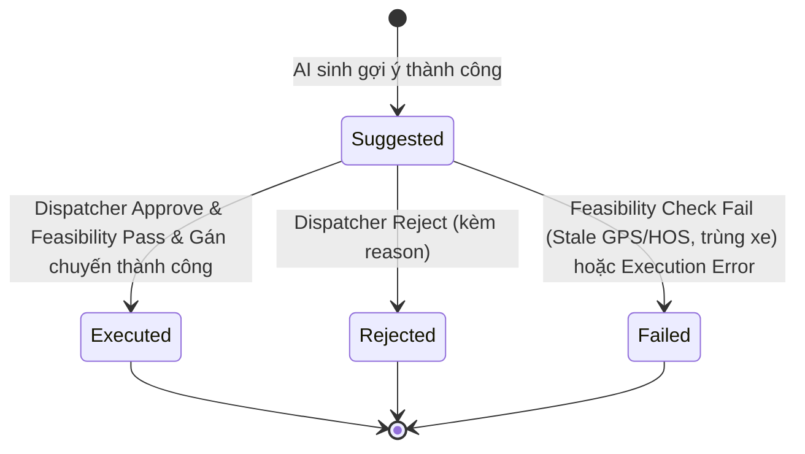

# LogisticsX AI Gap & AI Dispatch API Contract (Thực Tế vs v0)

> Tài liệu đặc tả hợp đồng API cho phân hệ AI Hỏi (Gap Detection & Resolution) và AI Điều Phối (AI Dispatch & Optimization Integration) trong dự án LogisticsX TMS Backend.
> Phiên bản: v1.0 (Đối soát trực tiếp từ mã nguồn thực tế và kiểm thử tự động).

---

## 1. Bảng so sánh giữa Đặc tả v0 và Triển khai Thực tế

| Hạng mục / Endpoint v0 | Đường dẫn triển khai thực tế | Trạng thái | HTTP Method & Response DTO | Ghi chú so với v0 |
|---|---|---|---|---|
| Prefix chung | `/api/ai/...` | ĐÃ CÓ | N/A | Quy chuẩn repo bắt buộc tiền tố `/api/...` cho toàn bộ Spring Boot Controllers. |
| Envelope chung | `ApiResponse<T>` | ĐÃ CÓ | N/A | Mọi response bọc trong envelope chuẩn của TMS (`success`, `code`, `message`, `data`, `meta`, `errors`, `params`). |
| `/ai/features` | `/api/ai/features` | **ĐÃ CÓ** | `GET` -> `FeaturesView` | Trả về cờ tính năng theo tenant: `gapEnabled`, `dispatchEnabled`, `dryRun`, `autonomousLocked`, model, tokens, cooldown. |
| Trạng thái Load & Capabilities | `/api/ai/loads/{loadId}/status` | **ĐÃ CÓ** | `GET` -> `LoadStatusView` | Bắt buộc cho Frontend: trả về `capabilities` (`canApprove`, `canReject`, `canRerun`, `canViewRuns`), summary gap và decisions. |
| Tổng quan nhiều load (Overview) | `/api/ai/loads/overview` | **ĐÃ CÓ** | `POST` -> `List<LoadStatusView>` | Nhận body `{"loadIds": [...]}` (tối đa 100 loadIds với validate `@Size(max = 100)`). |
| Chạy lại (Rerun) | `/api/ai/loads/{loadId}/rerun` | **ĐÃ CÓ** | `POST` -> `RerunResult` | Nhận body `{"target": "gap" | "dispatch" | "both"}`. |
| Lịch sử chạy & Audit runs | `/api/ai/runs` | **ĐÃ CÓ** | `GET` -> `PagedResponse<RunAuditView>` | Hỗ trợ lọc theo `loadId`, `type`, `status`, phân trang `page`, `size`. Đầy đủ metrics tokens, cost, latency, error. |
| `/api/ai/gaps` | `/api/ai/gaps` | ĐÃ CÓ | `GET` -> `LoadGapsView` | Lọc theo `loadId`, `severity`, `status`. |
| `/api/ai/gaps/check` | `/api/ai/gaps/check` | ĐÃ CÓ | `POST` -> `CheckResult` | Phân tích chủ động một hoặc nhiều load. |
| `/api/ai/gaps/{id}/dismiss` | `/api/ai/gaps/{id}/dismiss` | ĐÃ CÓ | `POST` -> `AiLoadGap` | Chỉ cho phép dismiss gap `WARNING`, cấm dismiss gap `BLOCKING` (400 `GAP_CANNOT_DISMISS_BLOCKING`). |
| `/api/ai/gaps/{id}/answer` | `/api/ai/gaps/{id}/answer` | ĐÃ CÓ | `POST` -> `AiLoadGap` | Người phụ trách trả lời / xác nhận giá trị đề xuất. |
| `/api/ai/dispatch/runs` | `/api/ai/dispatch/runs` | ĐÃ CÓ | `POST` -> `RunResult` | Kích hoạt AI Dispatch. Kiểm tra chặn nếu còn gap BLOCKING (400 `BLOCKED_BY_GAP`), chặn Autonomous mode (400 `AUTONOMOUS_MODE_LOCKED`). |
| `/api/ai/dispatch/sessions` | `/api/ai/dispatch/sessions` | ĐÃ CÓ | `GET` -> `PagedResponse<AiDispatchSession>` | Danh sách phiên điều phối (phân trang, lọc theo status). |
| `/api/ai/dispatch/sessions/{id}` | `/api/ai/dispatch/sessions/{id}` | ĐÃ CÓ | `GET` -> `SessionDetail` | Chi tiết phiên điều phối kèm danh sách các gợi ý `AiDispatchDecision`. |
| `/api/ai/dispatch/pending` | `/api/ai/dispatch/pending` | ĐÃ CÓ | `GET` -> `List<Suggestion>` | Toàn bộ đề xuất đang ở trạng thái `Suggested` chờ duyệt. |
| `/api/ai/dispatch/decisions/{id}/approve` | `/api/ai/dispatch/decisions/{id}/approve` | ĐÃ CÓ | `POST` -> `Suggestion` | Phê duyệt gợi ý. Gọi domain service `LoadService.assignTruck(loadId, truckId)`, gán xe/tài xế vào Load. Quyền yêu cầu: `ADMIN`, `DISPATCHER`. |
| `/api/ai/dispatch/decisions/{id}/reject` | `/api/ai/dispatch/decisions/{id}/reject` | ĐÃ CÓ | `POST` -> `Suggestion` | Từ chối gợi ý (yêu cầu bắt buộc `reason`). |
| `/api/ai/dispatch/sessions/{id}/cancel` | `/api/ai/dispatch/sessions/{id}/cancel` | ĐÃ CÓ | `POST` -> `Map<String, String>` | Hủy phiên đang chạy. |
| `/api/ai/config` | `/api/ai/config` | ĐÃ CÓ | `GET` -> `ConfigView` | Cấu hình tham số AI hệ thống. |

---

## 2. Đặc tả Enum Trạng thái Quyết định (Decision Status Lifecycle)

Khớp chuẩn 100% với đặc tả nghiệp vụ `ai-dispatch.md`:



- **`Suggested`**: Trạng thái ban đầu sau khi AI Dispatch Session hoàn tất đánh giá và xếp hạng. Gợi ý hiển thị trên màn hình điều phối chờ con người xem xét.
- **`Approved`**: Trạng thái trung gian thể hiện con người đồng thuận với gợi ý. 
- **`Executed`**: **Trạng thái cuối cùng của một quyết định được chấp thuận**. Do quy trình gán chuyến diễn ra trong cùng một transaction nghiệp vụ với thao tác Approve (thông qua `LoadService.assignTruck`), sau khi cập nhật thành công xe và tài xế vào Load trong TMS, quyết định chuyển sang trạng thái bền vững là `Executed`.
- **`Rejected`**: Con người từ chối gợi ý. Bắt buộc cung cấp trường `reason` để hệ thống ghi nhận lý do phục vụ đánh giá và audit.
- **`Failed`**: Revalidation thất bại (ví dụ: dữ liệu GPS hoặc HOS của tài xế đã cũ quá 5 phút tại thời điểm bấm duyệt, hoặc xe đã bị gán cho chuyến khác) hoặc xảy ra lỗi trong quá trình gán chuyến TMS.

---

## 3. Chi tiết các Endpoint Bổ sung (Frontend Handoff)

### 3.1 `GET /api/ai/features`
Lấy cờ tính năng và cấu hình AI cho tenant hiện hành (hỗ trợ bật/tắt từng tenant).

**Response (`data`):**
```json
{
  "gapEnabled": true,
  "dispatchEnabled": true,
  "dryRun": false,
  "autonomousLocked": true,
  "defaultProvider": "Anthropic",
  "activeModel": "claude-haiku-4-5",
  "maxTokens": 4096,
  "cooldownMinutes": 5,
  "maxAsks": 3
}
```

---

### 3.2 `GET /api/ai/loads/{loadId}/status`
Truy vấn trạng thái tổng hợp AI của một load, bao gồm capabilities để UI quyết định ẩn/hiện nút bấm.

**Response (`data`):**
```json
{
  "loadId": "8fa88c03-5ac2-4303-a3d8-bf4cf1a3e81e",
  "loadStatus": "Draft",
  "hasBlockingGaps": false,
  "blockingGapCount": 0,
  "warningGapCount": 1,
  "hasPendingSuggestions": true,
  "activeDecisionId": "9a8b7c6d-5e4f-3a2b-1c0d-e9f8a7b6c5d4",
  "topSuggestedTruckNumber": "TRK-8899",
  "topSuggestedDriverName": "Nguyễn Văn A",
  "topScore": 0.88500000,
  "capabilities": {
    "canApprove": true,
    "canReject": true,
    "canRerun": true,
    "canViewRuns": true
  }
}
```

**Quy tắc xác định Capabilities:**
- `canApprove`: `hasPendingSuggestions == true` && `hasBlockingGaps == false` && `userHasRole('ADMIN', 'DISPATCHER')`.
- `canReject`: `hasPendingSuggestions == true` && `userHasRole('ADMIN', 'DISPATCHER')`.
- `canRerun`: `true` (cho phép chạy lại bất cứ lúc nào khi load chưa chuyển sang trạng thái đã giao / hủy).
- `canViewRuns`: `true`.

---

### 3.3 `POST /api/ai/loads/overview`
Truy vấn trạng thái AI cho một danh sách Load IDs (tối đa 100) để hiển thị badge/indicator trên bảng danh sách điều phối TMS.

**Request Body:**
```json
{
  "loadIds": [
    "8fa88c03-5ac2-4303-a3d8-bf4cf1a3e81e",
    "b774ce0a-95fd-4d48-97b8-cc720423e4ec"
  ]
}
```

**Response (`data`):** Danh sách `LoadStatusView` tương ứng với từng load hợp lệ trong tenant.

---

### 3.4 `POST /api/ai/loads/{loadId}/rerun`
Yêu cầu AI đánh giá lại cho load cụ thể.

**Request Body:**
```json
{
  "target": "both"
}
```
*(Các giá trị hợp lệ của `target`: `"gap"`, `"dispatch"`, `"both"`).*

**Response (`data`):**
```json
{
  "loadId": "8fa88c03-5ac2-4303-a3d8-bf4cf1a3e81e",
  "target": "both",
  "gapAnalyzed": true,
  "dispatchTriggered": true,
  "message": "Rerun completed successfully"
}
```

---

### 3.5 `GET /api/ai/runs`
Truy vấn nhật ký chạy (audit run) phục vụ giám sát token, chi phí, độ trễ và chất lượng mô hình.

**Query Parameters:**
- `loadId` (UUID, optional): Lọc theo Load ID.
- `type` (String, optional): `GAP_EVALUATION`, `DISPATCH_OPTIMIZATION`.
- `status` (String, optional): `SUCCESS`, `FAILED`, `FALLBACK`.
- `page` (int, default: 0), `size` (int, default: 20, max: 100).

**Response (`data`):**
```json
{
  "content": [
    {
      "id": "e0e85d9b-a01b-4f0e-b73a-4e2b0a9f5c1d",
      "tenantId": "tenant-default",
      "runType": "DISPATCH_OPTIMIZATION",
      "status": "SUCCESS",
      "loadId": "8fa88c03-5ac2-4303-a3d8-bf4cf1a3e81e",
      "modelName": "claude-haiku-4-5",
      "promptVersion": "v1.0",
      "inputTokens": 1250,
      "outputTokens": 380,
      "totalTokens": 1630,
      "costUsd": 0.003200,
      "latencyMs": 420,
      "errorMessage": null,
      "createdAt": "2026-10-16T10:30:00Z"
    }
  ],
  "page": 0,
  "size": 20,
  "totalElements": 1,
  "totalPages": 1
}
```

---

## 4. Các Endpoint Nghiệp vụ Chi tiết

### 4.1 Phân hệ AI Gap
- `GET /api/ai/gaps`: Lọc danh sách gap.
- `POST /api/ai/gaps/check`: Kiểm tra chủ động.
- `POST /api/ai/gaps/{id}/dismiss`: Bỏ qua gap warning (lỗi `GAP_CANNOT_DISMISS_BLOCKING` nếu là blocking).
- `POST /api/ai/gaps/{id}/answer`: Trả lời gap.

### 4.2 Phân hệ AI Dispatch
- `POST /api/ai/dispatch/runs`: Chạy gợi ý điều phối AI.
- `GET /api/ai/dispatch/sessions`: Phân trang phiên điều phối.
- `GET /api/ai/dispatch/sessions/{id}`: Chi tiết phiên và danh sách quyết định.
- `GET /api/ai/dispatch/pending`: Danh sách gợi ý đang chờ duyệt (`Suggested`).
- `POST /api/ai/dispatch/decisions/{id}/approve`: Duyệt gợi ý. Gọi `LoadService.assignTruck`, chuyển trạng thái thành `Executed`.
- `POST /api/ai/dispatch/decisions/{id}/reject`: Từ chối gợi ý (yêu cầu trường `reason`).
- `POST /api/ai/dispatch/sessions/{id}/cancel`: Hủy phiên.
- `GET /api/ai/config`: Cấu hình tham số AI.

---

## 5. Bảng Mã Lỗi Nghiệp Vụ (Error Codes)

| Mã lỗi | HTTP Status | Ý nghĩa nghiệp vụ |
|---|---|---|
| `BLOCKED_BY_GAP` | 400 | Load còn gap BLOCKING chưa giải quyết, không thể chạy điều phối. |
| `GAP_NOT_FOUND` | 404 | Không tìm thấy gap ID tương ứng. |
| `GAP_CANNOT_DISMISS_BLOCKING` | 400 | Không thể dismiss gap có mức độ nghiêm trọng BLOCKING. |
| `GAP_ALREADY_RESOLVED` | 400 | Gap đã được giải quyết hoặc đã đóng trước đó. |
| `AI_DISPATCH_DISABLED` | 403 | Tính năng AI Dispatch đang tắt ở cấu hình hệ thống hoặc tenant. |
| `AUTONOMOUS_MODE_LOCKED` | 400 | Chế độ Autonomous hiện đang bị khóa, chỉ hỗ trợ HumanInTheLoop. |
| `DECISION_NOT_PENDING` | 400 | Quyết định không ở trạng thái Suggested để duyệt hoặc từ chối (ví dụ đã Approve/Reject trước đó). |
| `REJECTION_REASON_REQUIRED` | 400 | Từ chối gợi ý bắt buộc phải nhập lý do cụ thể (`reason`). |
| `FEASIBILITY_FAILED` | 409 | Revalidation kiểm tra khả thi thất bại (dữ liệu HOS/GPS đã stale hoặc tài xế/xe bị trùng lịch). |
| `LLM_BUDGET_EXCEEDED` | 429 | Hạn mức token/chi phí LLM của tenant trong ngày đã vượt ngưỡng. |
| `LLM_PROVIDER_TIMEOUT` | 504 | Nhà cung cấp LLM không phản hồi kịp thời (hệ thống tự fallback). |
