# CHƯƠNG 2. PHÂN TÍCH YÊU CẦU HỆ THỐNG — BẢN NHÁP TỪNG PHẦN

## 2.1. Khảo sát nghiệp vụ

Load trong mã lưu khách hàng, các điểm lấy và giao, ngày yêu cầu, chi phí và thông tin phân công. Giao diện đặt nhãn “đơn hàng”; thực thể `TripStop` tham chiếu Load và Trip riêng biệt. Vì vậy tài liệu giữ tên Load, không đồng nhất Load với chuyến. Nguồn: `entity/Load.java`, `entity/TripStop.java`; frontend `src/pages/loads/create.tsx`.

## 2.2. Yêu cầu chức năng

Bảng 2.1 mô tả phạm vi đã đối chiếu tĩnh; chưa đại diện toàn bộ hệ thống.

| Mã | Yêu cầu |
|---|---|
| UC001 | Tạo Load với khách hàng và dữ liệu vận chuyển. |
| UC002 | Cập nhật Load, kiểm tra phiên bản và nguồn ngày nghiệp vụ. |
| UC003 | Xem thông tin chi tiết Load. |
| UC004 | Xem trạng thái và các sự kiện timeline của Load. |
| UC005 | Tra cứu hàng đợi Load. |
| UC006 | Xóa Load (cần xác minh giao diện). |
| UC007 | Điều chỉnh ngày nghiệp vụ (UI đang bị tắt). |

## 2.3. Yêu cầu phi chức năng

Mã thể hiện kiểm tra quyền, kiểm tra DTO, phân trang và giao dịch; đây là cơ chế kỹ thuật, chưa chứng minh mục tiêu hiệu năng, độ sẵn sàng hoặc nghiệm thu. Nguồn: `SecurityConfig`, `LoadController`, `PaginationValidator`, `LoadService`.

## 2.4. Tác nhân

Trong phạm vi API Load, `SecurityConfig` cho phép ADMIN, ACCOUNTANT và DISPATCHER. Tên vai trò kỹ thuật không khẳng định chức danh nhân sự thực tế; các quyền dữ liệu phụ cần xét riêng.

## 2.5–2.6. Biểu đồ use case

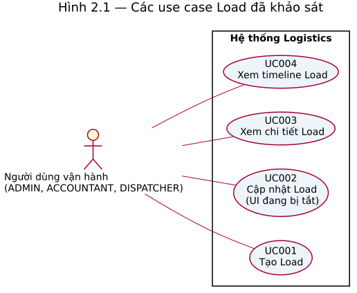

**Hình 2.1. Các use case Load đã khảo sát.** Người dùng có một trong ba vai trò tương tác với bốn mục tiêu nằm trong ranh giới hệ thống. Không thể coi hình này là biểu đồ tổng thể vì các module khác chưa phân tích đầy đủ. Nguồn: `SecurityConfig`, `LoadController`, `LoadTimelineController` và các trang Load frontend.

## 2.7. Đặc tả use case

Đặc tả UC001–UC004, dữ liệu vào/ra, ngoại lệ và ca kiểm thử dự kiến được trình bày trong [tệp đặc tả](../03-usecase-specifications/UC001-UC004-Load.md). Đây là phân tích tĩnh, chưa phải kết quả kiểm thử.

## 2.8. Biểu đồ hoạt động

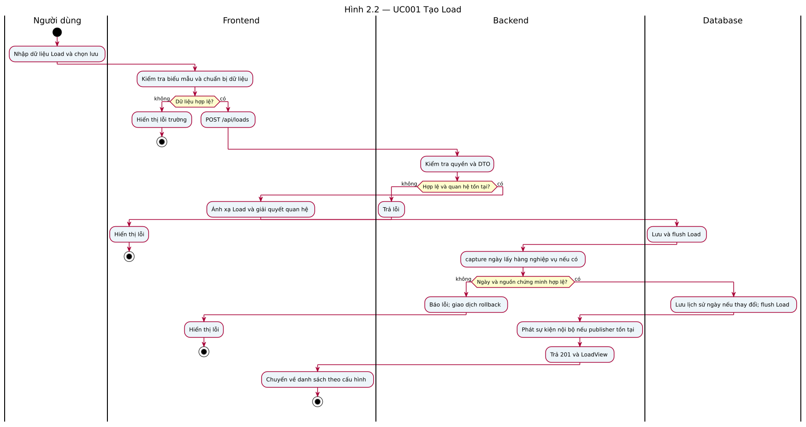

**Hình 2.2. Hoạt động UC001.** Người dùng cung cấp dữ liệu, frontend kiểm tra rồi gửi yêu cầu; backend xác thực DTO và quan hệ, lưu Load, xử lý ngày nghiệp vụ và phản hồi. Nhánh lỗi không hoàn tất giao dịch. Nguồn: `LoadCreate`, `LoadForm`, `LoadService.create`, `LoadPickupBusinessDateService.capture`.

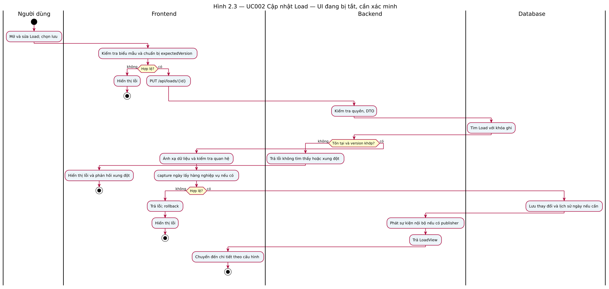

**Hình 2.3. Hoạt động UC002.** Mã cập nhật khóa bản ghi và kiểm tra phiên bản trước khi lưu. Route sửa hiện không được mount vì cờ runtime false; hình là bản nháp cần xác minh. Nguồn: `LoadEdit`, `LoadService.update`, `LoadRepository.findByIdForUpdate`.

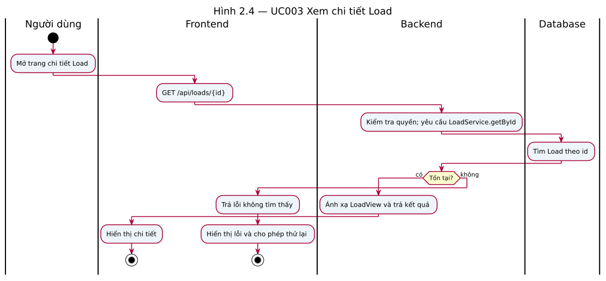

**Hình 2.4. Hoạt động UC003.** Backend tìm theo id, chuyển sang DTO hoặc trả lỗi không tìm thấy. Nguồn: `LoadShow`, `LoadController.getById`, `LoadService.getById`.

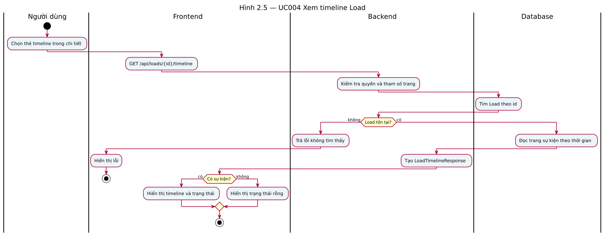

**Hình 2.5. Hoạt động UC004.** Service kiểm tra Load và đọc một trang sự kiện; frontend phân biệt có dữ liệu và danh sách rỗng. Nguồn: `LoadTimelinePanel`, `LoadTimelineController`, `LoadTimelineService`.

## 2.9. Tổng kết chương

Phần hiện tại chỉ khảo sát bốn use case trong module Load. Các module còn lại, biểu đồ tổng thể và danh mục đầy đủ chưa được xác minh.

## Bổ sung lô Load

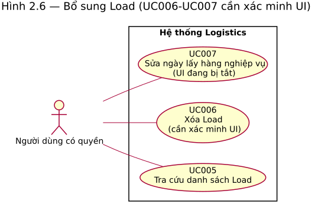

**Hình 2.6. Các mục tiêu Load bổ sung.** UC005 có mã điều phối và API; UC006 và UC007 được đánh dấu cần xác minh UI. Nguồn: `LoadController`, `LoadPickupBusinessDateController`, frontend `DispatchPage` và `PickupBusinessDateForm`.

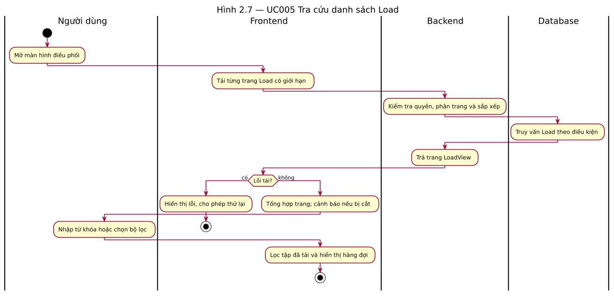

**Hình 2.7. Hoạt động UC005.** Client tải các trang có giới hạn và lọc tập đã tải; nếu vượt giới hạn, giao diện cảnh báo. Nguồn: `DispatchPage`, `useTmsLoads`, `fetchAllLoads`, `LoadService.search`.

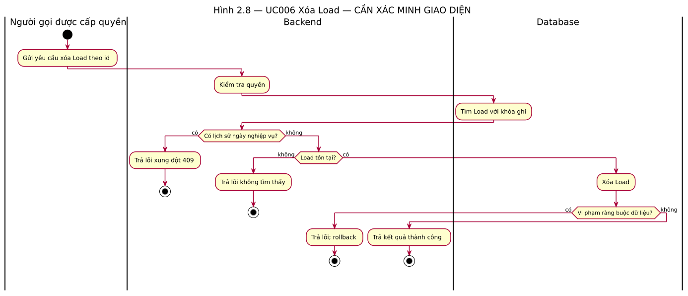

**Hình 2.8. Hoạt động UC006, cần xác minh UI.** Backend bảo vệ lịch sử ngày và kiểm tra tồn tại trước xóa. Nguồn: `LoadService.delete`.

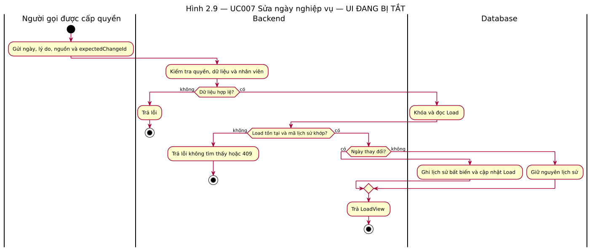

**Hình 2.9. Hoạt động UC007, UI đang bị tắt.** Backend kiểm tra actor, provenance và mã lịch sử; chỉ ghi lịch sử khi ngày thay đổi. Nguồn: `LoadPickupBusinessDateService.remediate`, `capture`. Đặc tả trong `../03-usecase-specifications/UC005-UC007-Load.md`.

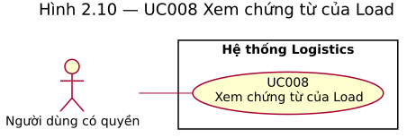

**Hình 2.10. UC008 — Xem chứng từ của Load.** Người dùng có quyền mở tab chứng từ của Load; phạm vi là tra cứu metadata, không khẳng định có upload hoặc xác nhận POD. Nguồn: `LoadDocumentsPanel`, `DocumentController.search`, `SecurityConfig`.

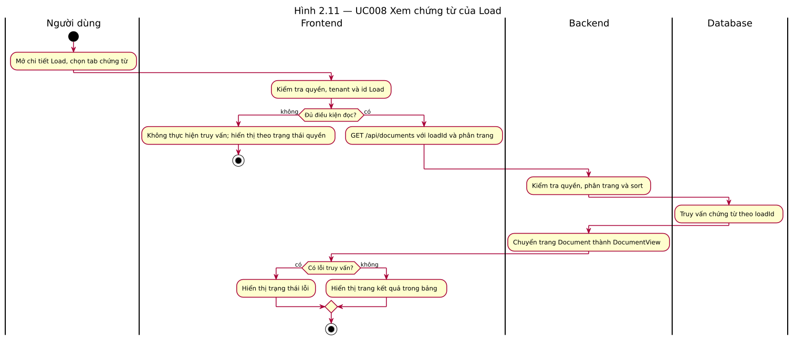

**Hình 2.11. Hoạt động UC008.** Giao diện chỉ truy vấn khi có id, tenant và quyền; backend lọc chứng từ theo Load và trả trang. Trường hợp bị từ chối hoặc lỗi được xử lý riêng. Nguồn: `LoadDocumentsPanel`, `DocumentService.search`, `DocumentRepository.search`.
