# CHƯƠNG 3. THIẾT KẾ HỆ THỐNG — BẢN NHÁP TỪNG PHẦN

## 3.1–3.2. Kiến trúc tổng thể và thành phần

Frontend React gọi API backend Spring Boot; cấu hình repository chỉ ra PostgreSQL. Chưa hoàn thành sơ đồ thành phần, triển khai hay xác minh môi trường production. Nguồn: `pom.xml`, frontend `package.json`, `application.yml`, `docker-compose.yml`.

## 3.3. Biểu đồ lớp

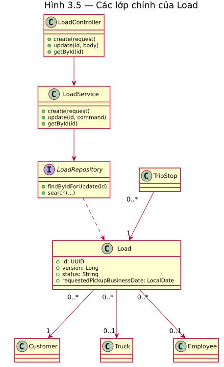

**Hình 3.5. Các lớp chính liên quan Load.** Controller gọi service, service dùng repository; Load liên kết khách hàng bắt buộc và xe, điều phối viên tùy chọn. TripStop liên kết Load. Đây là trích đoạn, không phải mô hình đầy đủ. Nguồn: `LoadController`, `LoadService`, `LoadRepository`, `Load`, `TripStop`.

## 3.4. Biểu đồ tuần tự

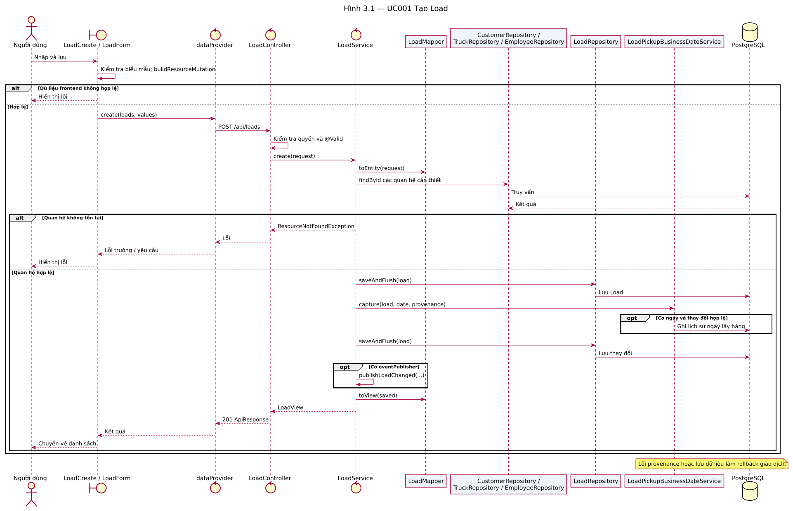

**Hình 3.1. Tuần tự UC001.** `LoadCreate` và data provider gửi dữ liệu tới controller; service ánh xạ, kiểm tra quan hệ, lưu và xử lý ngày nghiệp vụ. Lỗi provenance hoặc lưu làm rollback. Nguồn: `LoadController.create`, `LoadService.create`, `LoadPickupBusinessDateService.capture` và frontend `LoadCreate`.

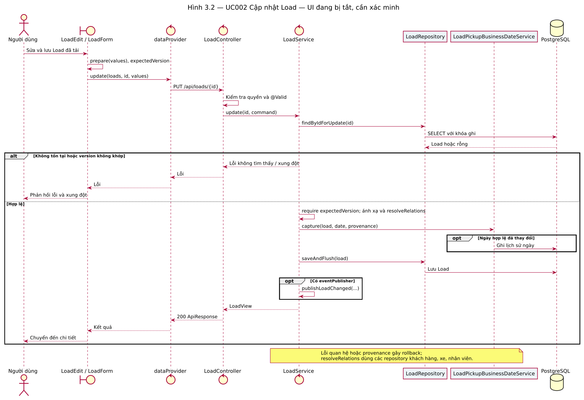

**Hình 3.2. Tuần tự UC002 — UI đang bị tắt.** Route sửa không được mount khi cờ runtime false; luồng là bản nháp cần xác minh. Service khóa Load và đối chiếu `expectedVersion` trước khi ghi; sự kiện nội bộ tùy thuộc publisher. Nguồn: `LoadEdit`, `LoadService.update`, `LoadRepository`.

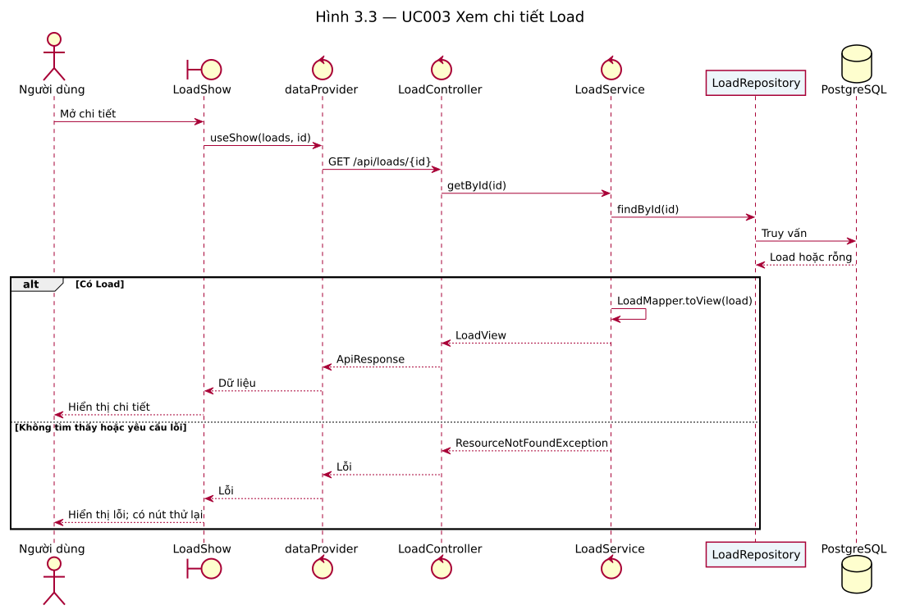

**Hình 3.3. Tuần tự UC003.** Giao diện lấy dữ liệu qua data provider, service tìm theo id và chuyển DTO; nhánh không tìm thấy trả lỗi. Nguồn: `LoadShow`, `LoadController.getById`, `LoadService.getById`.

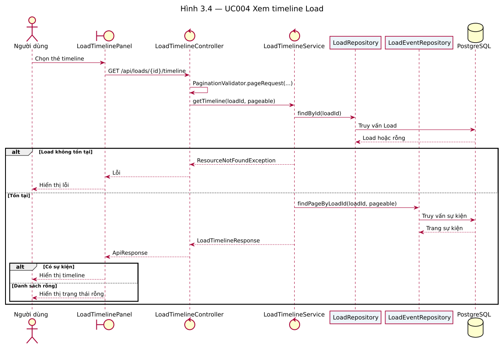

**Hình 3.4. Tuần tự UC004.** Controller tạo phân trang, service tìm Load và đọc sự kiện; giao diện hiển thị rỗng nếu không có kết quả. Nguồn: `LoadTimelinePanel`, `LoadTimelineController`, `LoadTimelineService`.

## 3.5. Biểu đồ trạng thái

Chưa hoàn thành: status của Load là chuỗi; các giá trị lựa chọn trên giao diện không đủ chứng minh một máy trạng thái và mọi điều kiện chuyển trạng thái.

## 3.6–3.7. Thiết kế cơ sở dữ liệu và ERD

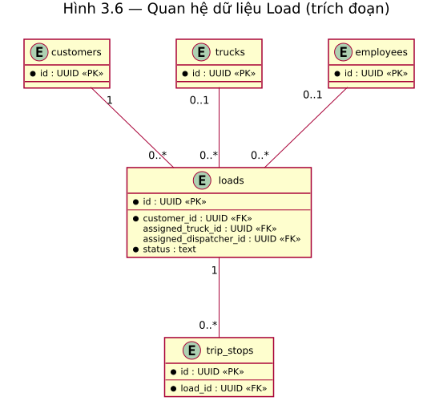

**Hình 3.6. Trích đoạn quan hệ Load.** Mỗi Load có một khách hàng, xe và điều phối viên tùy chọn; mỗi TripStop liên kết một Load. Nguồn: `entity/Load.java`, `entity/TripStop.java`, `db/migration/tenant/V1__baseline_business_schema.sql`. Các quan hệ và ràng buộc khác chưa được mô tả.

## 3.8. Thiết kế API

Bốn API có trong ma trận truy vết; các request, response và lỗi xem đặc tả UC001–UC004. Chưa hoàn thiện danh mục API toàn hệ thống.

## 3.9. Bảo mật và phân quyền

`SecurityConfig` yêu cầu ADMIN, ACCOUNTANT hoặc DISPATCHER cho đường dẫn Load thông thường; các matcher cụ thể hơn có thể áp dụng cho nghiệp vụ chuyên biệt. Kiểm tra này chưa xác minh cấu hình hoặc identity đang vận hành.

## 3.10. Tổng kết chương

Thiết kế hiện là trích đoạn Load dựa trên mã, cần mở rộng và kiểm chứng trước khi dùng làm tài liệu cuối cùng.

## Bổ sung tuần tự Load

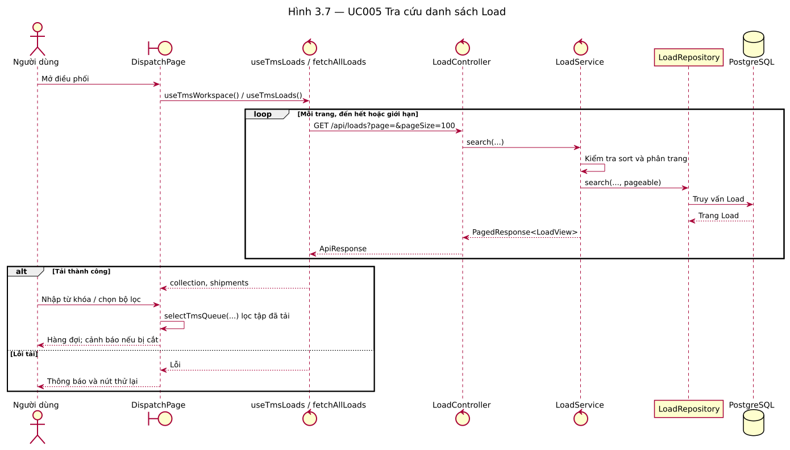

**Hình 3.7. UC005.** API đọc từng trang, giao diện lọc tập đã tải. Nguồn: `fetchAllLoads`, `LoadController.search`, `LoadService.search`, `LoadRepository.search`.

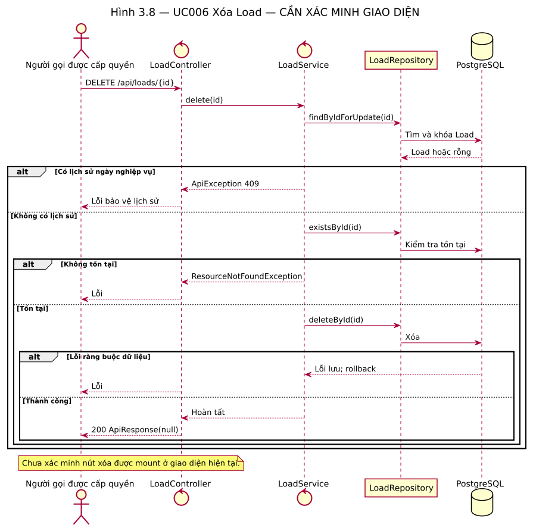

**Hình 3.8. UC006 — cần xác minh UI.** API kiểm tra lịch sử và sự tồn tại trước xóa. Nguồn: `LoadController.delete`, `LoadService.delete`.

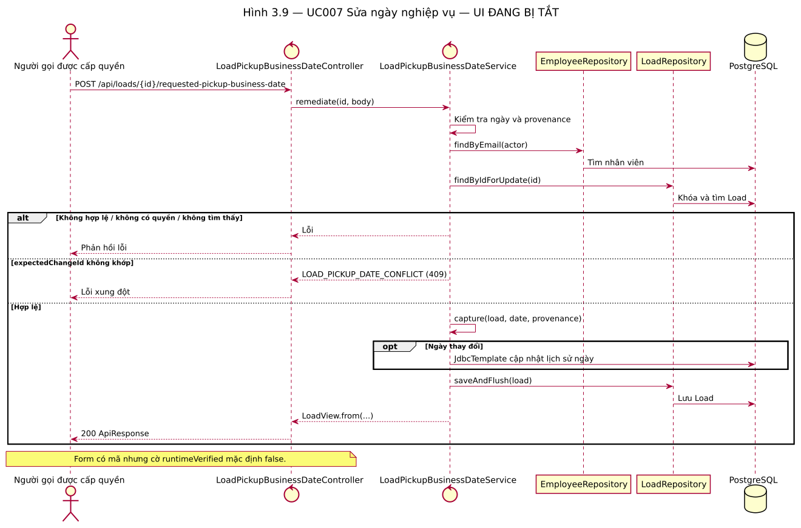

**Hình 3.9. UC007 — UI đang bị tắt.** Service đối chiếu actor, mã lịch sử và ghi lịch sử bằng JDBC khi ngày thay đổi. Nguồn: `LoadPickupBusinessDateController`, `LoadPickupBusinessDateService`.

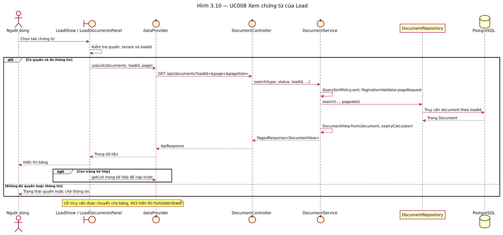

**Hình 3.10. UC008.** Panel, data provider, controller, service, repository và database trao đổi để đọc một trang chứng từ theo `loadId`; có thể nạp trước trang kế tiếp. Thứ tự chi tiết và lỗi được ghi trong [đặc tả UC008](../03-usecase-specifications/UC008-XemChungTuLoad.md). Nguồn: `LoadDocumentsPanel`, `DocumentController`, `DocumentService`, `DocumentRepository`.

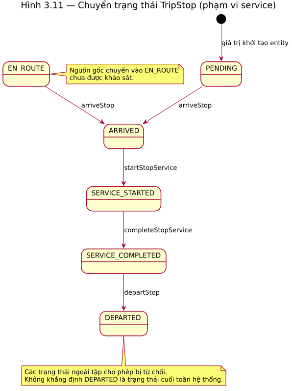

**Hình 3.11. Chuyển trạng thái TripStop trong phạm vi service.** Giá trị mới mặc định là PENDING; `arriveStop` chấp nhận PENDING hoặc EN_ROUTE, sau đó lần lượt bắt đầu dịch vụ, hoàn thành dịch vụ và rời điểm. Các trạng thái không hợp lệ bị từ chối. Chưa xác định nguồn chuyển vào EN_ROUTE và chưa chứng minh DEPARTED là trạng thái cuối toàn hệ thống. Nguồn: `entity/TripStop.java`, `service/TripExecutionService.java`.

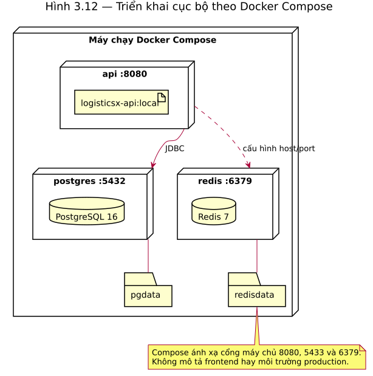

**Hình 3.12. Triển khai cục bộ.** Compose khai báo API, PostgreSQL, Redis và volume dữ liệu; API được cấu hình kết nối PostgreSQL và Redis. Sơ đồ không chứng minh môi trường production hoặc sự hiện diện của frontend trong Compose. Nguồn: `docker-compose.yml`, `Dockerfile`.

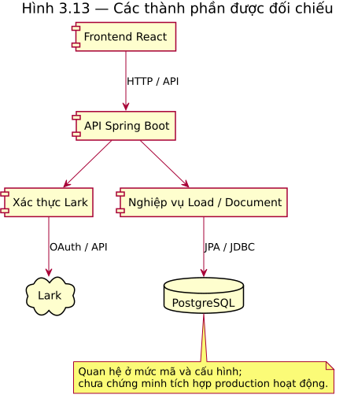

**Hình 3.13. Thành phần được đối chiếu.** Frontend sử dụng HTTP, backend xử lý Load/chứng từ, truy cập PostgreSQL và có tích hợp xác thực Lark. Sơ đồ là trích đoạn kiến trúc source, chưa chứng minh tích hợp ngoài đang chạy. Nguồn: frontend `src/providers/dataProvider.ts`, `src/pages/resourceRegistry.ts`; backend `LoadController`, `DocumentController`, `LarkAuthController`, `application.yml`.
