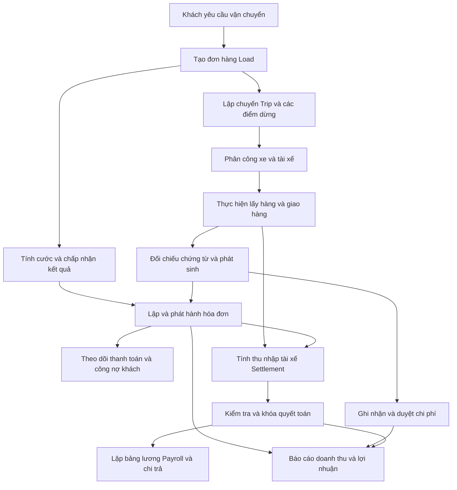
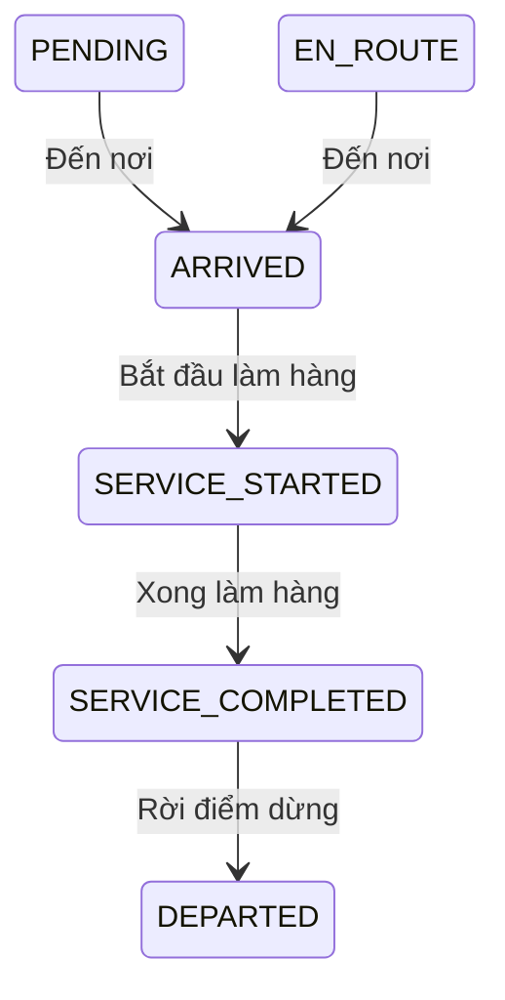

# Giải thích nghiệp vụ LogisticsX

**Ngày đối chiếu:** 17/10/2026.  
**Đối tượng:** Chủ doanh nghiệp vận tải, quản lý vận hành, điều phối, kế toán và người mới tìm hiểu hệ thống.  
**Phạm vi:** Backend Java/Spring Boot trong repository `logictics_api`, bao gồm mã nguồn đang sửa và các phân hệ mới chưa commit tại thời điểm đối chiếu. Tài liệu mô tả hành vi trong mã nguồn, không xác nhận phiên bản đã triển khai hoặc kết nối nhà cung cấp thật.

## 1. Hệ thống giải quyết việc gì?

LogisticsX quản lý công việc của doanh nghiệp vận tải: khách thuê chở hàng gì, xe nào đi, ai lái, đã lấy/giao hàng chưa, khách phải trả bao nhiêu, doanh nghiệp phát sinh chi phí gì và tài xế được hưởng bao nhiêu.

Mỗi công ty vận tải là một **tenant**, có dữ liệu vận hành riêng. Khách hàng thuê chở hàng là **Customer** bên trong công ty đó. Ví dụ: nhà xe A là tenant; công ty B thuê nhà xe A vận chuyển là customer. Hai khái niệm này quyết định phạm vi dữ liệu và công nợ khác nhau.

Quy trình tổng thể:



Sơ đồ thể hiện quan hệ nghiệp vụ. Các bước tính cước, phát hành hóa đơn, khóa quyết toán và thanh toán có lệnh xử lý riêng. Không nên hiểu các mũi tên là mọi bước đều tự động chạy sau khi bước trước hoàn tất; sơ đồ cũng không bổ sung điều kiện chặn chưa có trong mã nguồn, như bắt buộc giao xong mới được lập mọi loại hóa đơn.

## 2. Các khái niệm cần phân biệt

| Khái niệm | Hiểu theo công việc hằng ngày | Ví dụ |
|---|---|---|
| Load | Một yêu cầu vận chuyển của khách | Chở hàng của khách B từ kho X đến kho Y |
| Trip | Một chuyến thực hiện của xe, có danh sách điểm dừng | Xe 01 lấy và giao hàng cho nhiều Load |
| Trip Stop | Một điểm lấy/giao hàng trong chuyến, có thứ tự và thời gian | Điểm 1 lấy hàng; điểm 2 giao hàng |
| Driver Assignment | Lịch sử tài xế được phân công cho chuyến trong khoảng thời gian cụ thể | Tài xế A chạy chặng đầu, tài xế C nhận chặng sau |
| Rating | Tính giá cước bán cho khách theo chính sách | Cước chính, phụ thu nhiên liệu, phụ phí |
| Invoice | Chứng từ xác định khoản khách phải trả | Hóa đơn vận chuyển và thuế đã được xác định |
| Payment | Bản ghi thanh toán của khách gắn với hóa đơn | Khách thanh toán một phần hóa đơn |
| Expense | Khoản chi được khai báo và xét duyệt | Dầu, cầu đường, sửa chữa |
| Shipment Cost | Dòng trong sổ chi phí vận chuyển, dùng cho tính toán tài chính theo điều kiện | Chi phí tài xế được ghi khi khóa settlement |
| Accessorial | Khoản phát sinh ngoài cước chính | Chờ kho, bốc xếp, dừng thêm |
| Settlement | Bảng quyết toán thu nhập và các khoản điều chỉnh của tài xế | Tiền theo dặm, theo đơn, phụ cấp, khấu trừ |
| Payroll Run | Đợt xử lý lương, gồm nhiều khoản của nhân viên | Đợt lương kỳ 01–15 của tháng |
| Payslip | Phiếu lương chụp lại kết quả đã chốt | PDF thể hiện thu nhập, khấu trừ và thực lĩnh |
| Snapshot | Bản lưu căn cứ và kết quả của một quyết định tính toán | Giá đã được chấp nhận kèm phiên bản chính sách |

Một Load có thể xuất hiện ở nhiều điểm dừng. Một Trip có thể phục vụ nhiều Load. Vì vậy, chi phí hay số dặm của cả chuyến không mặc nhiên là chi phí hay số dặm riêng của từng đơn hàng.

Năm con số thường bị nhầm:

| Con số | Ý nghĩa |
|---|---|
| Giá cước báo khách | Giá thương mại ghi trên Load; trường hiện tại là `deliveryCostAmount` |
| Doanh thu ghi nhận | Tổng tiền trước thuế của các hóa đơn đủ điều kiện, có tính dấu tăng/giảm của chứng từ |
| Tiền đã thu | Khoản thanh toán có trạng thái hoàn tất được báo cáo chấp nhận |
| Công nợ còn lại | Khoản khách còn phải trả sau khi đối chiếu hóa đơn và thanh toán |
| Lợi nhuận | Doanh thu trừ các chi phí đủ điều kiện, theo cách phân loại và phạm vi dữ liệu của báo cáo |

**`deliveryCostAmount` là giá bán cho khách.** Tên trường có chữ “cost” nhưng không có nghĩa đây là chi phí vận hành của nhà xe. Doanh thu cũng có thể đã ghi nhận trong khi khách chưa trả tiền.

## 3. Ai phụ trách việc gì?

| Nhóm người dùng | Công việc được hỗ trợ trong backend hiện tại |
|---|---|
| `ADMIN` | Quản lý dữ liệu, vai trò và các cấu hình/chính sách thuộc quyền quản trị |
| `DISPATCHER` | Quản lý đơn, chuyến, xe, tài xế; thao tác điểm dừng; chạy/chấp nhận tối ưu; xử lý gợi ý AI và đồng bộ Lark theo quyền |
| `ACCOUNTANT` | Giá cước, hóa đơn, thanh toán khách, duyệt chi phí/phụ phí và báo cáo tài chính |
| `PAYROLL`, `PAYROLL_MANAGER` | Chính sách thu nhập tài xế, kỳ lương, settlement, payroll, chi trả và các báo cáo được cấp quyền |
| Tài xế đã đăng nhập | Xem phiếu lương/PDF thuộc chính mình qua luồng kiểm tra quyền sở hữu |

Đây là cách phân công trách nhiệm theo các nhóm quyền đang có, không phải danh sách toàn bộ quyền của từng màn hình. Đặc biệt, quyền tạo khoản phát sinh không đồng nghĩa quyền duyệt khoản đó; quyền điều phối không đồng nghĩa quyền phê duyệt tài chính.

Các lệnh tài chính quan trọng lấy người thao tác từ tài khoản đã xác thực và hồ sơ Employee trong công ty hiện hành. Tên người duyệt do phía gọi tự truyền vào không thay thế được danh tính đã xác thực.

## 4. Nhận đơn, lập chuyến và thực hiện vận chuyển

### 4.1. Tiếp nhận Load

Người phụ trách ghi nhận khách hàng, điểm lấy/giao, tọa độ, lịch hẹn, giá cước và tiền tệ, loại hàng, nguồn đơn và người điều phối. Hàng nguy hiểm có thêm thông tin phân loại và mã UN.

Hai loại ngày phục vụ hai mục đích:

| Dữ liệu | Mục đích |
|---|---|
| Lịch hẹn lấy/giao có giờ và múi giờ | Điều phối, so sánh thời gian thực hiện và lịch hẹn |
| Ngày lấy hàng nghiệp vụ `requestedPickupBusinessDate` | Chọn chính sách tính cước có hiệu lực trong ngày đó |

Ngày nghiệp vụ phải được ghi nhận rõ ràng, kèm nguồn và lý do. Hệ thống không tự lấy phần ngày từ lịch hẹn hoặc dùng ngày hiện tại để thay thế. Sửa ngày đã có bằng chứng tạo thêm lịch sử hiệu chỉnh, giữ người sửa và căn cứ cũ.

Ví dụ: lịch hẹn `16/10 lúc 23:30, UTC−07` tương ứng `17/10` theo UTC. Ngày tính cước vẫn phải là ngày nghiệp vụ đã được xác nhận riêng; không tự đổi thành `17/10` chỉ vì cách lưu thời gian.

### 4.2. Lập Trip và phân công tài xế

Trip gom các điểm dừng theo thứ tự và liên kết với xe. Phân công tài xế có thời điểm bắt đầu/kết thúc và vai trò `PRIMARY`, `SECONDARY`, `TEAM` hoặc `RELIEF`.

Khi đổi tài xế, bản phân công cũ được đóng khoảng hiệu lực để giữ lịch sử. Đây là căn cứ trả lời “ai thực hiện công việc vào lúc phát sinh”, thay vì chỉ nhìn tài xế chính hiện tại của xe. Việc trả lương theo dặm còn cần số dặm được xác nhận cho chính phân công đó.

### 4.3. Ghi nhận tại điểm dừng

Luồng điểm dừng đang được kiểm soát trực tiếp:



Mỗi bước ghi thời gian tương ứng. Không thể ghi rời điểm dừng bằng lệnh này khi chưa hoàn tất bước làm hàng. Thời gian từ đến nơi đến rời đi là căn cứ tính lưu tại kho/bãi; thời gian làm hàng có mốc bắt đầu và kết thúc riêng.

Load có timeline lưu sự kiện, thời gian, nguồn, trạng thái và chứng từ liên quan. Màn hình cần đối chiếu trạng thái đơn, chuyến, điểm dừng và timeline như những thông tin liên quan nhưng riêng biệt.

**Giới hạn hiện tại:** Các trạng thái Load/Trip vẫn là chuỗi trong nhiều luồng CRUD. Các tên quen thuộc như `DRAFT`, `DISPATCHED`, `PICKED_UP`, `DELIVERED`, `COMPLETED`, `CANCELLED` mô tả vòng đời vận hành, nhưng không chứng minh mọi chuyển tiếp đều có bộ kiểm soát thống nhất. Nhánh gán xe mới còn đặt Load thành `ASSIGNED`. Lệnh cập nhật điểm dừng hiện chỉ cập nhật điểm dừng; không tự chứng minh Load đã giao, Trip đã hoàn tất hoặc hóa đơn đã phát hành.

Khi sửa Load/Trip qua lệnh cập nhật có phiên bản, người dùng phải gửi phiên bản đang xem. Dữ liệu đã bị người khác thay đổi cần được tải lại trước khi sửa tiếp, tránh ghi đè kế hoạch mới bằng thông tin cũ.

## 5. Tính giá cước bán cho khách

### 5.1. Chọn chính sách

Giá được xác định theo khách hàng, ngày lấy hàng nghiệp vụ, tiền tệ và các điều kiện đã cấu hình như tuyến, thiết bị hoặc mức dịch vụ. Hợp đồng và quy tắc có phiên bản; sửa chính sách bằng cách công bố phiên bản mới.

Quy tắc khớp điều kiện dùng **số ưu tiên nhỏ hơn**. Nếu có nhiều quy tắc cùng thắng ở mức ưu tiên cao nhất, hệ thống báo mơ hồ để người có trách nhiệm xử lý. Nó không tự chọn bản mới nhất hoặc quy tắc có nhiều điều kiện hơn.

### 5.2. Các thành phần giá

| Thành phần | Cách hiểu và điều kiện |
|---|---|
| Cước chính `FLAT` | Giá trọn gói theo quy tắc |
| Cước chính `PER_MILE` | Số dặm đủ điều kiện × đơn giá theo dặm |
| Mức tối thiểu/tối đa | Giới hạn tiền cước chính nếu quy tắc có cấu hình |
| Phụ thu nhiên liệu `FSC` | Tính riêng khi có chính sách nhiên liệu và dữ liệu hợp lệ |
| Phụ phí được chọn | Phần thu khách của các Accessorial đã duyệt và thuộc đúng Load |

V1 tính cước chính theo `FLAT` và `PER_MILE`. Các phương pháp khác chưa được hỗ trợ không tự chuyển về cách tính mặc định.

Số dặm của từng thành phần phải có căn cứ phù hợp. Bằng chứng dặm theo hợp đồng được ghi riêng cho Load và thành phần tương ứng. Các trường khoảng cách cũ `Load.distance`, `Trip.totalDistance` chưa chứng minh được đơn vị, nguồn và ý nghĩa, nên không được dùng thay cho số dặm tài chính đã xác nhận. Các nguồn dặm kế hoạch/thực tế ở cấp Load chưa có bộ cung cấp đủ điều kiện sẽ trả không khả dụng.

Với chính sách nhiên liệu `INDEX_BASED_MPG`:

```text
Phụ thu mỗi dặm = max(0, giá nhiên liệu chỉ số − giá nhiên liệu gốc) / MPG hợp đồng
Tiền phụ thu = phụ thu mỗi dặm sau làm tròn × số dặm FSC đủ điều kiện
```

Giá chỉ số, vùng, thời hạn dữ liệu, MPG và giá gốc phải có căn cứ. Tích hợp nhiên liệu hiện dùng nguồn chỉ số USD/gallon theo chính sách tương thích; không tự quy đổi ngoại tệ. Thiếu cấu hình/dữ liệu bắt buộc là chưa tính được, không phải phụ thu bằng 0.

### 5.3. Xem thử và chấp nhận

1. **Preview:** Tính thử và giải thích các đầu vào, quy tắc, nguồn dặm, nhiên liệu và từng dòng tiền. Chưa tạo hóa đơn hoặc kết quả tài chính đã chấp nhận.
2. **Accept:** Kiểm tra lại căn cứ và lưu bản kết quả bất biến cùng người chấp nhận, phiên bản chính sách và dữ liệu nguồn.
3. **Lập hóa đơn:** Dùng bản đã chấp nhận. Không tính lại bằng bảng giá hiện tại.

Nếu dữ liệu thay đổi từ lúc xem thử đến khi chấp nhận, hệ thống yêu cầu xem/tính lại. Sửa kết quả đã chấp nhận tạo bản mới có liên kết và lý do, giữ nguyên bản cũ.

Kết quả rating là **tiền trước thuế**. Thuế thuộc quy trình xác định riêng khi lập hóa đơn.

## 6. Hóa đơn và điều chỉnh doanh thu

### 6.1. Lập và phát hành

Luồng billing từ rating dùng kết quả đã chấp nhận, đúng Load, khách hàng và tiền tệ. Kế toán phải ghi quyết định có yêu cầu thuế hay không, kèm căn cứ và người xác nhận.

Nếu bắt buộc thuế, phải có đánh giá thuế từ kế toán hoặc nguồn bên ngoài được tin cậy, với các dòng phân bổ khớp tổng. Quyết định không yêu cầu thuế cũng cần bằng chứng. Backend không tự suy ra thuế bằng 0 từ việc thiếu thông tin hoặc chỉ từ cờ miễn thuế của khách.

| Trạng thái hóa đơn | Ý nghĩa đối với doanh thu |
|---|---|
| `DRAFT` | Nháp; chưa tính là doanh thu thực tế |
| `ISSUED`, `SENT` | Đủ điều kiện ghi nhận doanh thu trước thuế |
| `PARTIALLY_PAID` | Đã thanh toán một phần; vẫn là hóa đơn doanh thu |
| `PAID` | Đã thanh toán đủ; vẫn là cùng doanh thu đó |
| `CANCELLED` và trạng thái không đủ điều kiện khác | Không tính vào doanh thu đủ điều kiện |

Bảng mô tả cách báo cáo hiểu trạng thái; không có nghĩa việc tạo Payment tự động chuyển hóa đơn qua toàn bộ trạng thái này.

### 6.2. Bốn loại chứng từ trong chuỗi billing

| Loại | Dùng khi nào? | Tác động doanh thu trước thuế |
|---|---|---|
| `PRIMARY` | Hóa đơn chính của đơn hàng | Tăng |
| `SUPPLEMENTAL` | Phụ phí dương đủ điều kiện phát sinh bổ sung | Tăng phần bổ sung |
| `CREDIT` | Giảm một phần/toàn bộ khoản đã lập | Giảm |
| `REBILL` | Lập hóa đơn thay thế đầy đủ sau khi đã credit toàn bộ hóa đơn gốc | Tăng theo hóa đơn thay thế |

Supplemental không được lặp cước chính, FSC hoặc cùng khoản phụ phí đã tính. Credit phải chỉ rõ chứng từ/dòng gốc và không vượt phần được giảm. Rebill cần bằng chứng đã đảo đầy đủ tiền trước thuế và thuế của hóa đơn gốc; có thể là nhiều credit từng phần cộng đủ.

Số tiền thể hiện trên chứng từ credit vẫn không âm; loại chứng từ mang ý nghĩa giảm trừ. Doanh thu thuần dùng dấu kinh tế của chứng từ:

```text
Doanh thu = tổng tiền trước thuế đủ điều kiện của PRIMARY + SUPPLEMENTAL + REBILL
            − tổng tiền trước thuế đủ điều kiện của CREDIT
```

Chứng từ đã phát hành được giữ nguyên lịch sử. Việc sửa sai đi qua chứng từ điều chỉnh, không ghi đè số tiền cũ. Các hóa đơn kế thừa chưa xác định được loại chứng từ không tự bị phân loại lại.

## 7. Thanh toán khách hàng và công nợ

Khách có thể thanh toán từng phần. Khi tạo Payment, backend yêu cầu hóa đơn, số tiền dương, tiền tệ phù hợp và khóa yêu cầu để nhận biết lần gửi lại. Lệnh tạo hiện bắt đầu ở `PENDING`.

| Trạng thái Payment | Ảnh hưởng |
|---|---|
| `PENDING` | Giữ chỗ phần số dư tương ứng; chưa được tính là tiền đã thu |
| `COMPLETED`, `PAID`, `SUCCEEDED`, `SETTLED` | Được tính vào tiền đã thanh toán trong báo cáo |
| `CANCELLED`, `VOID` | Giải phóng phần giữ chỗ theo quy tắc lệnh |
| Trạng thái lịch sử không nhận diện được | Cần xử lý rõ trước khi thực hiện lệnh tài chính mới |

Ví dụ với hóa đơn 1.260 USD, đã thanh toán xác nhận 500 USD và còn Payment chờ 100 USD:

```text
Công nợ chưa thanh toán = 1.260 − 500 = 760 USD
Phần còn có thể tạo Payment mới = 1.260 − 500 − 100 = 660 USD
```

Phần giữ chỗ giúp hai người hoặc hai lần gửi không cùng tạo khoản thanh toán vượt số dư. Nó không chứng minh tiền đã vào tài khoản.

Sau khi tạo, chỉ mô tả và mã tham chiếu được sửa theo điều kiện. Số tiền, hóa đơn và tiền tệ được bảo vệ. Hủy Payment chờ cần lý do; không xóa lịch sử thanh toán.

**Phạm vi hiện tại:** Bộ lệnh Payment khách hỗ trợ ghi nhận chờ, sửa metadata và hủy khoản chờ. Nó chưa cung cấp lệnh xác nhận hoàn tất từ nhà cung cấp, hoàn tiền hoặc đảo khoản đã thanh toán. Việc báo cáo đọc được trạng thái `SETTLED` không có nghĩa đã có kết nối thu tiền thật.

## 8. Chi phí, phụ phí và phí chờ

### 8.1. Từ khoản chi đến sổ chi phí

Expense là nguồn khai báo chi phí. Người có quyền duyệt xác nhận khoản chi và hệ thống tạo/cập nhật dòng sổ chi phí theo cùng nguồn, tránh cộng lặp khi gửi lại lệnh.

Một dòng sổ chi phí có hai chiều độc lập:

| Chiều | Giá trị điển hình | Ý nghĩa |
|---|---|---|
| Cơ sở số tiền | `ESTIMATE`, `ACCRUAL`, `ACTUAL` | Ước tính, dồn tích, thực tế |
| Trạng thái xử lý | `DRAFT`, `VERIFIED`, `APPROVED`, `POSTED`, `VOIDED` | Mức kiểm tra/chốt và hiệu lực của dòng |

Báo cáo lợi nhuận thực tế chỉ cộng dòng **`ACTUAL` và `APPROVED`/`POSTED`** đủ điều kiện. Có chữ “thực tế” nhưng chưa đạt trạng thái tài chính cần thiết thì chưa được cộng.

Một khác biệt cần biết: Expense đã duyệt có Load được chiếu thành chi phí `ACTUAL/VERIFIED`; duyệt nguồn này chưa đồng nghĩa chi phí đã đạt `APPROVED`/`POSTED` của sổ. Phần chi công ty của Accessorial được duyệt có luồng chiếu `ACTUAL/APPROVED` riêng. Không nên dùng một nhãn “đã duyệt” chung để diễn giải cả hai.

Khoản chi chưa xác định được Load vẫn thuộc phạm vi công ty, không tự gán cho đơn. Ước tính bảo dưỡng theo CPM × số dặm cũng chưa phải bằng chứng đã thực chi.

### 8.2. Một phụ phí có ba số tiền

| Thành phần Accessorial | Ý nghĩa |
|---|---|
| `customerAmount` | Thu khách bao nhiêu; đưa vào rating/billing theo điều kiện |
| `companyCostAmount` | Doanh nghiệp chịu khoản chi bao nhiêu; chiếu vào sổ chi phí khi đủ điều kiện |
| `driverPayAmount` | Tài xế được hưởng bao nhiêu; dùng trong settlement theo điều kiện |

Ví dụ cùng một phát sinh có thể thu khách 100 USD, trả đơn vị phục vụ 30 USD và trả thêm tài xế 20 USD. Ba số độc lập, không cần bằng nhau. Không cộng cả ba vào cùng một tổng chi phí. Phần trả tài xế sẽ được ghi theo nguồn settlement phù hợp, tránh ghi hai lần.

### 8.3. Tính phí chờ tại điểm dừng

Phí chờ dùng thời điểm đến/rời thực tế, khoảng miễn phí, đơn giá và cách làm tròn theo block hoặc theo giờ liên tục.

```text
Thời gian vượt miễn phí = max(0, thời gian lưu thực tế − thời gian miễn phí)
Số block = làm tròn lên(thời gian vượt miễn phí / độ dài block)
Tiền khách = thời gian tính tiền × đơn giá giờ / 3.600 giây
```

Nếu `blockMinutes = 0`, tính liên tục theo thời gian vượt miễn phí. Đơn giá trả tài xế được xác định riêng.

Ví dụ miễn 45 phút, block 15 phút, đơn giá 60 USD/giờ: lưu đúng 45 phút thì phí bằng 0; lưu 45 phút 1 giây bắt đầu block đầu tiên, phí 15 USD. Công thức giữ độ chính xác thời gian trước khi làm tròn tiền; số phút nguyên hiển thị không được dùng lại để tính phí.

Xem thử phí chờ chưa tạo một khoản phải thu/phải trả. Cần ghi nhận và duyệt Accessorial qua quy trình riêng.

## 9. Quyết toán thu nhập tài xế — Settlement

Settlement trả lời: **Theo công việc đã làm và chính sách có hiệu lực, doanh nghiệp phải quyết toán với tài xế bao nhiêu?** Đây là bước xác định nghĩa vụ, tách với bước chuyển tiền.

### 9.1. Các phương pháp tính

| Phương pháp | Căn cứ |
|---|---|
| `PER_MILE` | Số dặm actual hoặc planned được chính sách chọn trên phân công tài xế × đơn giá |
| `PER_LOAD` | Mỗi Load đủ điều kiện được tính một lần trong phép tính |
| `PERCENT_REVENUE` | Doanh thu hóa đơn trước thuế theo cơ sở đã chọn × tỷ lệ |
| `HOURLY` | Số giờ đã ghi nhận trong time entry × đơn giá |
| `DAILY` | Một đơn vị cho mỗi ngày/chính sách đủ điều kiện |
| `FLAT_RATE` | Một khoản cố định cho kỳ theo chính sách hiệu lực đầu kỳ |

Phụ phí trả tài xế lấy `driverPayAmount` đã duyệt. Cần thời điểm phát sinh và lịch sử phân công chứng minh duy nhất người hưởng. Không đoán người nhận từ tài xế chính hiện tại, không tự chia đều cho nhiều người.

Chính sách riêng tài xế được xét trước chính sách mặc định. Chính sách có phiên bản và ngày hiệu lực; nhiều họ chính sách cùng đủ điều kiện nhưng không phân giải được sẽ bị báo mơ hồ. Thiếu số giờ, số dặm hoặc doanh thu bắt buộc cần xác minh, không tự chuyển thành tiền công 0.

### 9.2. Phần trăm doanh thu lấy số nào?

Chính sách mới chọn rõ một trong hai cơ sở:

- `PRIMARY_INVOICE_REVENUE`: Chỉ doanh thu hóa đơn chính đủ điều kiện.
- `NET_ELIGIBLE_REVENUE`: Doanh thu thuần của chuỗi chứng từ đủ điều kiện, kể cả supplemental, credit và rebill.

Thuế, giá báo trên Load và tiền khách đã chuyển không thay thế cơ sở này. Tỷ lệ `0,20` nghĩa là 20%. Phiên bản chính sách được chọn theo ngày làm việc chuẩn của settlement, không theo ngày trả tiền hay ngày hiện tại. Chính sách lịch sử `INVOICE_SUBTOTAL` có quy tắc tương thích riêng, không tự đổi sang cơ sở mới.

### 9.3. Kiểm tra, duyệt và khóa

```text
CALCULATED → IN_REVIEW → APPROVED → LOCKED
Đã tính      Đang kiểm tra Đã duyệt   Đã khóa
```

Trước khi chốt, các dòng phải khớp tổng, tiền tệ và nguồn. Một nguồn công việc không được sử dụng lại để trả trùng trong các kỳ chồng lấn. Lịch kỳ quyết toán hiện dùng ranh giới UTC; cấu hình vùng thuế không tự đổi cách chia kỳ lịch sử.

Nếu doanh thu làm căn cứ đổi trước approve/lock, hệ thống chặn với `SETTLEMENT_REVENUE_BASIS_STALE`. Kế toán phải tính lại và duyệt lại. Khi khóa, các dòng thu nhập/điều chỉnh chi phí có liên kết Load/Trip đủ điều kiện được ghi thành chi phí tài xế thực tế. Không lấy toàn bộ số thực nhận sau tạm ứng/hoàn ứng làm chi phí vận hành.

Sau khóa, không mở khóa để sửa số cũ. Sai lệch được xử lý bằng settlement điều chỉnh hoặc đảo có liên kết nguồn và lý do, rồi đi qua kiểm tra/duyệt/khóa. Hóa đơn phát hành muộn tác động cơ sở phần trăm doanh thu được xử lý bằng điều chỉnh hoặc ghi nhận có căn cứ rằng không ảnh hưởng tiền công; không viết lại payroll/payslip đã chốt.

## 10. Bảng lương, phiếu lương và chi trả

Payroll lấy settlement đã khóa thuộc kỳ và cùng tiền tệ, thêm các khoản khấu trừ/hoàn trả có nguồn, xử lý thuế và xác định thực lĩnh. Một settlement không được đưa vào nhiều khoản lương để chi trùng.

```text
Thực lĩnh = Thu nhập gộp − Khấu trừ khác − Thuế thu nhập
            − Khoản bảo hiểm khấu trừ + Hoàn trả
```

Đây là cấu trúc tính trong hệ thống, không phải bảng thuế pháp luật cho một quốc gia cụ thể. Nguồn thuế cần vùng áp dụng, phân loại lao động, chính sách có phiên bản và bộ tính đủ điều kiện. Backend hiện có khung nhiều khu vực; chưa có bộ tính thuế pháp định production đi kèm để mặc định áp dụng. Thiếu các đầu vào đó thì thuế/thực lĩnh chưa xác định, không tự là 0; payroll chưa được chốt.

Payroll cũng qua `CALCULATED → IN_REVIEW → APPROVED → LOCKED`. Khi khóa, hệ thống phát hành phiếu lương và PDF bất biến. Nếu không tạo được phiếu/PDF, thao tác khóa bị hoàn tác. Đổi tên hoặc chính sách sau này không sửa lại phiếu đã phát hành.

Các đối tượng có trạng thái kết thúc khác nhau:

| Đối tượng | Khi nào xem là hoàn tất? |
|---|---|
| `PayrollPayment` | `SUCCEEDED` khi có bằng chứng chuyển tiền hợp lệ |
| `PayrollRunItem` | `PAID`, hoặc `NO_PAYMENT_REQUIRED` được xác nhận có căn cứ |
| `PayrollRun` | `COMPLETED` khi mọi item đều đạt một trong hai kết quả trên |

Khóa bảng lương và lên lịch chi chưa có nghĩa đã trả tiền. Kết quả chuyển tiền chưa rõ vẫn cần đối soát; không tạo lần chi khác chỉ vì chưa nhận phản hồi. Chứng cứ ngân hàng có thể giải quyết hồ sơ đối soát qua lệnh chuyên biệt, không thực hiện chuyển tiền mới.

Khoản thực lĩnh đúng bằng 0 cần quyết định không phải chuyển tiền, có người xác nhận và lý do. Không tạo giao dịch thanh toán 0 giả. Khoản thu hồi âm cũng cần quy trình riêng, không tự ép về 0 hoặc gửi lệnh trả tiền âm.

**Giới hạn vận hành:** Hợp đồng hiện tại chưa có adapter chuyển tiền và xác minh callback production. Lên lịch thành công chưa chứng minh đã kết nối ngân hàng hoặc nhà cung cấp thật.

## 11. Lợi nhuận và cách đọc báo cáo

### 11.1. Báo cáo dựa vào dữ liệu nào?

Doanh thu lấy hóa đơn đủ điều kiện trước thuế, có dấu kinh tế. Chi phí thực tế lấy sổ chi phí đủ điều kiện, không lấy giá báo khách hoặc bản ước tính thay thế.

Chính sách phân loại chi phí V1 tách:

- **Biến phí:** Ví dụ nhiên liệu, tài xế, cầu đường, phụ phí, giấy phép; bảo dưỡng trực tiếp cần metadata chứng minh.
- **Định phí phân bổ:** Ví dụ bảo hiểm theo quy tắc V1; bảo dưỡng phân bổ CPM có căn cứ tương ứng.
- **Chưa phân loại:** Chi phí chưa đủ bằng chứng để xác định cách tính.

```text
Lãi đóng góp = Doanh thu − Biến phí
Lợi nhuận sau phân bổ = Doanh thu − Biến phí − Định phí phân bổ
Tỷ suất tương ứng = Lãi hoặc lợi nhuận / Doanh thu
```

Có chi phí chưa phân loại thì chỉ số lãi dẫn xuất chưa khả dụng. Không được bỏ qua dòng chưa rõ để làm đẹp lợi nhuận. Có chi phí tài xế thuộc Trip nhiều Load mà chưa có cách phân bổ được chấp thuận thì các chỉ số liên quan cũng cần báo chưa đủ căn cứ.

Không có ước tính được duyệt thì chưa tính được chênh lệch thực tế so với ước tính. Một bản ước tính do người dùng nhập chưa duyệt không phải mốc so sánh có thẩm quyền.

Số lợi nhuận này phản ánh sổ đã ghi nhận và phạm vi phân bổ được chứng minh. Nó không tự đảm bảo đã bao gồm mọi chi phí chung hoặc mọi khoản còn chưa nhập của doanh nghiệp.

### 11.2. Ba mức độ khả dụng

| Mức | Cách đọc |
|---|---|
| `AVAILABLE` | Đủ dữ liệu và điều kiện cho chỉ số theo cơ sở công bố |
| `PARTIAL` | Có phần số liệu, nhưng còn giới hạn phải đọc cùng giải thích |
| `UNAVAILABLE` | Chưa tính được; giá trị có thể là `null` và có lý do |

`UNAVAILABLE` không phải 0. Ví dụ chưa có số dặm thực tế thì chưa tính được chi phí/dặm; doanh thu bằng 0 thì không có tỷ suất lợi nhuận, dù số tiền lỗ vẫn có thể tính được.

Báo cáo phân biệt đơn vị phần trăm và tỷ lệ: `25` ở trường `PERCENT` nghĩa là 25%; `0,25` ở trường `RATIO` cũng nghĩa là 25%. Không thể nhân 100 cho mọi trường một cách đồng loạt.

### 11.3. Số dặm, thời gian và đội xe

Các chỉ số thực tế cần số dặm thực tế có nguồn và phân bổ đúng đối tượng. Một Trip nhiều Load không tự được chia dặm theo số đơn. Báo cáo theo xe phải dùng căn cứ gắn với công việc/lịch sử được chứng minh, không suy ra từ xe hoặc tài xế đang gán hiện tại.

Tỷ lệ sử dụng đội xe cần lịch sử có khoảng hiệu lực của tư cách tham gia đội xe, năng lực sẵn sàng và hoạt động sản xuất:

```text
Tỷ lệ sử dụng = Tổng thời gian hoạt động sản xuất đủ điều kiện
               / Tổng thời gian năng lực khả dụng đủ điều kiện
```

Không lấy trạng thái xe hiện tại để suy ra cả tháng, không mặc định mỗi xe sẵn sàng 24 giờ/ngày, không lấy trung bình đơn giản tỷ lệ của từng xe. Khoảng thiếu hoặc mâu thuẫn bằng chứng có thể làm tỷ lệ chưa khả dụng.

Trong báo cáo lịch sử fleet, tỷ trọng dặm có hàng dùng `loaded / (loaded + empty)`; deadhead dùng `empty / actual operational miles`. Hai mẫu số khác nhau nên không phải lúc nào cũng cộng thành 100%.

Các chỉ số sức khỏe đội xe như thời gian ngừng xe, lịch sử bảo dưỡng đến hạn, chi phí bảo dưỡng/dặm đầy đủ và phân loại breakdown hiện còn thiếu nguồn chứng minh và trả chưa khả dụng theo hợp đồng. Có phiếu sửa chữa không tự chứng minh một lần breakdown.

Chỉ số đúng hạn so sánh thời điểm thực tế và hạn hẹn; chậm dù chưa đủ một phút vẫn là chậm. Báo cáo xem dữ liệu không tự tạo thêm chi phí hoặc bản chốt tính toán.

## 12. Tối ưu hóa điều phối và nhánh AI mới

### 12.1. Luồng Optimization V1

Optimization đánh giá tổ hợp **Load + Trip đã có + tài xế + xe**. Trước khi chấm điểm, cần bằng chứng đủ điều kiện về vị trí, lịch, năng lực, điều kiện hàng, tuyến/ETA, giới hạn giờ lái/làm việc HOS và dự toán chi phí.

Thiếu bằng chứng bắt buộc, dữ liệu hết hạn hoặc không đạt điều kiện sẽ loại ứng viên với lý do. Dữ liệu vị trí/HOS có giới hạn độ mới 5 phút; tuyến/ETA có xét giao thông 15 phút, đồng thời vẫn phải tuân theo hạn hiệu lực riêng ngắn hơn của nguồn.

Sau khi qua điều kiện cứng, chính sách đã công bố chấm điểm theo bốn tiện ích:

| Tiện ích | Trọng số |
|---|---|
| Hiệu quả lãi đóng góp dự kiến | 35% |
| Khả năng đúng hạn | 30% |
| Hiệu quả quãng đường chạy rỗng | 25% |
| Dư địa giờ lái/làm việc HOS | 10% |

Điểm là kết quả đánh giá theo chính sách, không phải xác suất bảo đảm của chuyến đi. Các ứng viên bằng điểm có cùng hạng. Chi phí dự kiến dùng cho tối ưu không sửa chi phí thực tế trong kế toán.

Khi chấp nhận ứng viên, hệ thống kiểm tra lại tình trạng và bằng chứng, kiểm soát tranh chấp tài nguyên và ghi lịch sử. Kết quả là gán xe/tài xế cho **Trip đang có**; thao tác này không tạo Trip hoặc phát lệnh dispatch. Dữ liệu đã đổi cần người điều phối đánh giá lại, không âm thầm thay bằng ứng viên khác.

### 12.2. AI Gap — phát hiện dữ liệu thiếu

Gap là một thông tin thiếu hoặc mâu thuẫn trên Load. Bộ luật hiện kiểm tra tọa độ, địa chỉ, lịch hẹn, giá cước dương, chi tiết hàng nguy hiểm; đồng thời cảnh báo ghi chú hàng đông lạnh mâu thuẫn loại hàng, thiếu dispatcher hoặc khoảng cách.

| Mức | Cách xử lý đang có |
|---|---|
| `BLOCKING` | Gap mở chặn bước chạy AI Dispatch; không cho dismiss |
| `WARNING` | Có thể xử lý hoặc dismiss theo quyền và lý do |

Gap mới ở `OPEN`; khi dữ liệu không còn vi phạm, lần đánh giá có thể chuyển gap mở thành `RESOLVED`. Qua số lần nhắc/cooldown cấu hình mà vẫn chưa xử lý có thể chuyển `NEEDS_HUMAN`.

**Giới hạn cần biết:** Lệnh trả lời hiện đóng gap, nhưng chỉ một trường hợp xác nhận đề xuất đổi loại sang Reefer có ghi sửa Load trong lệnh này. Trả lời bằng văn bản không bảo đảm mọi trường thiếu đã được cập nhật. Cơ chế chặn/đếm hiện chủ yếu xét `OPEN`; không nên xem trạng thái đóng gap hoặc không còn badge là chứng minh toàn bộ dữ liệu nguồn đã hợp lệ. Quy trình vận hành cần sửa và kiểm tra lại dữ liệu thực.

### 12.3. AI Dispatch trong mã đang sửa

Nhánh mới tạo session và gợi ý `Suggested`, cho người điều phối duyệt hoặc từ chối có lý do. Chế độ `Autonomous` đang bị khóa. Duyệt thành công gọi luồng gán xe vào Load, đặt Load `ASSIGNED` và ghi quyết định `Executed`; không tự tạo lịch sử phân công tài xế cho Trip.

Phải phân biệt nhánh này với Optimization V1 ở trên:

| Điểm đối chiếu | Hành vi đang thấy trong mã AI Dispatch |
|---|---|
| Chấm điểm | Tính riêng, có giá trị giả định như deadhead 15 dặm, tiện ích đúng hạn 0,95 và HOS 0,90 |
| Dữ liệu dặm/chi phí | Có dùng khoảng cách cũ và giá trị dự phòng; chưa gọi luồng Optimization V1 để chứng minh tính khả thi |
| Duyệt gợi ý | Kiểm tra Load đã gán xe và xe bảo trì; chưa thực hiện toàn bộ xác minh HOS/GPS/tải trọng của Optimization V1 |
| Mô hình ngôn ngữ | Có `DeterministicFakeLlmProvider` được đăng ký; chưa chứng minh kết nối LLM thật |
| Nhãn fallback/chi phí AI | Nhãn `optimization_fallback`, token hoặc tiền ước lượng chưa chứng minh đã gọi engine hay dịch vụ bên ngoài thật |

Vì vậy, gợi ý AI mới thể hiện luồng đang phát triển và cơ chế người duyệt. Không dùng lời giải thích “HOS an toàn” hoặc điểm hiển thị của nhánh này làm bằng chứng nghiệp vụ đã được xác minh.

## 13. Lark và các dữ liệu hỗ trợ

### 13.1. Đăng nhập Lark

Tài khoản Lark được liên kết với Employee có sẵn của công ty. Lần đầu chỉ tự liên kết khi thông tin xác định được đúng một Employee đang hoạt động và có định danh Lark ổn định. Sau khi đã liên kết, mapping được ưu tiên kể cả email Lark thay đổi.

Đăng nhập không tự tạo nhân viên hoặc nâng quyền. Quyền lấy từ hồ sơ Employee. Thiếu liên kết, trùng email hoặc nhân viên không hoạt động cần người quản trị xử lý hồ sơ.

### 13.2. Đồng bộ Lark Base

Luồng đồng bộ hiện có đưa dữ liệu Load và Driver từ TMS sang bản ghi Base theo ánh xạ cấu hình và liên kết ID. Một bản ghi đã đồng bộ không nên được nhận diện bằng cách đoán tên hay số tiền.

| Trạng thái đồng bộ | Ý nghĩa |
|---|---|
| `PENDING` | Đang chờ hoàn tất đồng bộ/liên kết |
| `SYNCED` | Đã đồng bộ theo nội dung và cấu hình được ghi nhận |
| `MISSING` | Bản ghi Base đã liên kết không còn tìm thấy |
| `CONFLICT` | Có mâu thuẫn định danh, ánh xạ hoặc nội dung cần xử lý |
| `ERROR` | Lần đồng bộ bị lỗi |

Bản ghi Base cũ cần lệnh liên kết rõ ràng qua backfill; có chế độ xem thử. Bản ghi đã mất cần quyết định tái tạo qua tùy chọn riêng. Không tự nhận mọi bản ghi giống nhau là cùng thực thể.

Với các trường TMS quản lý, đồng bộ có thể ghi đè thay đổi bên Base và lưu vết phần bị thay thế. Nhận webhook thay đổi Base hiện có thể kích hoạt đánh giá lại Load đã liên kết; điều đó chưa chứng minh toàn bộ chỉnh sửa ở Base được nhập ngược vào dữ liệu nghiệp vụ TMS.

### 13.3. Chứng từ, kiểm tra xe và liên lạc

Backend có dữ liệu chứng từ gắn Load/xe/nhân viên, hồ sơ kiểm tra và các thành phần tin nhắn/thông báo. Các dữ liệu này hỗ trợ tra cứu và đối chiếu vận hành. Riêng DocumentService hiện cung cấp tra cứu, xem và xóa bản ghi; không nên suy ra từ đó đã có quy trình upload POD, OCR hoặc lưu trữ file đầy đủ.

Tương tự, sự tồn tại của entity Container, TrackingLink hoặc dữ liệu bảo dưỡng chưa chứng minh đã có toàn bộ luồng intermodal, theo dõi GPS trực tiếp hoặc ứng dụng tài xế. Những nội dung này xuất hiện trong tài liệu nền tảng cũ nhưng cần kiểm chứng riêng cho sản phẩm triển khai.

## 14. Ví dụ xuyên suốt một đơn hàng

Các số dưới đây chỉ dùng minh họa cách đối chiếu. Giả sử mọi căn cứ và phê duyệt liên quan đều hợp lệ, cùng USD, chi phí đã được gắn riêng cho Load. Số thuế là kết quả được kế toán xác nhận, không phải tỷ lệ pháp định do tài liệu đề xuất.

### 14.1. Giá cước và hóa đơn

| Khoản | Cách tính | USD |
|---|---|---:|
| Cước chính | 500 dặm hợp đồng × 2 USD/dặm | 1.000 |
| FSC | Giá chỉ số 4,50; giá gốc 3,50; MPG 5 → 0,20 USD/dặm × 500 | 100 |
| Phụ phí thu khách đã duyệt | Chọn đúng một khoản phát sinh | 100 |
| Tổng trước thuế | 1.000 + 100 + 100 | 1.200 |
| Thuế được xác nhận | Theo đánh giá/phân bổ riêng | 60 |
| Tổng khách phải trả | 1.200 + 60 | 1.260 |

Khi hóa đơn đủ điều kiện, doanh thu là 1.200 USD. Khách đã trả xác nhận 500 USD thì công nợ còn 760 USD; khoản Payment chờ 100 USD chỉ giữ chỗ, chưa tăng tiền đã thu.

### 14.2. Thu nhập tài xế

Giả sử chính sách tài xế là 20% `NET_ELIGIBLE_REVENUE`, và khoản phụ phí trên có phần trả tài xế độc lập 20 USD:

```text
Tiền theo doanh thu = 1.200 × 20% = 240 USD
Phụ phí trả tài xế = 20 USD
Tổng thu nhập làm căn cứ trong ví dụ = 260 USD
```

260 USD chưa tự là khoản chuyển ngân hàng. Payroll còn cần các khấu trừ, hoàn trả và căn cứ thuế/bảo hiểm. Thiếu cấu hình bắt buộc thì chưa xác định thực lĩnh.

### 14.3. Chi phí và lợi nhuận

Giả sử các dòng sau đã đạt `ACTUAL/APPROVED` hoặc `ACTUAL/POSTED` và phân loại đầy đủ:

| Chi phí | Cách phân loại trong ví dụ | USD |
|---|---|---:|
| Nhiên liệu | Biến phí | 400 |
| Tài xế, đã gồm 20 USD phụ phí | Biến phí, từ settlement đủ điều kiện | 260 |
| Cầu đường | Biến phí | 40 |
| Phần chi công ty của Accessorial | Biến phí, độc lập với phần trả tài xế | 30 |
| Bảo hiểm phân bổ thực tế đủ căn cứ | Định phí phân bổ | 70 |
| Tổng | | 800 |

```text
Biến phí = 400 + 260 + 40 + 30 = 730 USD
Lãi đóng góp = 1.200 − 730 = 470 USD
Lợi nhuận sau phân bổ = 1.200 − 730 − 70 = 400 USD
Tỷ suất lợi nhuận sau phân bổ ≈ 33,33%
```

Không cộng lại 20 USD phụ phí tài xế lần nữa. Không dùng số tiền đã thu 500 USD thay cho doanh thu 1.200 USD khi tính lãi. Nếu bảo hiểm mới là ước tính hoặc chi phí còn ở `VERIFIED`, giả thiết của bảng này chưa đạt và phải đọc lại số báo cáo theo dữ liệu đủ điều kiện.

### 14.4. Khách được giảm giá sau khi đã khóa settlement

Giả sử một credit hợp lệ làm giảm 100 USD doanh thu trước thuế, không đổi các nguồn khác. Doanh thu thuần còn 1.100 USD. Theo chính sách NET trong ví dụ, phần tiền công theo doanh thu giảm 20 USD.

Settlement/Payslip cũ giữ nguyên. Phần giảm được ghi bằng điều chỉnh theo quy trình và kiểm tra làm tròn; không sửa trực tiếp 240 thành 220 trên bản đã khóa. Phần thuế/công nợ của credit vẫn phải được đối chiếu theo chứng từ và đánh giá thuế riêng.

## 15. Xử lý các tình huống thường gặp

| Tình huống | Ý nghĩa nghiệp vụ | Việc cần làm |
|---|---|---|
| Có lịch hẹn nhưng rating báo thiếu ngày | Chưa có ngày lấy hàng nghiệp vụ được chứng minh | Ghi ngày độc lập kèm nguồn/lý do |
| Có nhiều quy tắc giá cùng thắng | Chưa xác định được một giá có thẩm quyền | Sửa cấu hình/phiên bản/hiệu lực, tính lại |
| Có khoảng cách trên Load nhưng không tính được giá theo dặm | Khoảng cách đó chưa phải nguồn dặm đủ điều kiện | Bổ sung bằng chứng đúng thành phần |
| Xem thử giá xong nhưng accept bị stale | Căn cứ thương mại đã đổi | Xem lại preview mới trước khi chấp nhận |
| Hóa đơn chưa lập được vì thuế | Chưa có quyết định hoặc đánh giá/phân bổ cần thiết | Kế toán bổ sung căn cứ; không điền 0 để bỏ qua |
| Expense đã duyệt nhưng chưa vào lợi nhuận thực tế | Nguồn được duyệt và trạng thái sổ chi phí là hai bước khác nhau | Kiểm tra basis, status và luồng chốt chi phí được hỗ trợ |
| Settlement thiếu dặm/giờ/người hưởng | Chưa đủ căn cứ trả lương | Xác minh nguồn công việc và lịch sử phân công |
| Có `SETTLEMENT_REVENUE_BASIS_STALE` | Doanh thu làm căn cứ đã đổi trước chốt | Tính lại có audit và duyệt lại |
| Payroll đã khóa nhưng chưa nhận tiền | Chưa có bằng chứng chuyển tiền thành công | Kiểm tra payment attempt và hồ sơ đối soát |
| Chỉ số là `null/UNAVAILABLE` | Thiếu nguồn, phạm vi hoặc mẫu số hợp lệ | Đọc reason/basis và bổ sung đúng dữ liệu |
| Điểm AI có vẻ cao | Có thể đang xem nhánh AI dùng giả định | Kiểm tra luồng sinh điểm và bằng chứng thực tế trước khi gán |
| Lark báo `CONFLICT`/`MISSING` | Liên kết hoặc bản ghi ngoài TMS cần xử lý | Kiểm tra mapping/backfill/tái tạo theo tình huống |

Các lệnh tài chính dùng khóa yêu cầu để xử lý gửi lại an toàn: cùng khóa và cùng nội dung trả lại kết quả cũ; dùng lại khóa với nội dung khác bị từ chối. Khi mất kết nối, cần giữ khóa của thao tác đang làm thay vì tạo một thao tác kinh tế mới.

Các khoản tiền phải cùng tiền tệ trong phép tính tương ứng. Hệ thống không tự quy đổi USD/EUR hoặc đổi nhãn tiền tệ. Chính sách làm tròn và phiên bản của nó là một phần căn cứ; không mặc định mọi đồng tiền đều có hai chữ số thập phân.

## 16. Căn cứ đối chiếu và tài liệu chi tiết

Các phần trên được đối chiếu với mã nguồn hiện tại và hợp đồng theo phân hệ. Một số tài liệu triển khai ghi trạng thái ở thời điểm từng giai đoạn; khi có khác biệt, cần kiểm tra implementation và tài liệu quyết định cuối cùng, không lấy một dòng tiến độ cũ làm trạng thái toàn hệ thống.

| Nội dung | Tài liệu/căn cứ |
|---|---|
| Load, Trip, điểm dừng và timeline | [LoadService](../src/main/java/com/company/logicstic/service/LoadService.java), [TripService](../src/main/java/com/company/logicstic/service/TripService.java), [TripExecutionService](../src/main/java/com/company/logicstic/service/TripExecutionService.java), [LoadTimelineService](../src/main/java/com/company/logicstic/service/LoadTimelineService.java) |
| Phân quyền | [SecurityConfig](../src/main/java/com/company/logicstic/config/SecurityConfig.java) và kiểm tra ở controller/service của từng chức năng |
| Ngày nghiệp vụ và dặm tính cước | [Load pickup date and rating mileage](load-pickup-date-and-rating-mileage.md) |
| Chính sách và kết quả tính cước | [Rating V1](rating-v1-domain-contract.md), [Rating engine](rating-engine-v1.md), [FSC](rating-fsc-v1.md), [Accepted snapshots](rating-accepted-snapshots.md) |
| Hóa đơn và điều chỉnh | [Invoice rating contract](invoice-rating-v1-contract.md), [Settlement–billing consistency](settlement-billing-revenue-consistency.md) |
| Thanh toán khách | [Payment commands](payment-command-contracts.md) |
| Chi phí và phụ phí | [Cost ledger](cost-ledger-contracts.md), [Accessorial](accessorial-contracts.md) |
| Thu nhập tài xế | [Driver pay policies](driver-pay-policy-contracts.md), [Settlement](settlement-contracts.md) |
| Payroll và chuyển tiền | [Payroll contracts](payroll-contracts.md) |
| Lợi nhuận và báo cáo | [Profitability](profitability-contracts.md), [Reporting](reporting-contracts.md), [Fleet history](fleet-history-v1-contract.md) |
| Tối ưu hóa có bằng chứng | [Optimization V1](optimization-v1-domain-contract.md) |
| AI Gap/Dispatch đang phát triển | [GapRuleEngine](../src/main/java/com/company/logicstic/ai/gap/GapRuleEngine.java), [AiGapService](../src/main/java/com/company/logicstic/ai/gap/AiGapService.java), [AiDispatchService](../src/main/java/com/company/logicstic/ai/dispatch/AiDispatchService.java), [LLM provider hiện có](../src/main/java/com/company/logicstic/ai/llm/DeterministicFakeLlmProvider.java) |
| Lark | [Đăng nhập–Employee](lark-employee-login.md), [LarkSyncService](../src/main/java/com/company/logicstic/integration/lark/base/LarkSyncService.java), [Lark Base event listener](../src/main/java/com/company/logicstic/ai/event/LarkBaseLoadEventListener.java) |
| Giới hạn luồng chứng từ | [DocumentService](../src/main/java/com/company/logicstic/service/DocumentService.java) |

Tài liệu kế thừa trong `docs/docs/` có nội dung nền tảng .NET, nhiều portal và tích hợp khác. Chúng có giá trị tham khảo về sản phẩm gốc; phạm vi đã có trong backend Java cần được xác nhận bằng nguồn tương ứng như bảng trên.
