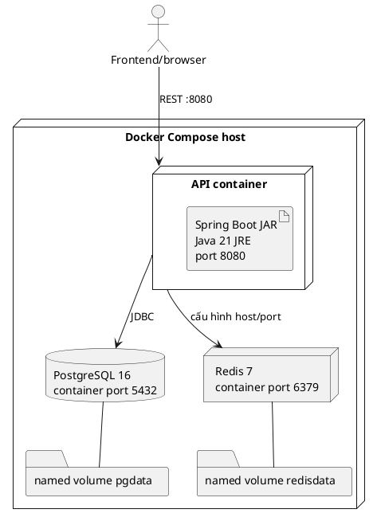

# 06. Kiến trúc và triển khai

## 6.1 Kiến trúc hệ thống quan sát được

Backend là ứng dụng Spring Boot MVC chạy trên Java 21, tiếp nhận HTTP qua controller, kiểm tra xác thực/phân quyền ở Spring Security, kiểm tra request bằng Jakarta Validation, xử lý nghiệp vụ ở service, truy cập PostgreSQL qua Spring Data JPA/Hibernate và quản lý schema bằng Flyway. SpringDoc cung cấp OpenAPI/Swagger UI. (nguồn: `pom.xml:19-29`, `:39-78`, `:80-104`, `src/main/resources/application.yml:12-30`, `README.md:5-17`)

Frontend là một ứng dụng riêng ở sibling repository `/home/vumoi/logictics-app`, dùng React/TypeScript, Refine/Ant Design và adapter API. Đây là quan sát repo frontend hiện có, không phải bằng chứng cùng một repo hay deploy chung. (nguồn: `/home/vumoi/logictics-app/package.json:1-73`, `/home/vumoi/logictics-app/src/providers/dataProvider.ts:1-5`, `/home/vumoi/logictics-app/src/App.tsx:179-186`)

```text
Người dùng
   │ HTTPS/HTTP + identity token
   ▼
Frontend React (repo logistics-app)
   │ REST /api
   ▼
Spring Security / Filters
   ▼
Controller → Validation → Service → Repository/JPA
                                      │
                     TenantRoutingDataSource (nếu tenancy bật)
                                      │
                                      ▼
                                 PostgreSQL
```

Lark OAuth, Lark Base và event webhook nằm trong integration packages; AI dispatch, AI gap và optimization có controller/service riêng. Redis có service/container trong compose nhưng việc dùng Redis trong runtime nghiệp vụ không được khẳng định chỉ từ việc khai báo container. (nguồn: `src/main/java/com/company/logicstic/integration/lark/auth/LarkAuthController.java:17-60`, `src/main/java/com/company/logicstic/ai/dispatch/AiDispatchController.java:27`, `src/main/java/com/company/logicstic/ai/gap/AiGapController.java:20-42`, `src/main/java/com/company/logicstic/service/optimization/OptimizationApplicationService.java:30-92`, `docker-compose.yml:20-32`)

## 6.2 Deployment diagram cho cấu hình local trong repository

Sơ đồ chỉ mô tả file Docker Compose/Dockerfile hiện có. Port mapping local là PostgreSQL host 5433 → container 5432, Redis 6379 → 6379, API 8080 → 8080; volume có tên `pgdata` và `redisdata`. Compose khai báo services PostgreSQL 16, Redis 7 và API; compose file hiện tại không có service frontend. (nguồn: `docker-compose.yml:1-74`)



Mối nối API–Redis là quan hệ được compose cấu hình qua dependency/host environment; source này chưa đủ để khẳng định feature nào đọc/ghi cache Redis. Compose đặt thông tin kết nối qua biến môi trường. Bản báo cáo này không chép lại giá trị mặc định của các credential. (nguồn: `docker-compose.yml:34-70`)

## 6.3 Service, cổng, volume

| Thành phần | Cấu hình quan sát được | Ghi chú |
|---|---|---|
| API | image local `logisticsx-api:local`; publish 8080:8080; depends_on postgres và redis | Dockerfile multi-stage JDK/JRE Java 21; process non-root; healthcheck gọi actuator health. (nguồn: `docker-compose.yml:34-70`, `Dockerfile:3-78`) |
| PostgreSQL | image `postgres:16-alpine`; publish 5433:5432; healthcheck; volume `pgdata` | Đây là cấu hình Compose local. (nguồn: `docker-compose.yml:1-18`, `:72-74`) |
| Redis | image `redis:7-alpine`; publish 6379:6379; healthcheck; volume `redisdata` | Redis được provision; mức sử dụng trong nghiệp vụ cần xác minh qua code runtime. (nguồn: `docker-compose.yml:20-32`, `:72-74`) |
| Frontend | Không được khai báo thành service trong compose backend | Frontend được truy cập như sibling repo; cách deploy production không tìm thấy. (nguồn: `docker-compose.yml:1-74`, `/home/vumoi/logictics-app/package.json:1-20`) |

## 6.4 Database, migration và tenancy

Database driver là PostgreSQL; Hibernate đặt `ddl-auto: validate`; Flyway tenant migration bật theo cấu hình `SPRING_FLYWAY_ENABLED` mặc định true trong application YAML. Schema migration nằm ở `classpath:db/migration/tenant`. Registry datasource có cấu hình riêng trong nhóm tenancy. (nguồn: `pom.xml:64-78`, `src/main/resources/application.yml:12-27`, `:64-82`)

Tenancy là database-per-tenant theo hướng tenant-aware datasource routing, nhưng filter chỉ được tạo khi `app.tenancy.enabled=true`; giá trị mặc định trong `application.yml` là false. Vì vậy chỉ có thể ghi nhận implementation và cấu hình mặc định, không thể kết luận deployment thực tế đang chạy multi-tenant. (nguồn: `src/main/java/com/company/logicstic/config/TenantJwtClaimFilter.java:21-25`, `src/main/java/com/company/logicstic/config/TenantRoutingDataSource.java:12-34`, `src/main/resources/application.yml:64-82`)

## 6.5 Các biến môi trường

Danh sách dưới đây là tên biến được tham chiếu trong `.env.example`, Compose hoặc `application.yml`; giá trị không được sao chép. Những biến secret phải được cung cấp ngoài tài liệu báo cáo. (nguồn: `.env.example:1-46`, `docker-compose.yml:39-66`, `src/main/resources/application.yml:11-112`)

| Nhóm | Tên biến có bằng chứng |
|---|---|
| Spring/server | `SPRING_PROFILES_ACTIVE`, `SERVER_PORT`, `SPRING_FLYWAY_ENABLED`, `SPRING_FLYWAY_LOCATIONS` |
| Database | `DB_URL`, `DB_USERNAME`, `DB_PASSWORD`, `POSTGRES_DB`, `POSTGRES_USER`, `POSTGRES_PASSWORD` |
| CORS/security | `CORS_ALLOWED_ORIGINS`, `TENANCY_ENABLED`, `TENANT_REGISTRY_DB_URL`, `TENANT_REGISTRY_DB_USERNAME`, `TENANT_REGISTRY_DB_PASSWORD`, `TENANT_REGISTRY_ENCRYPTION_KEY`, `TENANT_MAX_POOLS`, `TENANT_POOL_MAX_SIZE`, `TENANT_POOL_MIN_IDLE`, `TENANT_MIGRATION_LOCATIONS`, `TENANT_PROVISIONING_ADMIN_DB_URL`, `TENANT_PROVISIONING_ADMIN_DB_USERNAME`, `TENANT_PROVISIONING_ADMIN_DB_PASSWORD`, `TENANT_TEMPLATE_DATABASE` |
| AI/optimization | `AI_GAP_ENABLED`, `AI_DISPATCH_ENABLED`, `AI_DRY_RUN`, `AI_LLM_PROVIDER`, `AI_LLM_MODEL`, `AI_LLM_API_KEY`, `AI_LLM_BASE_URL`, `OPT_SINGLE_TENANT_SCOPE`, `OPT_DYNAMIC_ENDPOINT`, `OPT_DYNAMIC_TOKEN`, `OPT_HOS_ENDPOINT`, `OPT_HOS_TOKEN` |
| Lark auth/events/Base | `LARK_ENABLED`, `LARK_APP_ID`, `LARK_APP_SECRET`, `LARK_REDIRECT_URI`, `LARK_BASE_URL`, `LARK_JWT_SECRET`, `LARK_EVENT_VERIFICATION_TOKEN`, `LARK_EVENT_ENCRYPT_KEY`, `LARK_BASE_ENABLED`, `LARK_BASE_APP_TOKEN`, `LARK_BASE_LOADS_TABLE_ID`, `LARK_BASE_DRIVERS_TABLE_ID` |
| Lark Base field mapping | `LARK_BASE_LOAD_ID_FIELD`, `LARK_BASE_LOAD_NUMBER_FIELD`, `LARK_BASE_LOAD_NAME_FIELD`, `LARK_BASE_LOAD_STATUS_FIELD`, `LARK_BASE_LOAD_CUSTOMER_FIELD`, `LARK_BASE_LOAD_TRUCK_FIELD`, `LARK_BASE_LOAD_DISPATCHER_FIELD`, `LARK_BASE_LOAD_DELIVERY_DATE_FIELD`, `LARK_BASE_LOAD_DELIVERY_ZONE_FIELD`, `LARK_BASE_LOAD_LIFECYCLE_FIELD`, `LARK_BASE_DRIVER_ID_FIELD`, `LARK_BASE_DRIVER_NAME_FIELD`, `LARK_BASE_DRIVER_EMAIL_FIELD`, `LARK_BASE_DRIVER_PHONE_FIELD`, `LARK_BASE_DRIVER_STATUS_FIELD`, `LARK_BASE_DRIVER_SALARY_TYPE_FIELD`, `LARK_BASE_DRIVER_LIFECYCLE_FIELD` |

Bảng trên là danh sách tên đã thấy trong cấu hình mẫu/runtime, không bảo đảm mọi biến được dùng trong mọi profile. (nguồn: `.env.example:1-46`, `src/main/resources/application.yml:11-112`, `docker-compose.yml:39-66`)

## 6.6 Build, chạy local và production

- README hướng dẫn chạy backend bằng `./mvnw spring-boot:run`; chế độ đầy đủ cần cấu hình database. Cổng ứng dụng mặc định trong YAML là 8080. (nguồn: `README.md:255-290`, `src/main/resources/application.yml:29-30`)
- Dockerfile build JAR bằng Maven Wrapper trong stage JDK, package với `-DskipTests`, sau đó chạy JAR bằng Java 21 JRE trong image runtime. Dockerfile nói rõ test không chạy ở bước image build. (nguồn: `Dockerfile:3-34`, `:52-78`)
- CI có workflow `.github/workflows/backend-remediation.yml`, chạy Python unittest và regression runner PostgreSQL 16 cô lập, rồi upload verification manifests. Đây là CI kiểm tra; KHÔNG TÌM THẤY TRONG CODE bằng chứng pipeline tự deploy production. (nguồn: `.github/workflows/backend-remediation.yml:1-25`)
- Hướng dẫn production/UAT, URL public, cloud provider, topology production, TLS termination, autoscaling, secrets manager và observability deployment: KHÔNG TÌM THẤY TRONG CODE. Cần tài liệu vận hành môi trường thực tế để mô tả Chương 3.1.

## 6.7 Mâu thuẫn cần lưu ý

`docs/docs/architecture/overview.md` mô tả kiến trúc .NET 10/EF Core/Angular/SignalR, trái với `pom.xml`, Java source và package frontend hiện tại. Tài liệu này có dấu hiệu cũ hoặc thuộc thiết kế khác; lấy source build hiện tại làm bằng chứng chính và hỏi người phụ trách dự án về lịch sử thay đổi kiến trúc. (nguồn: `docs/docs/architecture/overview.md:1-60`, `pom.xml:6-20`, `README.md:5-17`)
